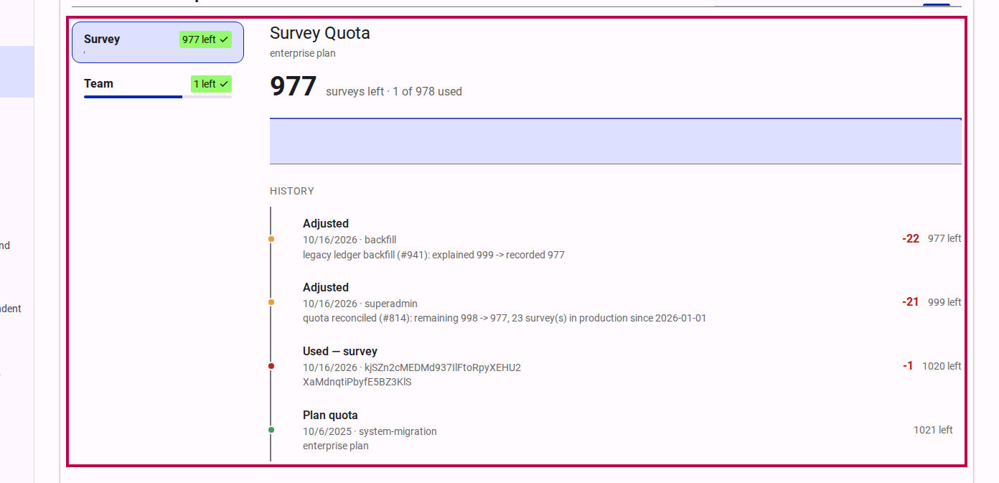
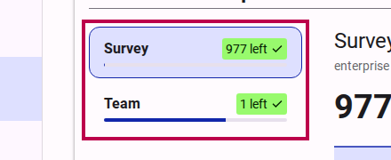

# How to buy additional quota

Every plan includes an allowance for each quota type — surveys and teams. When the allowance runs out, you can buy one-off packs of additional units from your customer portal; the units are added to your quota as soon as Stripe confirms the payment.

## Step 1: Open the quota tab

Sign in to your customer portal and open **Subscription → Quota**.

<figure>
  
  <figcaption>The Quota tab lists each quota type and shows the selected type's remaining units and history.</figcaption>
</figure>

The tab lists your quota types — surveys and teams — with the units left on each. The detail pane shows the selected type's remaining figure, the plan it comes from, and a timeline of everything that changed it: the plan quota, purchases, renewals, usage and adjustments.

## Step 2: Select the quota type

Select **survey** or **team** in the type list. Buy units for the type you are about to exhaust — a survey pack never adds team units, and the other way around.

<figure>
  
  <figcaption>Select the quota type you want to buy units for.</figcaption>
</figure>

## Step 3: Buy additional quota

In the detail pane, click **Buy survey quota** (or **Buy team quota**). The control is shown to owners and editors only.

> [!NOTE]
> A buy control appears only when a pack is on sale for that quota type. If it is not shown, contact support to arrange additional quota.

## Step 4: Choose the quantity and pay on Stripe

The dialog names the pack and its price — and, when the type offers more than one pack, lets you pick one first. Click **Buy on Stripe** to open Stripe's payment page, where you set the quantity (1–99), choose the payment method and pay. Stripe emails you the receipt.

The purchase is one-off: no subscription is started, and the units you receive are the pack's units times the quantity you buy.

## Step 5: Return to the portal

After payment you return to the quota tab. Until Stripe confirms the payment it shows a notice: *"Your purchase is being processed. The quota appears here as soon as Stripe confirms the payment."* The units are granted the moment the invoice settles, and the history shows the purchase as **Additional quota purchased**.

The two quota types differ after purchase:

- A **survey** pack applies to your current quota period: it does not roll over to the next renewal. Buying survey quota also clears a grace window: publishing resumes immediately and the one over-quota survey accepts respondents again.
- A **team** pack is permanent: it never lapses at renewal.

## Related Content

- [Subscription settings](../reference/customer/subscription.md) — the portal's subscription page and its tabs.
- [Quota card](../../../components/quota-card.md) — the card that shows a quota's remaining units and used share.
- [How to publish a survey](../../survey/how-to/publishing-a-survey.md) — taking a survey to production redeems one survey from the plan's quota.
