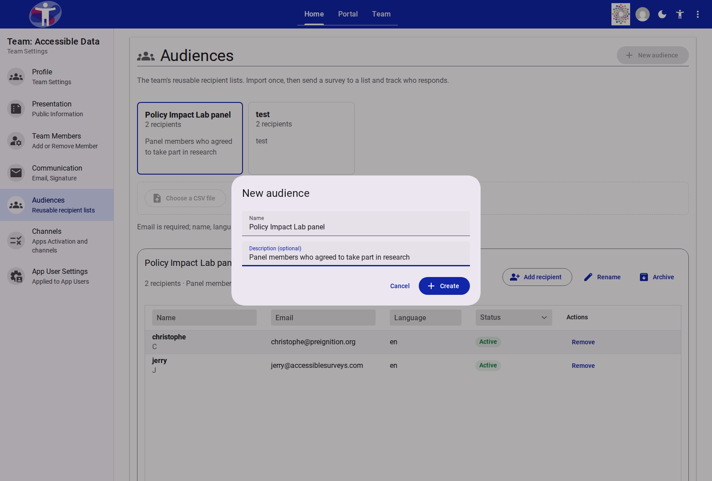
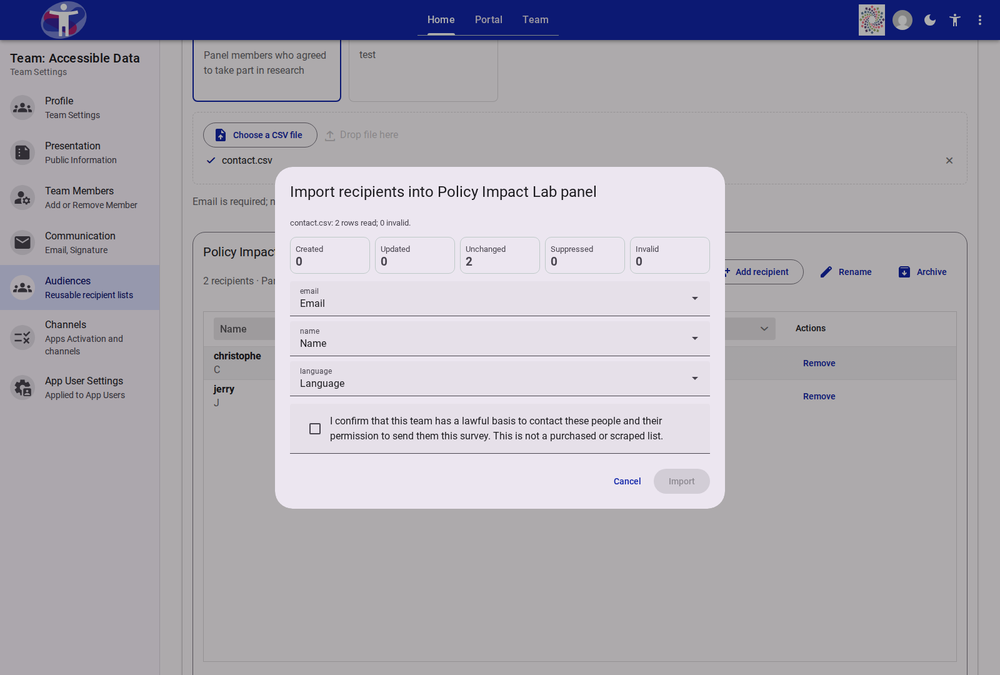
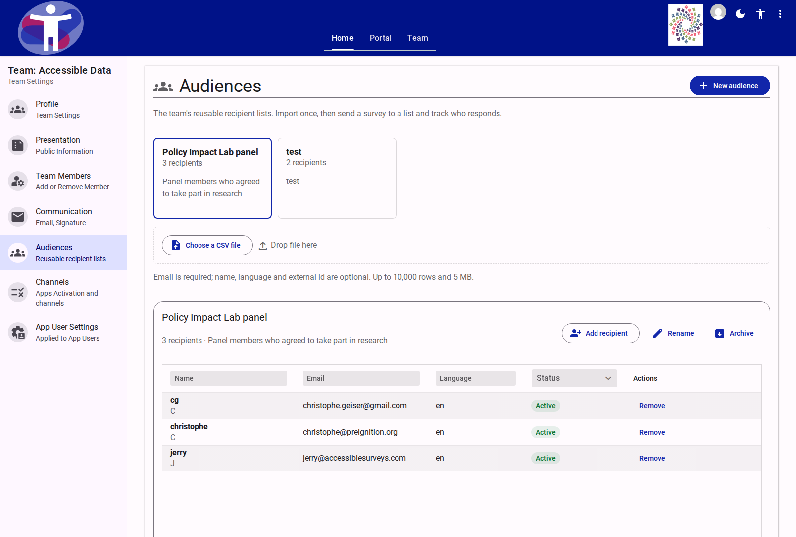

# How to Manage Team Audiences

A **team audience** is a reusable recipient list. Survey invitations and Listserv channels both draw from it, so a person appears once in the team and can belong to several audiences without being duplicated. This is the canonical guide for creating and maintaining audiences; the Survey and Listserv guides link here instead of repeating the CSV steps.

You need the team **Owner**, **Admin** or **Editor** role. Exporting and deleting an audience needs Owner or Admin.

## Before you start

- Open the team: **Customer Portal → Teams → Open → Audiences**.
- Prepare a CSV with at least an email column. Optional columns are name, language and external ID.
- Confirm your team has a lawful basis to contact these people and their permission to receive the survey or broadcast. Purchased or scraped lists are not permitted.

## Create an audience

1. Select **New audience**.
2. Enter a **Name** (up to 120 characters) and an optional **Description**.
3. Select **Create**.

<figure>
  
  <figcaption>Creating a named audience in Team Settings.</figcaption>
</figure>

A team can hold up to **50 audiences**. If the team has no audiences yet, uploading a CSV directly on the page creates the first audience from the file name.

## Import recipients from a CSV

1. Select the audience card.
2. Select **Choose a CSV file**, or drop a `.csv` file on the upload zone.
3. In the **Import recipients** dialog, review the dry run:

| Tile | What it means |
| --- | --- |
| **Created** | New recipients that will be added to the team and the audience. |
| **Updated** | Existing recipients whose details or membership will change. |
| **Unchanged** | Already in the audience with identical values. |
| **Suppressed** | On the organization-wide suppression list; added to the audience but never emailed. |
| **Invalid** | Missing or malformed addresses; they do not block the valid rows. |

1. Check the **Column mapping**: each CSV column maps to **Email**, **Name**, **Language**, **External id** or **Ignore**. Change a mapping to recompute the preview.
2. If invalid rows exist, select **Download error CSV** (`row,email,reason`) and fix them.
3. Tick the warranty confirming lawful basis and permission.
4. Select **Import**.

<figure>
  
  <figcaption>Review the dry-run counts, verify the column mappings, and accept the warranty before importing.</figcaption>
</figure>

Limits: **10,000 rows** and **5 MB** per file. Re-importing the same file is idempotent.

### Column rules

| Field | Required | Normalization |
| --- | --- | --- |
| **Email** | Yes | Trimmed, lowercased, at most 254 characters, must contain `@` and a dotted domain. |
| **Name** | No | Display name used in `{{name}}` and search. |
| **Language** | No | Platform language code; a region tag falls back to its base language. |
| **External id** | No | Identifier from a CRM or panel database. |

Common header spellings (`e-mail`, `mail`, `full name`, `lang`, `locale`) are recognized. Map anything else explicitly; unmapped columns are ignored.

## Work with recipients

Select an audience card to open its recipient grid, sorted by name or email.

<figure>
  
  <figcaption>An audience with its recipient grid and column filters.</figcaption>
</figure>

- **Add recipient**: enter an email, and optionally a name and language.
- **Remove**: removes the person from the selected audience but keeps them in the team's other audiences.
- **Delete from team**: removes the recipient from the team and every audience (Owner or Admin only).
- **Filter**: use the column filters for name, email, language and status (`Active` or `Suppressed`).

Adding or removing members requires Editor or above. Archived audiences are read-only.

## Rename, archive or delete an audience

- **Rename**: open **Audience settings** and update the name or description.
- **Archive**: makes the audience read-only and unavailable for new invitation runs until restored. Existing sends are unaffected.
- **Restore**: returns an archived audience to active.
- **Delete audience**: removes the audience after confirmation. Recipients stay in the team's other audiences.

Export and delete are recorded in the team audit log.

## Export an audience

Select **Export** (Owner or Admin) to download a CSV of the audience's recipients, including full email addresses. Exporting is an auditable action; handle the file as personal data.

## Use the audience elsewhere

- **Survey invitations**: choose the audience in **Share → Distribute → Invitations**. See [How to Send Invitations to a Team Audience](../../survey/how-to/send-invitations.md).
- **Listserv**: import the audience in **Channel Settings → Audience Import**. See [Importing a Team Audience](../../listserv/how-to/importing-a-team-audience.md).

Both reuse the same team records, so an address suppressed in one place is suppressed for the other.

## Troubleshooting

- **"Invalid" rows**: check for spaces, missing domains, or a header mapped to the wrong column. Fix the CSV and re-import.
- **A recipient is missing after import**: they may be suppressed. Filter by status to confirm.
- **Import button stays disabled**: tick the warranty; it is mandatory for every import.
- **Cannot export**: exporting requires Owner or Admin.
- **Audience not offered in the Survey or Listserv picker**: confirm it is not archived and belongs to the same team as the survey or channel.

## Related Content

- [Team Audiences Reference](../reference/team/audiences.md): Limits, statuses and permissions.
- [How to Send Invitations to a Team Audience](../../survey/how-to/send-invitations.md): The invitation run.
- [Importing a Team Audience](../../listserv/how-to/importing-a-team-audience.md): The Listserv import flow.
- [Understanding Access and Permissions](../explanation/understanding-access-and-permissions.md): Who can edit an audience.
