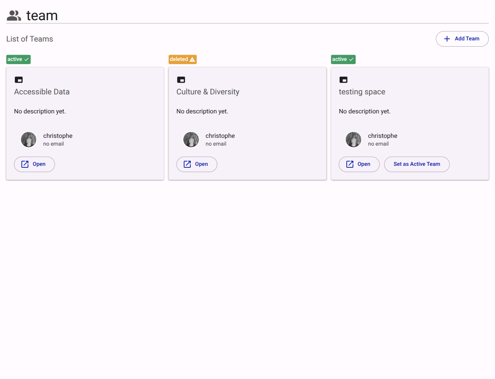

# How to Manage Teams

A **team** is the workspace that owns surveys, forms, audiences, channels and API keys. Most organizations have several, one per department, research program or client. This guide covers creating and organizing them.

You need to be an account **Owner** or **Admin** to create a team, and the team **Owner** or a platform **Super Admin** to delete or restore one.

## View your teams

Open **Customer Portal → Teams**. Each card shows the team's name and description, its owner, its status (`active` or `deleted`) and the team quota used.

<figure>
  
  <figcaption>Team cards with open, active-team, shortcut and management actions.</figcaption>
</figure>

## Create a team

1. Select **Add Team**.
2. Enter the team **name** and an optional description.
3. Confirm.

Creating a team redeems one team unit from your plan's quota. If no units remain, the dialog explains that you must buy an additional team pack from [Subscription → Quota](../reference/customer/subscription.md#quota-tab) before adding another team.

## Open a team

Select **Open** on a team card to enter its workspace settings: profile, presentation, members, communication, audiences, channels, app user settings, API keys and danger zone.

## Switch the active team

Select **Set as Active Team** on the card, or pick the team from the top-bar team switcher. The active team is the context for new surveys, forms and lists you create. Existing surveys stay with the team that owns them; switching teams does not move them.

## Pin a team to your shortcuts

Use the star (**shortcut**) control on a team card to add or remove the team from the persistent top-bar shortcuts. Shortcuts are personal to your user account and are useful when you work across several teams.

## Rename or describe a team

Open the team and select **Profile**. You can edit the team's internal **Name** and its internal **Presentation** note, which documents the team's scope for administrators. The team's public title and description are separate; see [How to Configure Team Presentation, Communication and Channels](./configure-team-presentation-and-communication.md).

## Delete a team

1. Open the team and select **Danger Zone**.
2. Select **Delete Team**.
3. Optionally enter a **Reason (recorded in the audit)**.
4. Confirm.

Deleting a team is a **soft delete**. Its surveys and forms are flagged as deleted and taken offline: compiled builds and respondent mirrors are removed. Collected response data is kept, and the team's quota allocation, API keys and member permissions are preserved.

## Restore a team

1. Open **Customer Portal → Teams** and find the team marked `deleted`.
2. Open it and select **Danger Zone → Restore team**.

The team, its surveys and configurations come back online, and member access is restored. Restoration is recorded in the team's audit metadata.

## When a team cannot be created

- **Quota exhausted**: buy a permanent team pack in **Subscription → Quota**. Team packs do not lapse at renewal.
- **Name rejected**: names must be non-empty; give the team a distinct name so members can tell teams apart in the switcher.
- **No Add Team action**: only Owners and Admins can create teams.

## Related Content

- [Customer Teams Reference](../reference/customer/teams.md): Team cards, quota and actions.
- [Team Danger Zone Reference](../reference/team/danger-zone.md): Delete and restore in detail.
- [How to Manage Account Holders and Team Members](./manage-account-holders-and-team-members.md): Giving people access to a team.
- [How to Buy Additional Quota](./buy-additional-quota.md): Permanent team packs.
