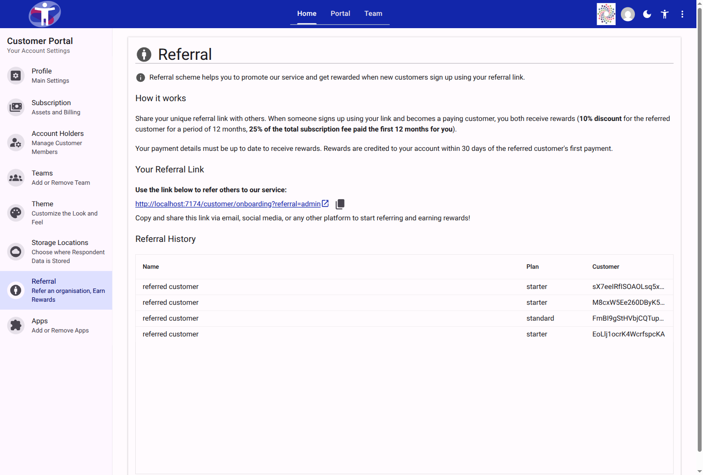
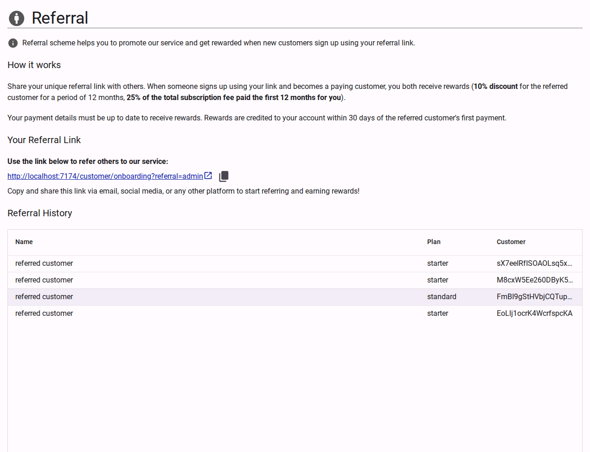

# Apps and Referrals

The **Apps** and **Referrals** pages manage platform extensions and referral partnership rewards for your organization.

## Apps

The **Apps** page displays available application modules within the Accessible Data platform:

- **Available Applications:** Modules such as **Accessible Surveys**, **Accessible Listserv**, and **Discussion App**.
- **Activation Status:** Shows whether an application is activated or available for provisioning under your organization.
- **Access Management:** Once an app is active, teams can be provisioned within the application to begin authoring surveys or managing listserv announcement channels.

## Referrals

The **Referrals** page provides tools to recommend Accessible Data to peer organizations and earn ongoing partnership rewards.

<figure>
  
  <figcaption>The Referrals overview panel in Customer Settings.</figcaption>
</figure>

### Reward Structure

When an organization signs up through your unique referral link and becomes a paying customer:

- **Referred Customer Benefit:** Receives an automatic **10% discount** on their subscription fees for their first 12 months.
- **Referring Organization Reward:** Receives **25% of the total subscription fee** paid by the referred customer during their first 12 months.
- **Payout Timing:** Referral rewards are credited to your account within 30 days of the referred customer's payment settling. Payment details must be kept active to receive credits.

<figure>
  
  <figcaption>Referral program terms and unique referral link generator.</figcaption>
</figure>

### Unique Referral Link

Each organization has a dedicated referral link formatted as:

```text
https://accessiblesurveys.com/customer/onboarding?referral={customerId}
```

- Click the one-click copy button (`<lapp-copy>`) to copy your link.
- Share your referral link via email, newsletters, or social media.

### Referral History

The **Referral History** table lists all organizations that registered through your link:

- Displays referred organization snapshots, creation timestamps, and reward payment statuses.

## Related Content

- [Customer Subscription Reference](./subscription.md) — Managing billing, invoices, and quota
- [Customer Profile Reference](./profile.md) — Public and private organization details
