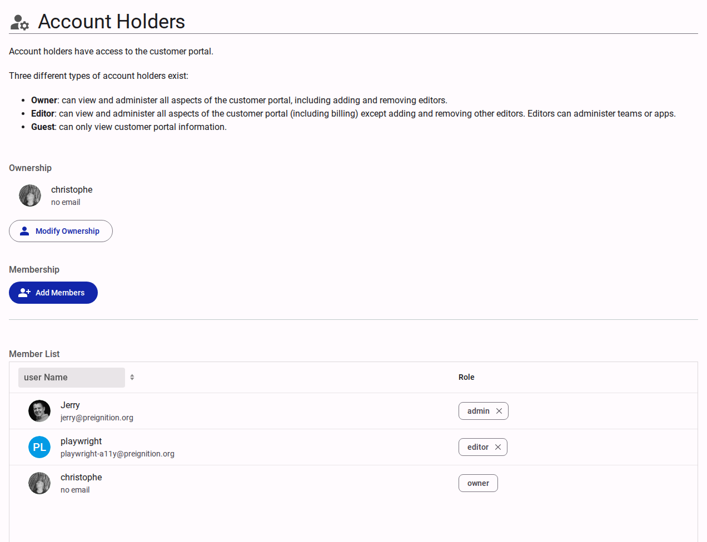

# Account Holders (Members)

The Account Holders section defines access roles for users within the customer account.

::: warning
Account Holders manage account-wide settings — subscription, billing, themes, languages and apps. They are **not** granted access to surveys. A colleague who needs to build or edit surveys must also be added as a [Team Member](../team/members.md).

See [Understanding Access and Permissions](../../explanation/understanding-access-and-permissions.md) for how the account, team and survey layers fit together.
:::

<figure><figcaption>Account holders interface.</figcaption></figure>

## Roles

- **Owner**: Administrative access to all portal aspects, including adding/removing editors and modifying private profile settings.
- **Admin**: Administrative access to all aspects, and can manage teams and apps, but cannot add or remove other Account Holders or view private settings.
- **Editor**: Administrative access to teams and apps, but restricted from managing other editors or viewing private settings.
- **Guest**: Read-only access to customer portal information.

## Interface Elements

- **Ownership**: Displays the current account owner.
  - **Modify Ownership**: Action to transfer the Owner role to another user.
- **Membership**:
  - **Add Members**: Interface to invite new users and assign roles.
- **Member List**: A table displaying all current users and their assigned roles. Roles can be adjusted or revoked directly from this list.
