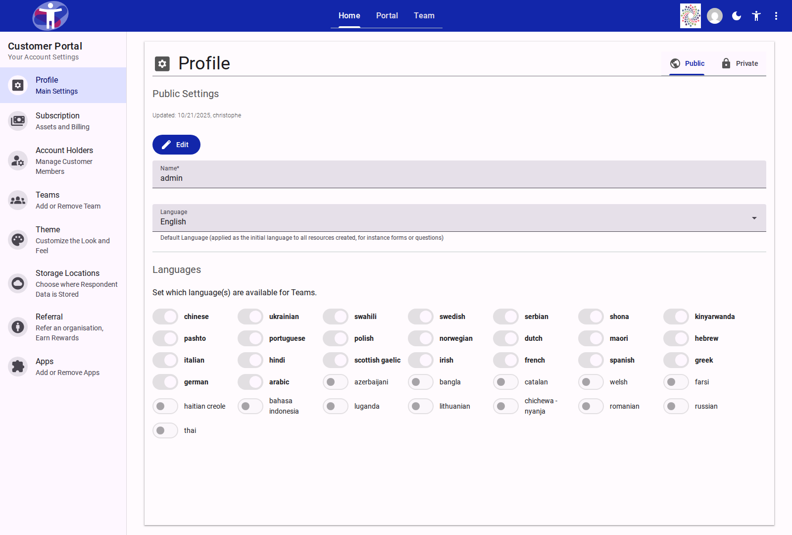
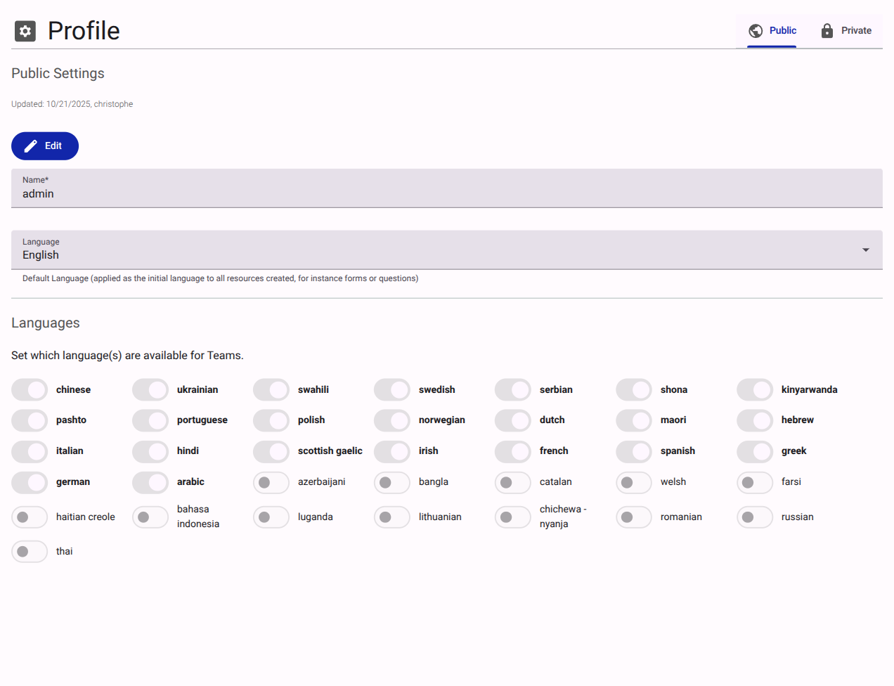

# Profile Settings

The **Profile** section manages core organizational details, language defaults, and administrative contact information. It is divided into two tabs: **Public** and **Private**.

<figure>
  
  <figcaption>The Customer Profile interface showing Public and Private tabs.</figcaption>
</figure>

## Public Settings

The **Public** tab controls organization metadata and language availability across your teams:

<figure>
  
  <figcaption>Public settings form displaying Name, Language, and Available Languages.</figcaption>
</figure>

- **Name**: The formalized display name of your customer organization. *Note: The organization name is established during onboarding and is rendered read-only in this panel.*
- **Language**: The default primary language applied as the initial language for newly created resources (e.g., new surveys, forms, or templates).
- **Languages**: A toggleable list of all supported languages (e.g., English, French, Spanish, Arabic, German, Ukrainian, etc.). Enabling a language makes it available for teams to use when authoring multilingual surveys or broadcast channels.
- **Currency & Currencies**: The default and enabled transaction currencies for billing and quota purchases.

## Private Settings

The **Private** tab manages sensitive administrative contact information:

- **Email**: The primary organizational contact email address used for administrative notifications and system alerts.
- **Phone**: Contact telephone number for billing or emergency communications.

::: warning Access Restriction
The **Private** tab contains confidential contact information and is only visible to and editable by **Owners** and platform Super Admins. Team members and general account holders cannot view this tab.
:::

## Related Content

- [Account Holders (Members)](./members.md) — Managing customer administrative roles and permissions
- [Customer Theme Settings](./theme.md) — Customizing brand colors and contrast themes
- [Storage Locations](./storage-locations.md) — Reviewing your organization's data residency location
