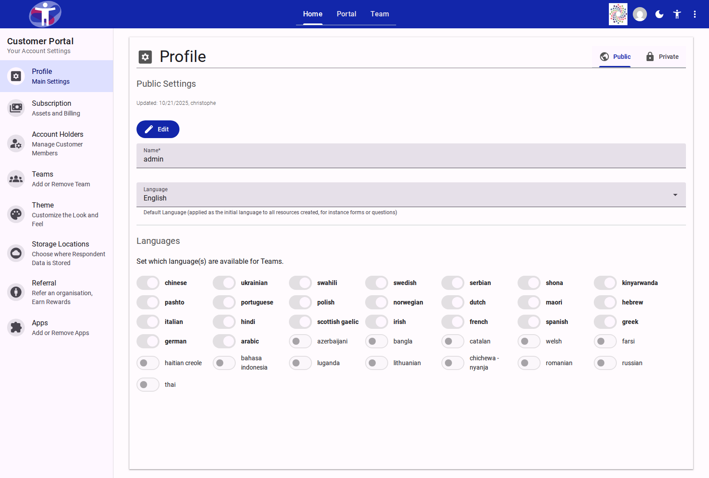
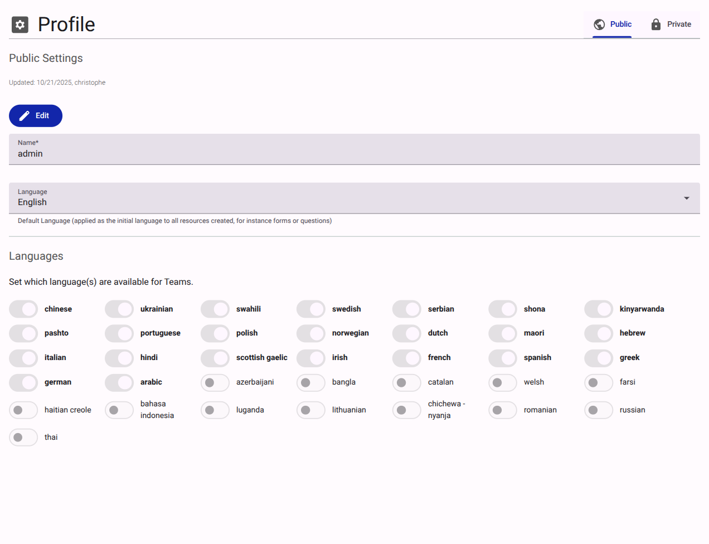

# Storage Locations

The **Storage Locations** section dictates the geographical database location where your respondents' survey data is stored, supporting strict data sovereignty and regulatory compliance requirements (such as GDPR).

<figure>
  
  <figcaption>The Storage Locations panel in Customer Settings.</figcaption>
</figure>

## One-Time Immutability Rule

::: warning Permanent Configuration
The storage location for your organization is established during initial onboarding or setup. **Once set, it is permanently locked and cannot be modified.**

Because survey respondent collections, encryption keys, and Firestore database instances are physically provisioned in the chosen territory, changing storage locations post-creation is not supported.
:::

<figure>
  
  <figcaption>Storage location dropdown displaying Multi-Region and Regional options.</figcaption>
</figure>

## Location Tiers

Organizations can choose between two infrastructure tiers:

### 1. Multi-Region Locations

Multi-region databases replicate respondent data across multiple physical data centers within a continent:

- **Options:** `eur3` (Europe multi-region) and `nam5` (North America multi-region).
- **Advantages:** Highest availability and automatic regional failover.
- **Recommended for:** International research initiatives, global employee surveys, and distributed respondent pools scattered across countries.

### 2. Regional Locations

Regional databases keep all respondent data pinned within a single sovereign territory or country:

- **Options:** Belgium (`europe-west1`), Frankfurt (`europe-west3`), London (`europe-west2`), Paris (`europe-west9`), Northern Virginia (`us-east4`), and other regional Google Cloud instances.
- **Advantages:** Strict jurisdictional data isolation where data must never leave a specific nation or legal framework.
- **Recommended for:** Healthcare, public sector, and government research subject to strict data localization laws.

## Related Content

- [Data Privacy and Security](../../../survey/explanation/data-privacy-and-security.md) — Security policies, encryption, and GDPR compliance
- [Customer Profile Reference](./profile.md) — Organization settings and default languages
