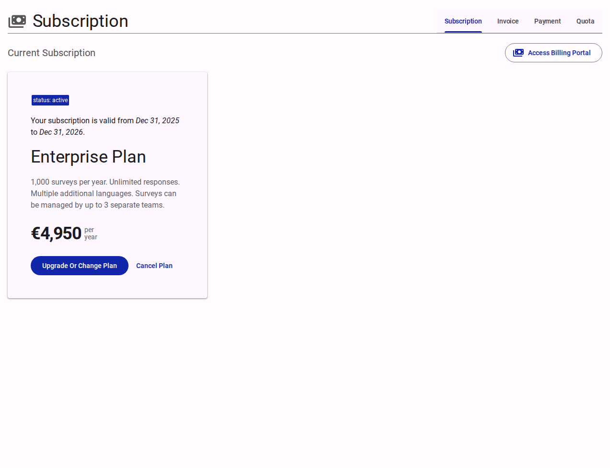

# Subscription

The Subscription page shows the plan for the current app, together with the account's invoices, payments and quotas. Billing is handled by Stripe: the page displays the records Stripe sends, and billing changes are made in the Stripe Billing Portal.

Open it from **Customer Portal → Subscription** in the left menu.

<figure>
  
  <figcaption>The Subscription page and its four tabs.</figcaption>
</figure>

## What you can do

- Check the current plan, its price and billing period.
- See when a free trial ends, and add a payment method.
- Open the Stripe Billing Portal to manage billing.
- Review past invoices and payments.
- Inspect remaining quota, view balance charts and event timelines, and purchase additional quota top-up packs.

## Tabs

- **Subscription**: the plans attached to the current app.
- **Invoice**: past invoices, with links to the full invoice in Stripe.
- **Payment**: past payment attempts.
- **Quota**: split-view quota manager displaying remaining units, history timelines, and top-up purchasing.

The Subscription, Invoice and Payment tabs have an **Access Billing Portal** button. The Quota tab has **Buy Additional Quota** instead.

## Status banner

A banner above the tabs appears only when something needs attention. It is hidden while a subscription is active or trialing.

- **Trial ending**: the banner says when the trial ends — in days when more than three days remain, otherwise in hours. If there is no payment method on file, use **Setup Payment (bank)** or **Setup Payment (card)** to add one in Stripe. If a payment method is already on file, billing starts when the trial ends.
- **Payment problem**: when a subscription is not active or trialing, the banner says payment could not be processed. Open the **Billing Portal** to update the payment method.

## Subscription tab

**Current Subscription** shows one card for each subscription attached to the current app. Each card shows:

- **Status**: for example active or trialing.
- **Validity**: the current billing period, or the trial end date while trialing.
- **Plan**: the plan name and description.
- **Price**: the amount, and whether it is billed per month or per year.

### Statuses

| Status | What it means |
| --- | --- |
| `active` | Paid and up to date. |
| `trialing` | The account is inside its free trial. |
| `past_due` | The most recent payment failed. |
| `unpaid` | Payment has not been collected. |
| `paused` | The subscription is paused. |
| `incomplete` | The first payment was not completed. |
| `incomplete_expired` | Checkout was not completed before it expired. |

### Changing or cancelling a plan

Use **Access Billing Portal** (see below). Plan changes and cancellations are handled by Stripe.

## Billing Portal

**Access Billing Portal** opens the Stripe-hosted portal for the account. Use it to:

- Add or replace a payment method.
- Download invoices and receipts.
- Change or cancel a subscription.

When you finish, Stripe returns you to the page you started from.

## Invoice tab

**Invoice History** lists each invoice with its description, total, status, date, billing period and invoice number. Expand a row to see the details and **View Invoice Details**, which opens the invoice on Stripe in a new tab.

## Payment tab

**Payment History** lists each payment with its amount, status, date and description. Expand a row to see the details. Only actual payments appear here.

## Quota tab

The **Quota** tab features a split-view management workbench:

- **Quota Type Selector (left)**: Lists all metered quota categories for your account—typically **surveys** (how many surveys can be in production simultaneously) and **teams** (how many workspaces can be provisioned). Each entry displays the quota name and remaining units.
- **Quota Detail Pane (right)**:
  - **Remaining Balance**: Displays current remaining units and progress towards your plan allowance.
  - **Grace Period Alert**: If survey publishing exceeded plan quota, a warning displays the 10-day grace deadline to settle the balance.
  - **Balance Chart & Event Timeline**: Interactive timeline tracking all quota events—initial plan allocation, subscription renewals, usage redemptions, top-up pack purchases, and administrative adjustments.
  - **Buy Additional Quota**: Organization Owners and Admins can click **Buy survey quota** or **Buy team quota** to purchase one-off unit packs via Stripe Checkout without modifying their recurring subscription tier.

::: info Quota Lifecycle Differences

- **Survey quota packs** apply to your current quota period to cover immediate research needs or clear an active grace window.
- **Team quota packs** are permanent additions that never lapse upon subscription renewal.
:::

## Related Content

- [How to Buy Additional Quota](../../how-to/buy-additional-quota.md) — Step-by-step top-up purchase guide
- [Quota Card Component Reference](../../../../components/quota-card.md) — Shared quota presentation component
- [Customer Teams Reference](./teams.md) — Managing workspaces within team quota limits
