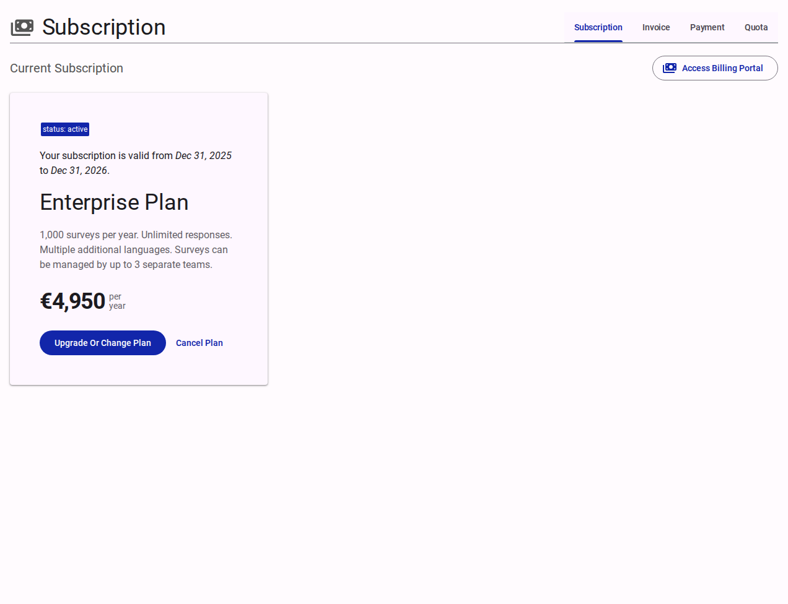

# Subscription

The Subscription page shows the plan for the current app, together with the account's invoices, payments and quotas. Billing is handled by Stripe: the page displays the records Stripe sends, and billing changes are made in the Stripe Billing Portal.

Open it from **Customer Portal → Subscription** in the left menu.

<figure><figcaption>The Subscription page and its four tabs.</figcaption></figure>

## What you can do

- Check the current plan, its price and billing period.
- See when a free trial ends, and add a payment method.
- Open the Stripe Billing Portal to manage billing.
- Review past invoices and payments.
- Check how much quota is left and how much the account has used.

## Tabs

- **Subscription**: the plans attached to the current app.
- **Invoice**: past invoices, with links to the full invoice in Stripe.
- **Payment**: past payment attempts.
- **Quota**: what the plan includes and how much is left.

The Subscription, Invoice and Payment tabs have an **Access Billing Portal** button. The Quota tab has **Buy Additional Quota** instead.

## Status banner

A banner above the tabs appears only when something needs attention. It is hidden while a subscription is active or trialing.

- **Trial ending**: the banner says when the trial ends — in days when more than three days remain, otherwise in hours. If there is no payment method on file, use **Setup Payment (bank)** or **Setup Payment (card)** to add one in Stripe. If a payment method is already on file, billing starts when the trial ends.
- **Payment problem**: when a subscription is not active or trialing, the banner says payment could not be processed. Open the **Billing Portal** to update the payment method.

## Subscription tab

**Current Subscription** shows one card for each subscription attached to the current app. Each card shows:

- **Status**: for example active or trialing.
- **Validity**: the current billing period, or the trial end date while trialing.
- **Plan**: the plan name and description.
- **Price**: the amount, and whether it is billed per month or per year.

### Statuses

| Status | What it means |
| --- | --- |
| `active` | Paid and up to date. |
| `trialing` | The account is inside its free trial. |
| `past_due` | The most recent payment failed. |
| `unpaid` | Payment has not been collected. |
| `paused` | The subscription is paused. |
| `incomplete` | The first payment was not completed. |
| `incomplete_expired` | Checkout was not completed before it expired. |

### Changing or cancelling a plan

Use **Access Billing Portal** (see below). Plan changes and cancellations are handled by Stripe.

::: info
**Upgrade Or Change Plan** and **Cancel Plan** on the card are not active yet. Use the Billing Portal instead.
:::

## Billing Portal

**Access Billing Portal** opens the Stripe-hosted portal for the account. Use it to:

- Add or replace a payment method.
- Download invoices and receipts.
- Change or cancel a subscription.

When you finish, Stripe returns you to the page you started from.

## Invoice tab

**Invoice History** lists each invoice with its description, total, status, date, billing period and invoice number. Expand a row to see the details and **View Invoice Details**, which opens the invoice on Stripe in a new tab.

## Payment tab

**Payment History** lists each payment with its amount, status, date and description. Expand a row to see the details. Only actual payments appear here.

## Quota tab

The Quota tab lists what the plan includes — typically surveys that can be published and teams that can be created. Each row shows the quota's name, type and units left.

Expand a **survey** or **team** row for a short summary:

- The units left.
- A progress bar showing how much of the quota is used, with a line such as "3 of 10 surveys used".
- If the quota runs out, a message saying whether publishing or adding teams is still allowed for a short time while more quota is arranged.
- What to do once nothing is left.

If no quota is configured for the account, the card says so and asks you to contact support.

::: info
**Buy Additional Quota** is not available yet. Contact support to arrange more quota.
:::

## Who can do what

Everyone with access to the Customer Portal can view subscriptions, invoices, payments and quotas. Actions that change billing or quota — **Access Billing Portal** and **Buy Additional Quota** — are disabled for read-only users, such as **Guest** account holders.

See [Understanding Access and Permissions](../../explanation/understanding-access-and-permissions.md) for how account roles work.

## Related pages

- [Account Holders (Members)](./members.md)
- [Teams](./teams.md)
- [Apps and Referrals](./apps-referrals.md)
