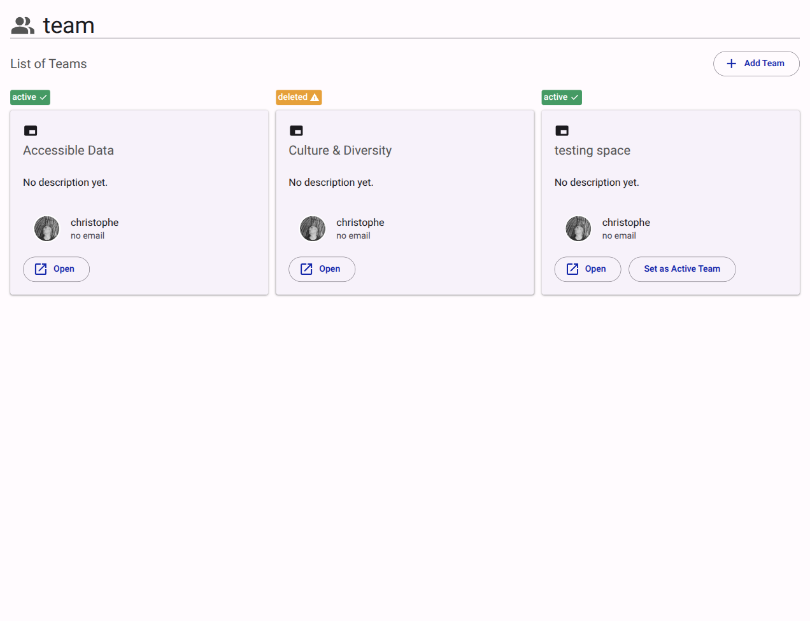

# Teams

The Teams section lists workspaces available within the customer account.

<figure><figcaption>Teams management interface.</figcaption></figure>

## Interface Elements

- **Team Cards**: Represent individual workspaces (e.g., "Accessible Data").
- **Status Badge**: Indicates the current state of the team (`active`, `deleted`).
- **Add Team**: Action to provision a new workspace. The dialog states the teams left on the customer's plan and, once the team quota is exhausted, that upgrading the subscription is required.
- **Open**: Navigates to the selected team's dedicated portal.
- **Set as Active Team**: Changes the user's current context to the selected team.
