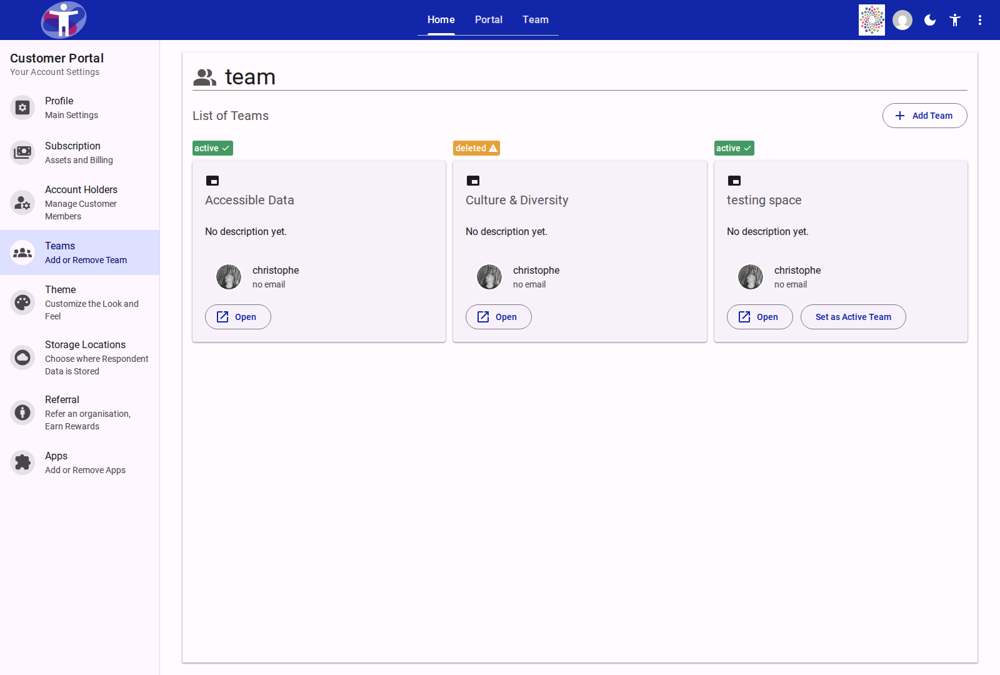
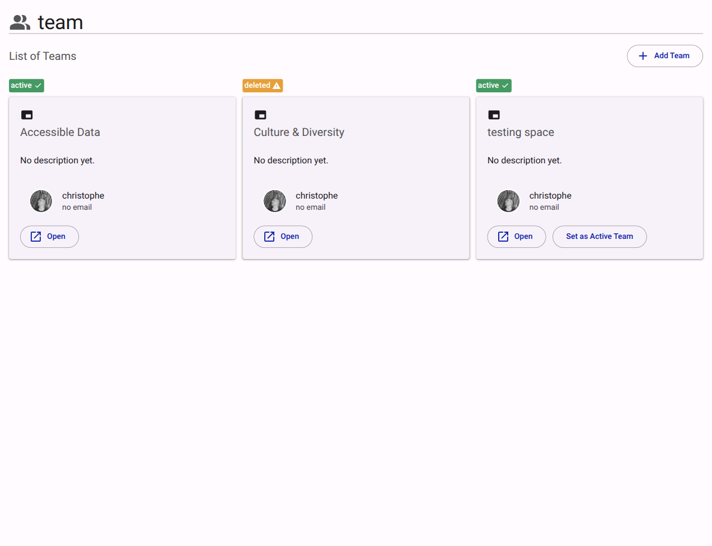

# Teams

The **Teams** section lists all collaborative workspaces configured under your customer account and allows administrators to provision new teams within their plan quota.

<figure>
  
  <figcaption>The Teams management overview panel.</figcaption>
</figure>

## Interface Elements

<figure>
  
  <figcaption>Team cards displaying workspace titles, descriptions, owner badges, and action buttons.</figcaption>
</figure>

### Team Cards

Each configured team workspace is represented by a dedicated card displaying:

- **Team Name & Description**: The formal title and optional description of the workspace.
- **Owner Display**: The account holder designated as the team owner.
- **Status Badge**: Indicates whether the team is `active` or soft-deleted (`deleted`).
- **Quota Allowance**: Displays the total teams provisioned against your plan's active team quota.

### Workspace Actions

- **Open**: Navigates directly into the selected team's workspace settings, audiences, channels, and survey management.
- **Set as Active Team**: Switches your current application session context to this team. All newly opened surveys and forms will open under this team's scope.
- **Shortcut Pinning**: Toggle the shortcut star icon to pin the team to your persistent top-bar navigation shortcuts for rapid switching between active projects.
- **Add Team**: Opens the team creation dialog:
  - Enter the new team's name and optional description.
  - Creating a team redeems one team unit from your plan's team quota.
  - If your team quota is exhausted, the button guides you to purchase an additional permanent team pack in [Subscription → Quota](./subscription.md#quota-tab) before adding more teams.

## Related Content

- [Team Profile Reference](../team/profile.md) — Configuring settings for an individual team workspace
- [Team Members Reference](../team/members.md) — Managing team collaborators and permissions
- [How to Buy Additional Quota](../../how-to/buy-additional-quota.md) — Purchasing permanent team quota packs
