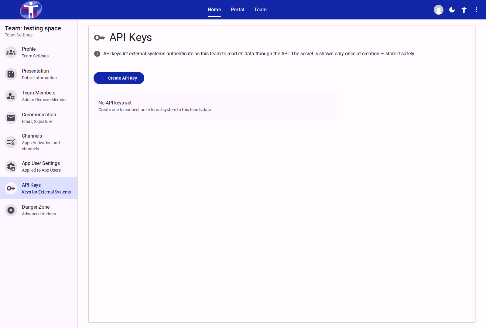
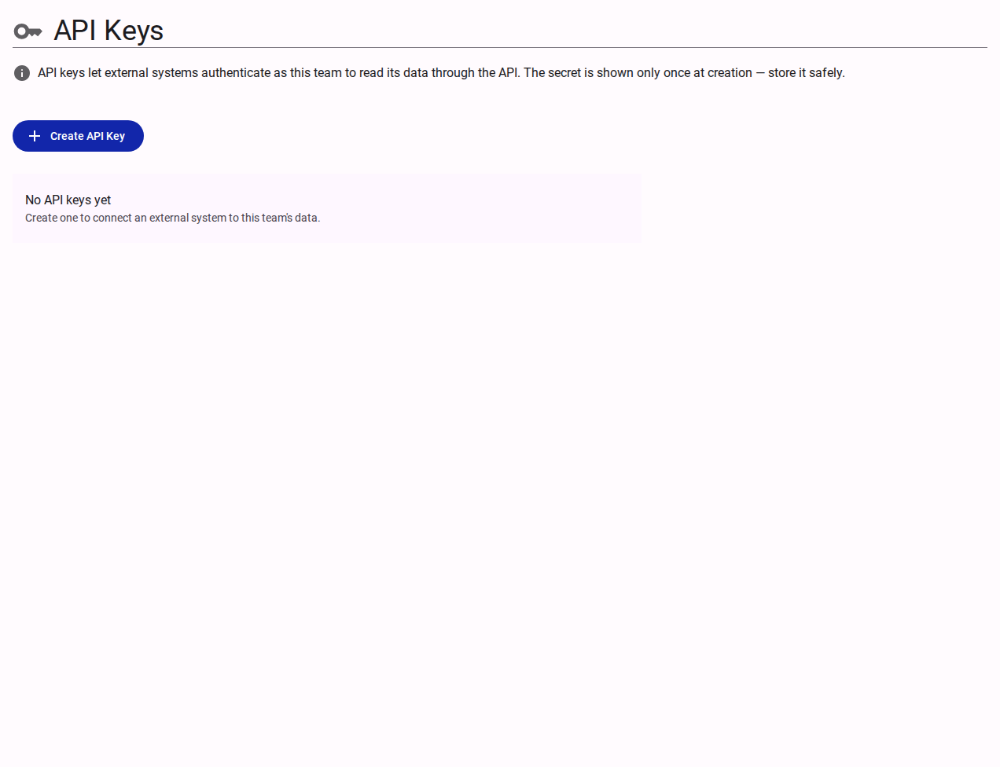

# Team API Keys

The **API Keys** panel under Team Settings allows team administrators to generate, list, and revoke credentials used for programmatic integration with Accessible Data APIs. The panel is available to **Owners and Admins** of the team.

<figure>
  
  <figcaption>The API Keys management panel in Team Settings.</figcaption>
</figure>

## Key Concepts

- **Cryptographic Security:** API keys are generated using cryptographically secure random bytes on the server.
- **Single Secret Reveal:** The plain-text secret is displayed to the user **exactly once** upon creation and automatically copied to the clipboard. The plain-text secret is never saved in readable form and cannot be retrieved again after the dialog closes.
- **Key Listing Display:** In the active keys list, each key card displays the user-provided **Key Name**, the **Created Date**, and a **Revoke** action button.
- **Immediate Revocation:** Revoking an API key removes its authorization immediately, cutting off access for any scripts or external systems using that key.

<figure>
  
  <figcaption>Configured API keys list with Revoke action.</figcaption>
</figure>

## Operations

| Action | Description | Dialog / UX Behavior |
| :--- | :--- | :--- |
| **Create API Key** | Generates a new API key for the team | Modal dialog collecting key name; presents secret key once with copy-to-clipboard |
| **Revoke API Key** | Immediately deactivates an existing key | Confirmation dialog with real-time process progress indicator |

## Related Content

- [How to Manage API Keys](../../how-to/manage-api-keys.md) — Step-by-step walkthrough for creating and revoking keys
- [Using API Documentation How-to](../../how-to/using-api-docs.md) — Testing API endpoints with generated keys
- [Platform API Reference](/api.html) — Interactive Scalar OpenAPI specification
