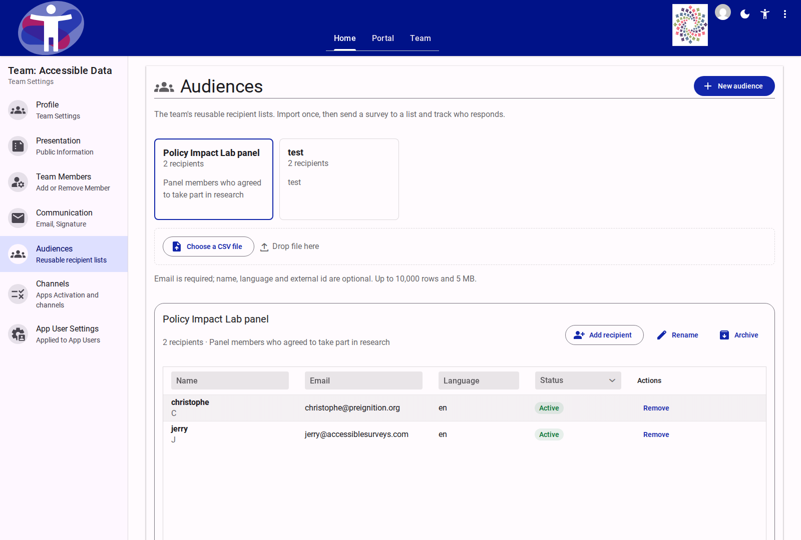
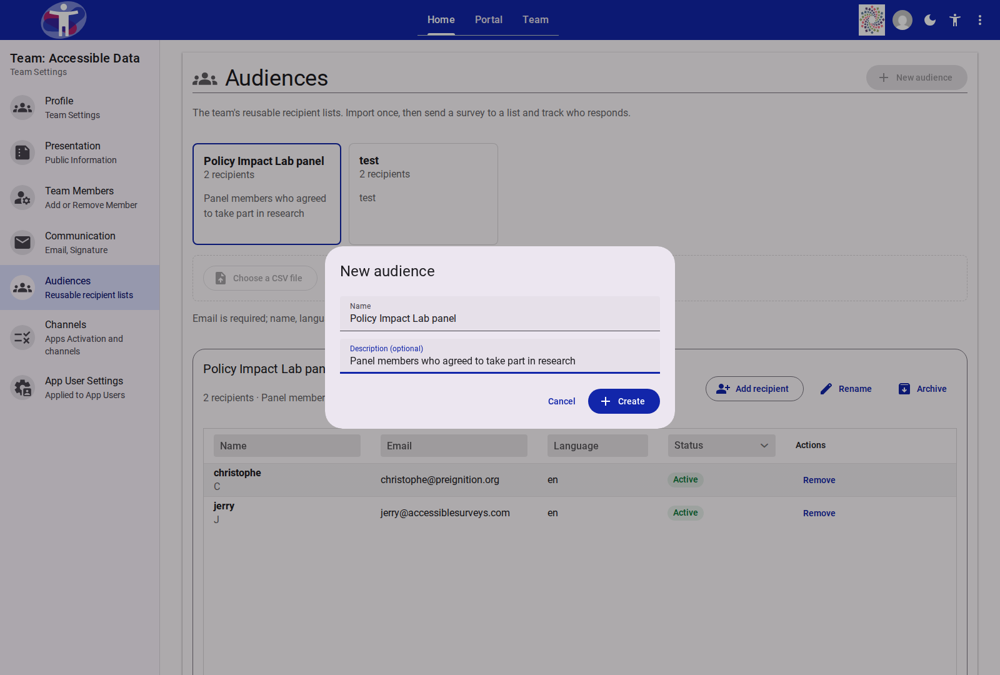
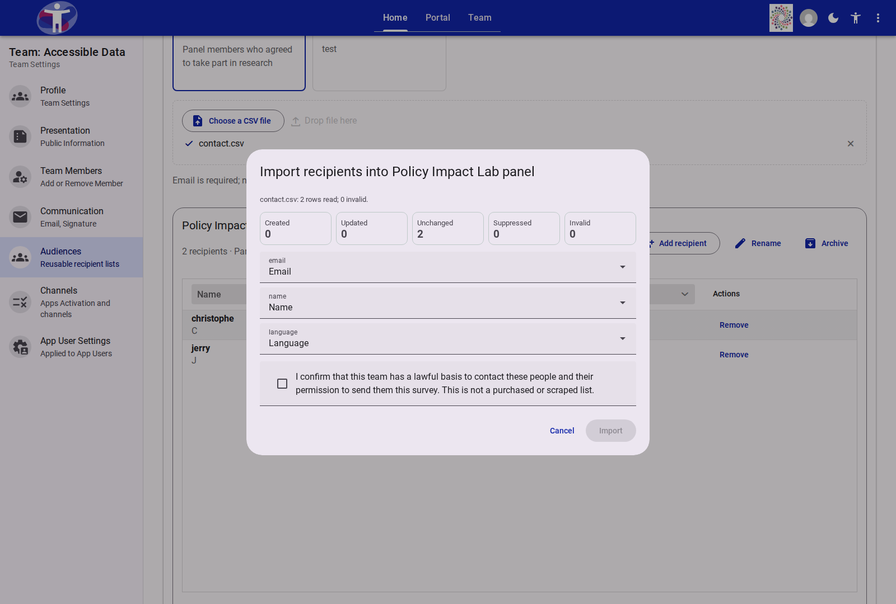

# Team Audiences

The **Audiences** page in **Team Settings** (`/customer/{teamId}/team/audiences`) manages the team's reusable recipient lists for survey invitation runs.

A team stores one **Recipient** record per normalized email address, while **Audiences** act as named membership lists (`audienceIds`). A single person can belong to several audiences within the same team without duplicating their recipient record.

<figure>
  
  <figcaption>The Team Audiences interface with audience selector cards, CSV import zone, and the filterable recipient grid.</figcaption>
</figure>

---

## Audience Cards and Lifecycle

Each audience appears as a selectable card at the top of the workspace displaying:

- **Name:** The display name of the audience (up to 120 characters).
- **Subtitle:** Total `recipientCount` (and an `Archived` indicator when archived).
- **Description:** Optional summary explaining the list's origin or purpose.

### Creating an Audience

Clicking **New audience** opens a modal dialog with two fields:

| Field | Required | Description |
| :--- | :--- | :--- |
| **Name** | Yes | Display name for the audience. Must not be empty. |
| **Description (optional)** | No | Free-text note describing the recipient group. |

<figure>
  
  <figcaption>The New audience modal dialog.</figcaption>
</figure>

::: tip Uploading on an Empty Team
If a team has no audiences yet, uploading a CSV file directly on the page automatically creates the team's first audience named after the CSV filename (without its extension) and opens the import preview dialog.
:::

### Audience Actions

The selected audience's detail header provides the following actions based on the member's team role:

| Action | Minimum Role | Behavior |
| :--- | :--- | :--- |
| **Add recipient** | Editor | Opens a dialog to add or update a single recipient (`Email`, optional `Name`, optional `Language` such as `fr` or `fr-CA`). Disabled when the audience is archived. |
| **Rename** | Editor | Opens the **Audience settings** dialog to update the audience's `Name` and `Description`. |
| **Archive / Restore** | Editor | Toggles the audience between `active` and `archived`. Archived audiences are read-only and cannot be selected for new invitation runs until restored. |
| **Export** | Admin / Owner | Downloads a CSV of all recipients in the selected audience, including full email addresses. Recorded in the team audit log (`audience-export`). |
| **Delete audience** | Admin / Owner | Deletes the audience after confirmation. Recipients remain in the team's other audiences. Recorded in the team audit log (`audience-delete`). |

---

## CSV Import Specification

Recipients can be bulk-imported into any active audience by clicking **Choose a CSV file** or dropping a `.csv` file onto the upload zone.

### File Requirements and Canonical Columns

- **Format:** `.csv` (`text/csv`), up to **10,000 rows** and **5 MB** (`5,000,000` bytes).
- **Canonical target fields:**

| Target Field | Required | Automatic Header Aliases | Normalization & Validation |
| :--- | :--- | :--- | :--- |
| `email` | **Yes** | `email`, `e-mail`, `mail`, `emailaddress` | Trimmed, lowercased, max 254 chars, must contain one `@` and a dotted domain with no whitespace. |
| `name` | No | `name`, `fullname`, `firstname`, `lastname` | Optional display name used for the `{{name}}` merge field and Progress search tokens. |
| `language` | No | `language`, `lang`, `locale` | Platform language code (e.g., `en`, `fr`). Region tags like `fr-CA` fall back to their base language (`fr`) if the region is not separately configured. |
| `external_id` | No | `externalid`, `id`, `externalf` | Optional identifier from an external CRM or panel database. |

Unrecognized columns default to **Ignore** and can be remapped interactively in the preview dialog. Reserved prototype property names (`__proto__`, `constructor`, `prototype`) are rejected.

### Import Preview and Warranty Dialog

After uploading a CSV, `customer-audience-import-dialog` parses the file on the server and displays a live preview before any changes are committed:

<figure>
  
  <figcaption>The CSV import dialog showing dry-run outcome counters, column mapping selectors, and the mandatory warranty checkbox.</figcaption>
</figure>

- **Dry-run outcome tiles:**
  - **Created:** New recipient records that will be added to the team and linked to this audience.
  - **Updated:** Existing team recipients whose metadata (`name`, `language`, `external_id`) or audience membership will be updated.
  - **Unchanged:** Recipients already present in the audience with identical values.
  - **Suppressed:** Recipients matching the customer-wide suppression list. They are added to the audience with `status: 'suppressed'` so the list stays accurate, but they are never emailed.
  - **Invalid:** Rows with missing or malformed email addresses. Invalid rows do not block valid rows.
- **Header mapping:** One dropdown per CSV column allowing the editor to map the column to `Email`, `Name`, `Language`, `External id`, or `Ignore`. Changing a mapping immediately recomputes the preview.
- **Error report:** If `Invalid > 0`, each failing row is listed with its row number and reason, and **Download error CSV** exports `row,email,reason` for offline correction.
- **Import warranty:** The **Import** button remains disabled until the user ticks:
  > *"I confirm that this team has a lawful basis to contact these people and their permission to send them this survey. This is not a purchased or scraped list."*

Committing an import records an `import-commit` entry (including the accepted warranty version) in the team audit log.

---

## Recipient Grid

The recipient table (`#recipient-grid`) displays all recipients belonging to the selected audience, sorted alphabetically by name or email.

| Column | Filter / Control | Description |
| :--- | :--- | :--- |
| **Name** | Text header filter | Displays the recipient's name (or email if unnamed) and their initial badge. |
| **Email** | Text header filter | Full normalized email address (visible to team owners, admins, and editors). |
| **Language** | Text header filter | Two-letter language code (or `—` when unset). |
| **Status** | Select header filter (`Active`, `Suppressed`) | `Active` (green badge) or `Suppressed` (red badge — unsubscribed, complained, or hard-bounced). |
| **Actions** | Row buttons | **Remove** (editors, admins, owners) removes the person from the selected audience while keeping them in the team's other audiences. **Delete** (admins and owners only) removes the recipient from the entire team and every audience. |

---

## System Limits and Permissions

### Quotas and Caps

| Limit | Value |
| :--- | :--- |
| Maximum audiences per team | `50` |
| Maximum recipients per audience | `10,000` |
| Maximum rows per CSV import | `10,000` |
| Maximum file size per CSV import | `5 MB` |
| Maximum outbound invitation/reminder emails per team per day | `20,000` |

### Access Control Matrix

| Role | View Audiences & Full Emails | Create, Edit, Archive, Import, Add/Remove Member | Export CSV, Delete Audience, Delete Recipient from Team |
| :--- | :--- | :--- | :--- |
| **Team Owner / Admin** | Yes | Yes | Yes |
| **Team Editor** | Yes | Yes | No |
| **Team Guest** | No | No | No |

---

## Related Content

- [How to Send Invitations to a Team Audience](../../../survey/how-to/send-invitations.md)
- [Communication Settings](./communication.md)
- [Data Privacy and Security — Invitation Records](../../../survey/explanation/data-privacy-and-security.md#invitation-records)
