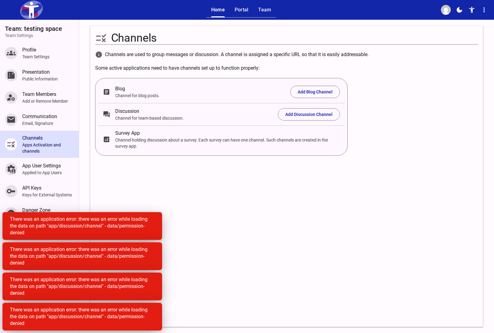
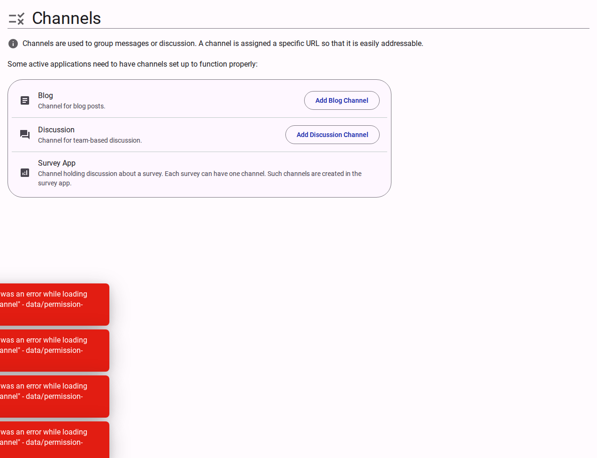

# Channels

The **Channels** section manages communication channels, discussion streams, and broadcast feeds associated with applications active for this team.

<figure>
  
  <figcaption>The Team Channels management panel.</figcaption>
</figure>

## Interface Overview

<figure>
  
  <figcaption>Channels list organized by active application.</figcaption>
</figure>

Channels organize messages, discussions, and updates around specific topics, projects, or applications.

### Application Streams

- **Blog Application Channels**: Channels provisioned to curate, manage, and publish blog post series and community articles.
- **Discussion Channels**: Channels for internal team deliberations, feedback threads, and topic-based message exchanges.
- **Survey App Channels**: Channels created to accompany specific surveys, enabling collaborative review discussions and feedback loops.

### Channel Controls

- **Add Channel**: Action button under each application category to provision a new channel with a designated name, description, and slug identifier.
- **Channel List**: Displays active channels, their URLs, and management actions (edit title, description, or delete channel).

## Related Content

- [Team Presentation Settings](./presentation.md) — Team public branding and descriptions
- [Customer Apps Reference](../customer/apps-referrals.md) — Organization-level app activation
