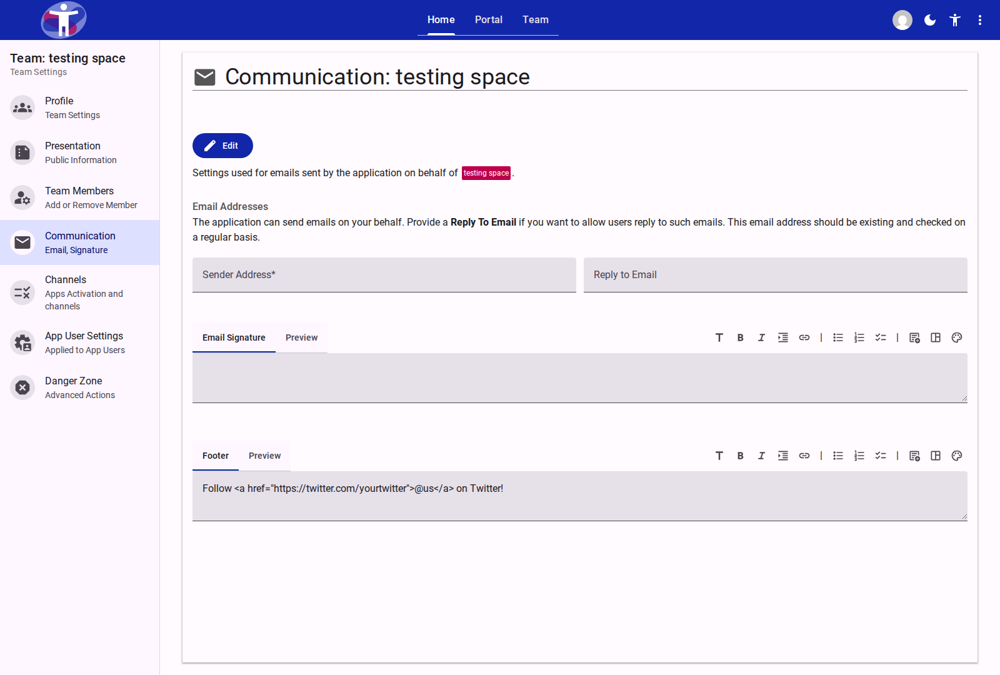
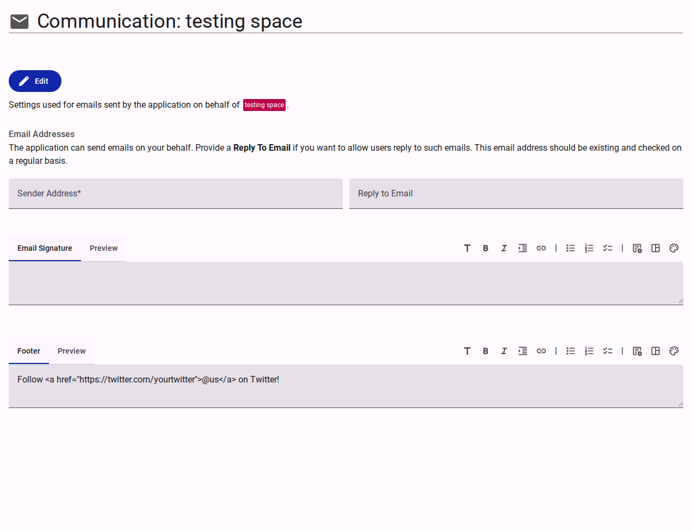

# Communication Settings

The **Communication** section configures the default sender identity, reply-to routing, signature, and persistent footers for outbound automated emails sent on behalf of the team (such as survey invitations and reminders).

<figure>
  
  <figcaption>The Team Communication overview panel.</figcaption>
</figure>

## Interface Elements

<figure>
  
  <figcaption>Communication form displaying Sender Address, Reply-to Email, Signature, and Footer.</figcaption>
</figure>

### Email Addresses

- **Sender Address**: The default email address associated with outbound team communications. Note: Emails are delivered via the platform's secure Mailgun delivery service.
- **Reply to Email**: A dedicated, actively monitored inbox where respondents' direct replies are routed when they reply to survey invitation emails, follow-ups, or confirmations.

### Standardized Email Framing

- **Email Signature**: A rich-text/Markdown field specifying a consistent closing sign-off appended to the body of survey invitation and broadcast emails (e.g., project team contact details or departmental sign-off).
- **Footer**: A rich-text/Markdown field for legal notices, regulatory disclaimers, or social media links appended to the bottom of all outbound messages.

::: tip Survey-Specific Overrides
Individual surveys can customize or override the default reply-to address when composing invitations in [Share → Distribute](../../../survey/reference/share/distribute/index.md#invitations) and [Share → Email](../../../survey/reference/share/email/index.md#sender-identity).
:::

## Related Content

- [Team Presentation Settings](./presentation.md) — Team public branding and logo
- [Survey Email Reference](../../../survey/reference/share/email/index.md) — Configuring transactional and opt-in survey emails
- [Team Audiences Reference](./audiences.md) — Managing reusable recipient lists
