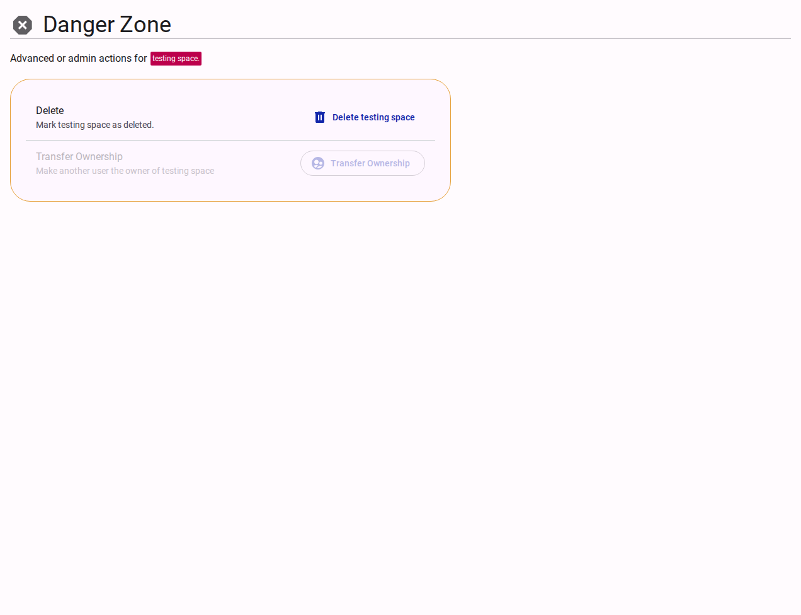

# Danger Zone

The **Danger Zone** contains high-impact administrative actions for managing the lifecycle of an individual team workspace.

<figure>
  
  <figcaption>The Team Danger Zone interface.</figcaption>
</figure>

::: warning Access Restriction
Actions in the Team Danger Zone are restricted to **Customer Owners** and platform Super Admins.
:::

## Available Actions

### Delete Team

- **What it does:** Soft-deletes the team workspace. All surveys and forms managed by the team are flagged as deleted and taken offline immediately (compiled builds and respondent mirrors are removed, but collected response data is safely kept).
- **Audit Reason Field:** An optional **Reason (recorded in the audit)** text field allows the owner to record the business reason for deleting the workspace in the permanent audit trail.
- **Reversibility:** Team deletion is fully reversible. The team's quota allocation, API keys, and member access permissions are preserved.

### Restore Team

- **What it does:** When a team is deleted, the Danger Zone panel updates to display a **Restore team** action.
- **Restoration Behavior:** Clicking **Restore team** reactivates the team, brings its surveys and configurations back online, and restores member access.

::: info Ownership Transfers
Transferring team ownership is not available directly within the team Danger Zone. Ownership assignments are managed by Customer Owners in [Account Holders (Members)](../customer/members.md).
:::

## Related Content

- [Customer Danger Zone Reference](../customer/danger-zone.md) — Managing organization-level deletion and restoration
- [Customer Teams Reference](../customer/teams.md) — Overview of organization workspaces and quotas
- [Team Profile Settings](./profile.md) — Basic team metadata and settings
