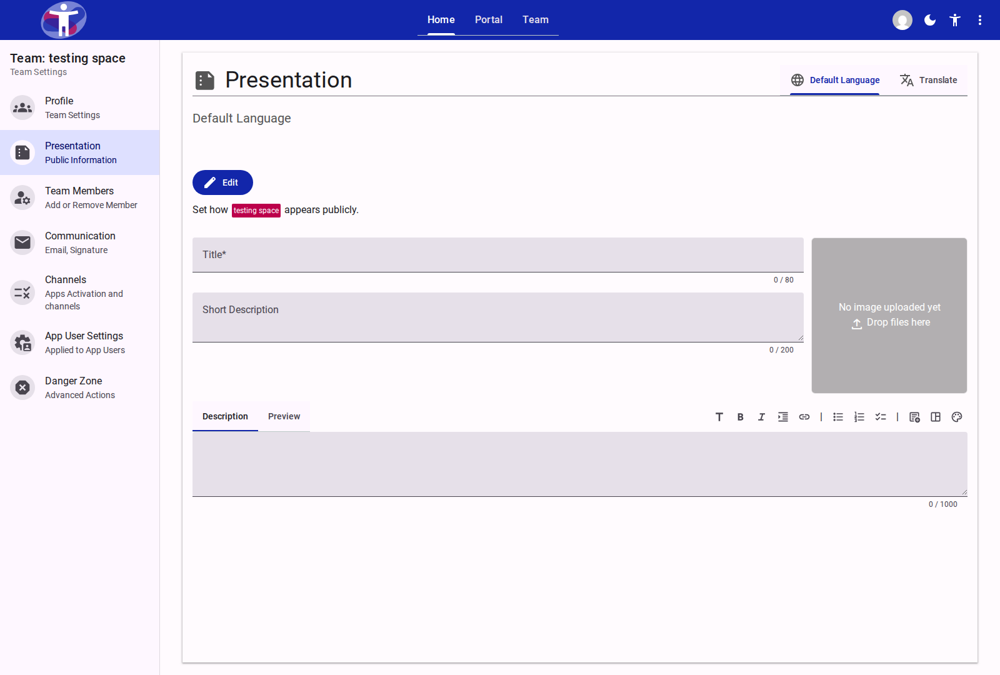
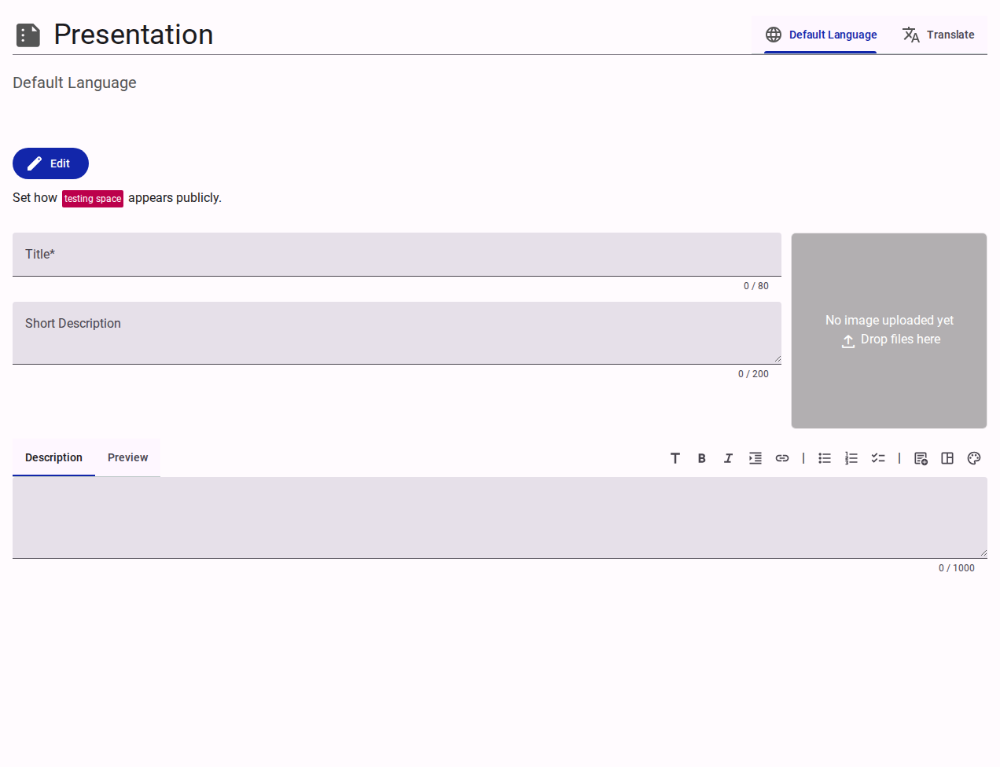

# Presentation Settings

The **Presentation** section configures the public-facing identity, branding logo, and localized descriptions for a team workspace.

<figure>
  
  <figcaption>The Team Presentation overview panel.</figcaption>
</figure>

## Interface Elements

<figure>
  
  <figcaption>Presentation form displaying Title, Short Description, Logo upload, and Description.</figcaption>
</figure>

### Branding & Information Fields

- **Title**: The formalized, public-facing name of the team (required, maximum 80 characters).
- **Short Description**: A concise summary of the team's purpose or research mission (maximum 200 characters), used on card summaries and directory listings.
- **Logo Upload**: Drag-and-drop or file selector to attach an official team or departmental logo. The logo is displayed on team portals and respondent-facing survey banners.
- **Description**: A full Markdown-enabled rich text field (maximum 1,000 characters) for detailed organizational background, contact instructions, or disclaimers.

### Multilingual Localization

- **Default Language**: The primary language for the team's presentation profile.
- **Translate Tab**: Allows team administrators to provide localized translations for the Title, Short Description, and Description for any language enabled under [Customer Profile](../customer/profile.md#public-settings).

## Related Content

- [App User Settings](./app-user-settings.md) — Setting default language and theme for survey visitors
- [Team Profile Settings](./profile.md) — Team internal name and administrative metadata
- [Team Communication Settings](./communication.md) — Email headers, signatures, and reply-to defaults
