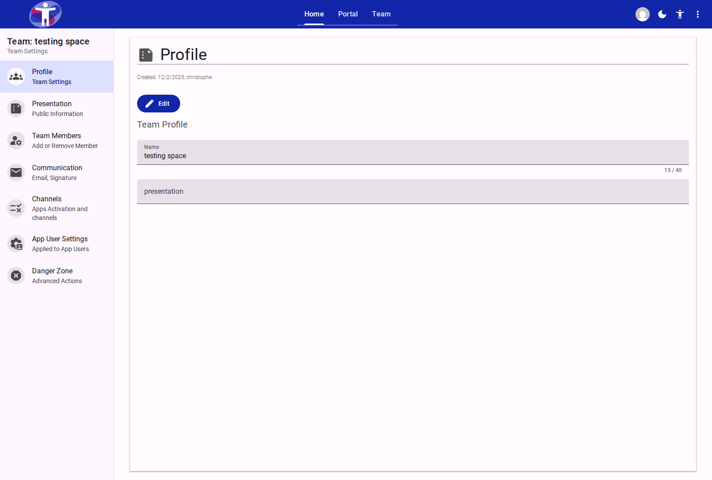
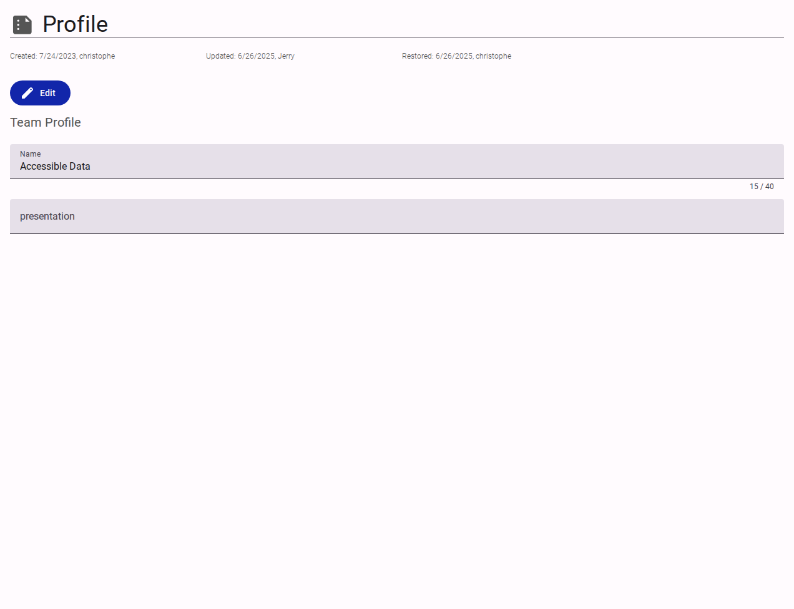

# Team Profile Settings

The **Profile** section manages the primary identity, internal description, and audit metadata for an individual team workspace.

<figure>
  
  <figcaption>The Team Profile overview panel.</figcaption>
</figure>

## Interface Elements

<figure>
  
  <figcaption>Profile form displaying team metadata and editing fields.</figcaption>
</figure>

### Administrative Metadata

The top header presents permanent audit trail facts:

- **Created**: Date, time, and user account that provisioned the team workspace.
- **Updated**: Timestamp of the latest configuration modification.
- **Restored**: Timestamp and actor if the team was previously soft-deleted and subsequently restored.

### Profile Fields

- **Edit Button**: Enables editing mode for team administrators to update profile values.
- **Name**: The formal name of the team (e.g., "Customer Experience Research"). Used across the portal, team switcher, and navigation bars.
- **Presentation**: An internal summary field used by organization administrators to document the team's operational scope, department code, or internal notes.

## Related Content

- [Team Presentation Settings](./presentation.md) — Public-facing title, descriptions, and logo branding
- [Team Members Reference](./members.md) — Collaborators and access roles within this workspace
- [Customer Teams Overview](../customer/teams.md) — Managing workspaces across the organization
