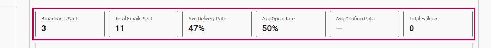

# Analyzing Broadcast Performance

The analytics page reports, for every sent broadcast, how many addresses were targeted, delivered, opened and confirmed, and how many never received the message. Use it to check delivery health and to see how many recipients acted on the message.

---

## Step 1: Open the Analytics Page

1. Sign in to the Listserv application.
2. Select **Admin** > **Analytics**.

The page lists every broadcast that reached the `sent` state in the current channel. Drafts, rejected broadcasts and broadcasts still in moderation are not listed.

<figure>
  
  <figcaption>The channel analytics page: summary tiles and one row per sent broadcast. Confirmed and Confirm Rate show — because none of these broadcasts asked for confirmation.</figcaption>
</figure>

::: info An open is not a read
The **Opened** figure comes from a tracking image. Mail servers, security scanners and privacy proxies fetch that image without a person seeing the message, and email clients may prefetch it. A high open count is therefore an upper bound, not proof of reading. **Confirmed** is the human signal: a recipient pressed a button on a page reached from the email.
:::

::: info Provider prefetches are excluded
A tracking-image fetch within two minutes of dispatch is treated as provider prefetch, not an open. The count is shown beneath **Opened** as **N prefetched**; those recipients are not counted in **Opened** or **Open Rate**, so a later real fetch can still count them. Broadcasts sent before this filter predate it and show every fetch. Fetches after the window can still come from scanners, so even the filtered open rate is an estimate; **Confirmed** remains the human floor.
:::

---

## Step 2: Read the Summary

The summary tiles at the top of the page summarize every listed broadcast:

| Tile | What it measures |
| --- | --- |
| **Broadcasts Sent** | Number of sent broadcasts in the channel. |
| **Total Emails Sent** | Sum of the unique subscriber addresses targeted across those broadcasts. |
| **Avg Delivery Rate** | Average of `delivered / sent` across broadcasts with data. |
| **Avg Open Rate** | Average of `opened / delivered`, after excluding provider prefetches inside the two-minute window. Legacy broadcasts use every fetch. |
| **Avg Confirm Rate** | Average of `confirmed / delivered`, over the broadcasts that asked for confirmation. |
| **Total Failures** | Recipients that never received the message, after the provider's retries. |

<figure>
  
  <figcaption>The summary tiles. A dash for Avg Confirm Rate means no sent broadcast in this channel has asked for confirmation yet.</figcaption>
</figure>

---

## Step 3: Read a Broadcast Row

| Column | What it shows |
| --- | --- |
| **Sent Date** | When the broadcast was dispatched. |
| **Sent** | Unique subscriber addresses targeted at dispatch. It is not a count of provider delivery events. |
| **Delivered** | Addresses whose mail server accepted the message. Delivery is not the same as reaching the inbox: a message can be filed as spam or quarantined afterwards. |
| **Opened** | Addresses that fetched the tracking image after the two-minute provider-prefetch window, counted once per recipient. Early fetches are shown beneath as **N prefetched**. Scanners can still fetch after the window. |
| **Confirmed** | Addresses that pressed the confirm-receipt link. Shown only for broadcasts that asked for confirmation; **—** otherwise. |
| **Failed** | Addresses that never received the message. Temporary retries that eventually delivered are not counted. |
| **Deliv. Rate** | `delivered / sent`. |
| **Open Rate** | `opened / delivered`, after excluding provider prefetches inside the two-minute window. |
| **Confirm Rate** | `confirmed / delivered`, for broadcasts that asked for confirmation; **—** otherwise. |

A confirm rate much lower than the open rate is expected. The two columns answer different questions: the open rate is an estimate that still includes scanners and proxies, while the confirm rate is a floor on the number of people who saw the message.

---

## Step 4: See Who Confirmed

For a broadcast that asked for confirmation, expand its row. The detail lists everyone who pressed the button, with their name, address and confirmation time, under a header such as "9 confirmed of 13 delivered".

Only channel owners and editors can read the confirmation list.

::: info Confirmation is optional per broadcast
The sender ticks **Add a 'confirm you received this' link** while composing or editing a broadcast. Broadcasts sent before the feature, and broadcasts that did not opt in, have no link, so Confirmed and Confirm Rate show **—** for them.
:::

---

## Step 5: Review Replies

Replies to a broadcast are threaded under it and counted in the **Responses** column on **Admin** > **Broadcasts**. Expanding the row there shows the full response thread. A reply is a stronger signal than a confirmation, but only a small share of recipients reply.

<figure>
  
  <figcaption>The broadcast list: delivery counts, response counts and the rate columns. Open the row for the email as subscribers received it and the response thread.</figcaption>
</figure>

::: info Click tracking disabled
In accordance with our privacy-first principles and [ADR 0002](../explanation/REF.md), link click tracking is disabled. Broadcast links are delivered directly as authored without intermediate tracking redirects, so the dashboard does not report clicks or a click-through rate.
:::

---

## Related Content

- [Creating & Sending Broadcasts](./creating-and-sending-broadcasts.md)
- [Mailing List & Digest Engine Explanation](../explanation/mailing-list-and-digest-architecture.md)
- [Broadcast Responses & Threading Explanation](../explanation/broadcast-responses-threading.md)
- [Channel Settings Reference](../reference/settings/index.md)
