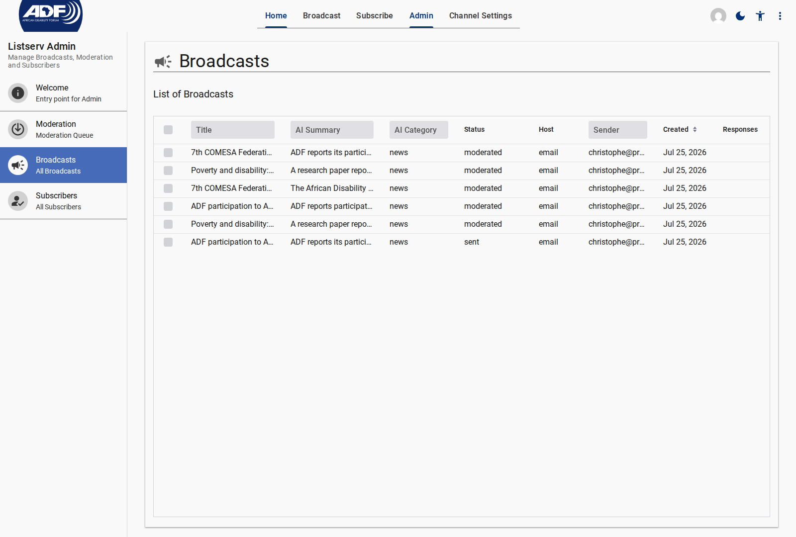

# Composing Multilingual Broadcasts

Accessible Listserv enables channel administrators to reach global subscriber communities in their preferred languages—including English, French, Portuguese, and Arabic—without manually translating each post.

---

## Step 1: Enable Active Languages on the Channel

Before dispatching multilingual broadcasts, ensure the desired target languages are activated for the channel:

1. Navigate to **Channel Settings → Active Languages**.
2. Toggle on each language your channel should support (e.g. English, French, Portuguese, Arabic).
3. Toggling a language auto-saves to your channel configuration. Only languages activated here will be generated by the translation engine.

---

## Step 2: Compose in Your Primary Language

You can compose your broadcast in any supported language:

1. In **Admin → Broadcasts**, click **Create Broadcast**.
2. Enter the **Title**, **Subject**, and compose the **Body** using the rich text / Markdown editor.
3. You do not need to manually translate your message into other languages. The system automatically detects the authoring language and prepares the draft.

<figure>
  
  <figcaption>Broadcast list view showing channel broadcasts.</figcaption>
</figure>

---

## Step 3: Automated Language Detection and Translation

When the broadcast moves through moderation and approval:

1. **Language Detection:** The server-side machine inspects the subject and body to identify the source language (`en`, `fr`, `pt`, or `ar`).
2. **Pre-Moderation & Pre-Dispatch Translation:** When the broadcast is approved, the translation engine automatically translates the title, subject, and body into each active language enabled on the channel.
3. **Translation Notice:** For recipients receiving an automatically translated version, a standard localized notice is prepended to the email informing them that the content was machine-translated and providing a link to view the original text in the public archive.

::: info Fallback Behavior
If an active language cannot be translated due to temporary service unavailability, subscribers in that segment receive the message in the author's primary language.
:::

---

## Step 4: Submit or Send

Once composed:

1. Click **Submit** to send the draft to the Moderation Queue.
2. If you hold **Owner** or **Editor** permissions and the channel is configured for direct send, you can approve the broadcast directly.
3. The send engine maps each subscriber's preferred language to the corresponding locale version of the broadcast upon dispatch.

---

## Related Content

- [Creating & Sending Broadcasts](./creating-and-sending-broadcasts.md) — Composing and dispatching announcements
- [Multilingual Support Explanation](../explanation/multilingual-support.md) — Language detection and translation engine architecture
- [Active Languages Reference](../reference/settings/index.md#3-active-languages-settings-language) — Channel translation settings
