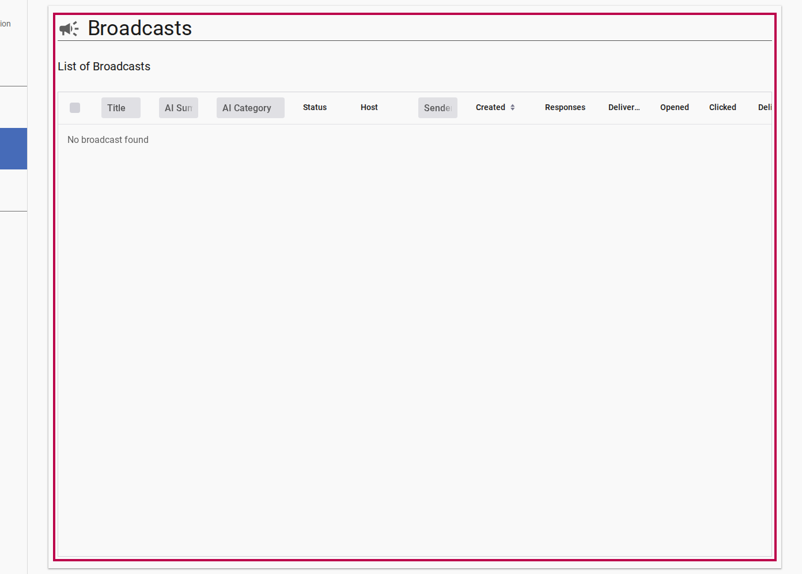

# Creating & Sending Email Broadcasts

Channel staff (`owner`, `editor`, `moderator`) and the channel's signed-in subscribers can draft a broadcast. A draft is private to its author and the channel staff until it is submitted for moderation; only `sent` broadcasts appear in the public archive.

---

## Step 1: Open the Broadcasts Page

1. Sign in to the Listserv application.
2. Open the channel's **Broadcasts** page from the top navigation.

<figure>
  
  <figcaption>The channel's broadcast archive with the New Broadcast action</figcaption>
</figure>

---

## Step 2: Start a New Draft

1. Click **New Broadcast**.
2. The compose form opens. Nothing is written until you click **Create broadcast**, so leaving the form creates no draft.

---

## Step 3: Compose the Broadcast

1. Enter the **Title** — the name the broadcast carries in the admin list.
2. Enter the **Subject** — the email subject line subscribers receive.
3. Compose the body using **Markdown**. Headings (`# Title`), bold (`**text**`), links (`[label](url)`), lists and blockquotes are supported.
4. Optionally tick **Add a 'confirm you received this' link**. The email footer then asks recipients to confirm receipt, and the analytics page shows how many confirmed and who they are. Leave it off when you do not need that signal.

::: tip Choose confirmation deliberately
Confirmation is a human action: the recipient opens a page and presses a button. It is the only metric that distinguishes a person from a mail scanner or a privacy proxy fetching the tracking image. It asks the recipient for an extra step, so use it on broadcasts where reach matters, not on every routine message.
:::

::: tip WCAG 2.1 AA Accessibility Defaults
Broadcast emails are generated as semantic HTML with contrast ratios meeting WCAG 2.1 AA and fallback text styles for legacy email clients. Write descriptive link labels and use headings in order.
:::

---

## Step 4: Create the Draft

1. Click **Create broadcast** (disabled until every required field is filled).
2. The broadcast is saved as a `draft` and its editor opens. Channel staff continue in the Admin broadcast editor; subscribers continue in their submission editor.
3. The draft's status is `draft`: it is not visible to subscribers. Each broadcast you create counts toward the channel's hourly cap (`rateLimit.maxPerHour`), drafts included.

---

## Step 5: Submit or Send

1. Review the draft in the editor, then click **Save** to keep your changes.
2. Click **Submit** to send the broadcast for moderation.
3. The broadcast lifecycle state updates:
   - `draft` → `submitted` → `detectingLanguage` → `translating` → `moderated`
   - A channel moderator **approves** (→ `sending` → `sent`) or **rejects** (→ `rejected`, returned to the author for editing).
4. During `sending`, the background engine dispatches localized versions to channel subscribers via Mailgun mailing lists. If you ticked the confirmation option, the engine adds the signed confirm-receipt link to the footer of the message; replies in a thread never carry it.

::: info Not yet available in the editor
The broadcast model supports layout templates, a primary language and file attachments, but the compose and edit forms currently expose only title, subject, body and the confirmation option.
:::

---

## Related Content

- [Moderating Community Submissions](./moderating-community-submissions.md)
- [Analyzing Broadcast Performance](./analyzing-broadcast-performance.md)
- [Broadcast Lifecycle & AI Moderation Explanation](../explanation/broadcast-lifecycle-and-moderation.md)
- [Markdown Content Format Explanation](../explanation/markdown-content-format.md)
