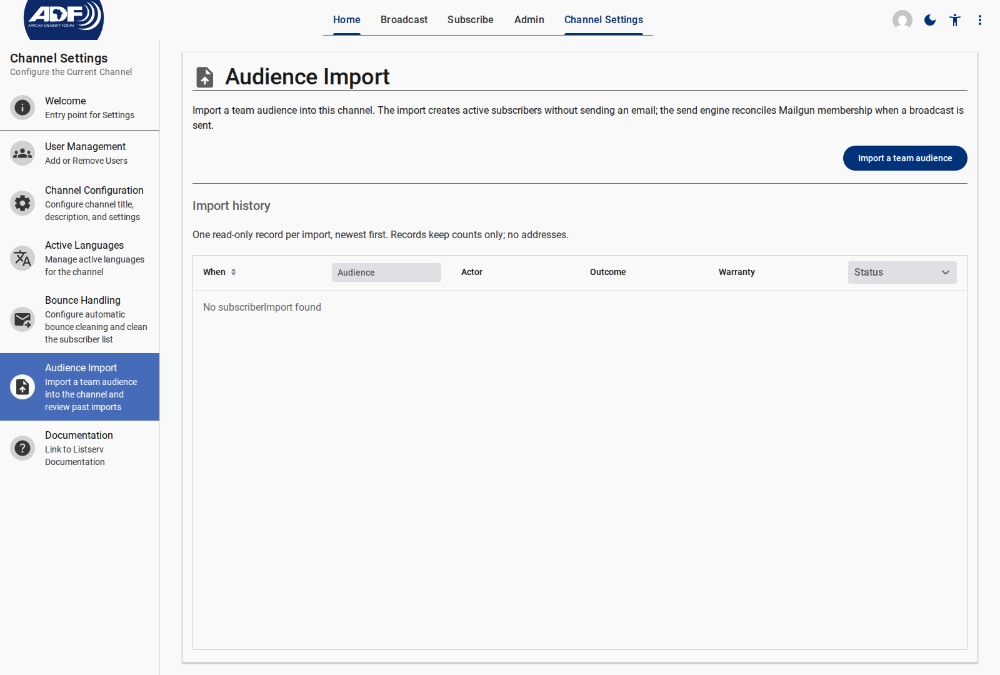
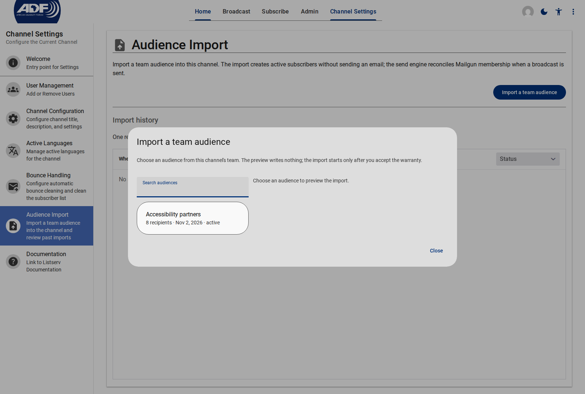
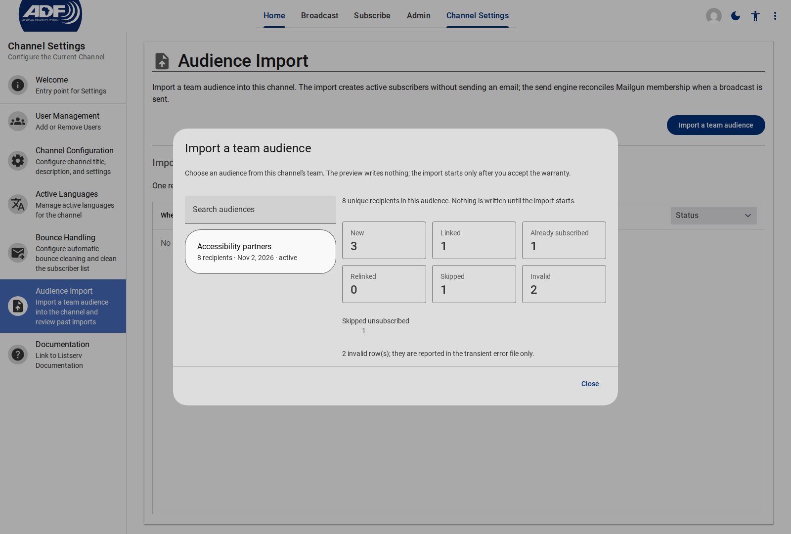
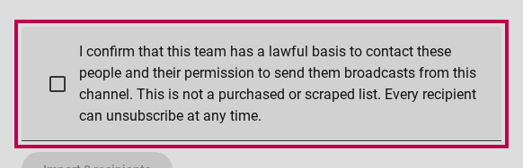
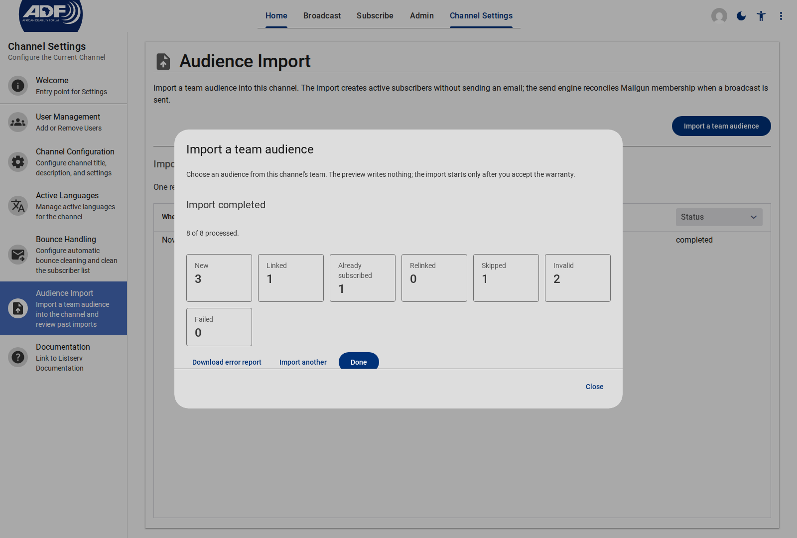
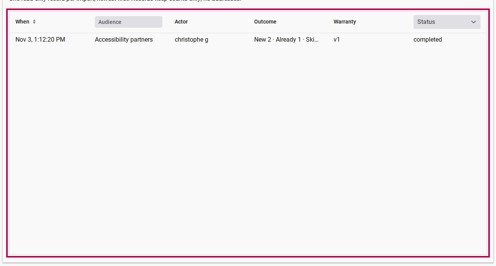
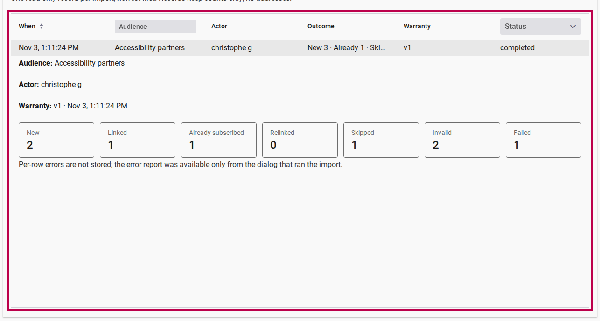

# Importing a Team Audience

Use **Audience Import** to populate a listserv channel from an existing team **Audience** — the reusable contact list managed in the Customer Portal (**Team Settings → Audiences**). Importing adds eligible contacts as active channel subscribers in one pass, without sending confirmation emails or asking people to subscribe again.

::: info Permissions and Data Controller Responsibility
Only a channel **owner** or **editor** can run an import from **Channel Settings → Audience Import** (channel **moderators** also have read access to the import history). Because imported subscribers bypass individual double opt-in, you must confirm before each import that your organization has a lawful basis and permission to send broadcasts from this channel. Purchased or scraped lists are not permitted.
:::

## Before You Start

- **Team audience ready:** The audience must belong to the same team as the listserv channel (up to **10,000 unique recipients** per import). Both **active** and **archived** audiences can be imported; importing never modifies the source audience.
- **No emails sent at import time:** Importing creates or links subscriber records silently. Mailing-list delivery is synced automatically when you send your next broadcast.

---

## Step 1: Open the Audience Import Dialog

1. Sign in to the Listserv application as a channel **owner** or **editor**.
2. Click **Channel Settings** in the top navigation bar, then select **Audience Import** in the left drawer.
3. Click **Import a team audience** to open the import dialog.

<figure>
  
  <figcaption>Open Channel Settings → Audience Import and click Import a team audience.</figcaption>
</figure>

---

## Step 2: Select a Team Audience

1. In the **Import a team audience** dialog, use **Search audiences** to filter your team's audiences by name.
2. Review each audience's recipient count, last-updated date, and status (`active` or `archived`). Audiences exceeding the 10,000-recipient limit are marked `over the 10,000 limit` and disabled.
3. Click an audience to generate a read-only preview on the right.

<figure>
  
  <figcaption>Select a team audience on the left to load its import preview.</figcaption>
</figure>

---

## Step 3: Review the Outcome Preview

Before anything is written, the preview classifies every unique email address in the selected audience:

| Metric | What Happens During Import |
| --- | --- |
| **New** | A new active subscriber record and user account will be created. |
| **Linked** | The email address already has a platform account; a new subscriber record will be linked to that existing account. |
| **Already subscribed** | The person is already an active subscriber in this channel. Existing delivery preferences are never overwritten; if their subscriber record was missing a display name or language, the audience's values are filled in and counted under **Updated existing records**. |
| **Relinked** | An active subscriber whose account link was missing will be reconnected to their user account. |
| **Skipped** | Recipients who are `pending`, `unsubscribed`, `bounced`, or organization-wide `suppressed` are left untouched and never re-subscribed. A breakdown below the tiles lists the exact count for each skipped reason. |
| **Invalid** | Rows with a missing or malformed email address (reported in the downloadable error CSV after the run). |

<figure>
  
  <figcaption>Review the recipient breakdown before starting the import. Only aggregate counts are shown.</figcaption>
</figure>

::: tip Privacy-First Preview
The preview writes nothing to the channel and displays aggregate counts only — never individual email addresses. Duplicate email addresses within the same audience are automatically collapsed to a single subscriber.
:::

---

## Step 4: Accept the Consent Warranty and Start the Import

1. Read the consent warranty statement below the preview counts.
2. Tick the confirmation checkbox to warrant that your team has a lawful basis and permission to send broadcasts from this channel, that the list is not purchased or scraped, and that every recipient can unsubscribe at any time.
3. Click **Import N recipients** (the button remains disabled until the checkbox is ticked).

<figure>
  
  <figcaption>Tick the warranty checkbox to enable the Import button.</figcaption>
</figure>

The dialog displays a live progress bar (`X of Y processed`) as recipients are imported.

::: info Resuming a Long or Interrupted Import
You can safely close the dialog or leave the page while a large import is running. Progress is saved continuously, and all subscriber writes are idempotent. If a run is interrupted or encounters a temporary error, reopen **Import a team audience** and click **Resume** to continue from the last processed recipient without creating duplicates.
:::

---

## Step 5: Inspect the Result and Download Any Error Report

When the run finishes, the dialog displays **Import completed** (or **Import failed**) with the final counts across **New**, **Linked**, **Already subscribed**, **Relinked**, **Skipped**, **Invalid**, and **Failed**.

<figure>
  
  <figcaption>Review the final import counts and download the transient error report if any rows were invalid or failed.</figcaption>
</figure>

- **Download error report:** Appears whenever one or more rows were **Invalid** or **Failed**. Click it right away to download `listserv-import-errors.csv` (`row,email,reason`) so you can fix those entries in **Team Settings → Audiences** and re-import. For privacy reasons, per-row errors and email addresses are never stored in the database — once you close the dialog, the error report is no longer available.
- **Import another:** Resets the dialog so you can select and import another audience.
- **Done:** Closes the dialog and returns to the **Audience Import** page.

---

## Step 6: Review the Import History

Every import is logged in the read-only **Import history** table on **Channel Settings → Audience Import**, ordered newest first.

1. Use the **Audience** text filter or the **Status** dropdown (`Running`, `Completed`, `Failed`) in the table header to narrow the list, or sort by **When**.
2. Read the compact **Outcome** summary (`New · Already · Skipped`) and the recorded **Warranty** version (`v1`) for each run.
3. Click any row to expand its audit details in place: the **Audience** name snapshot, the **Actor** who ran the import, the **Warranty** version and acceptance timestamp, all seven outcome counters, and any failure message.

<figure>
  
  <figcaption>The Import history table lists every run with its actor, compact outcome summary, warranty version, and status.</figcaption>
</figure>

<figure>
  
  <figcaption>Click a row to inspect the full count breakdown and warranty timestamp. No email addresses are stored in the history.</figcaption>
</figure>

---

## What Happens After an Import

- **Immediate broadcast eligibility:** Newly created and linked subscribers are set to `active` right away and receive the channel's next email broadcast in their preferred language (falling back to the channel's primary language when needed).
- **Safe re-imports:** Re-importing an updated audience is completely idempotent — already-active subscribers keep their existing preferences, and only newly added contacts or missing names/languages are updated.
- **Subscriber sign-in:** Imported subscribers receive broadcasts by email without needing to sign in. If they later wish to sign in on the web, they can set a password using **Forgot password** on the sign-in page.

---

## Related Content

- [Team Audiences Reference](../../customer/reference/team/audiences.md) — How to create and manage reusable recipient lists in Team Settings
- [How to Send Invitations to a Team Audience](../../survey/how-to/send-invitations.md) — Step-by-step guide to uploading a CSV into a Team Audience
- [Configuring Channel Settings](./configuring-channel-settings.md) — Managing channel metadata, active languages, bounce rules, and user access
- [Creating & Sending Email Broadcasts](./creating-and-sending-broadcasts.md) — Composing and dispatching broadcasts to channel subscribers
- [Subscribing & Managing Preferences](./subscribing-and-managing-preferences.md) — How subscribers join a channel and manage delivery settings
