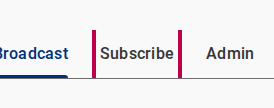
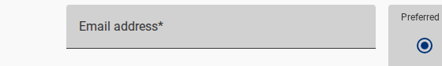
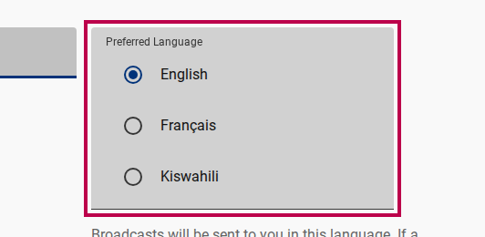
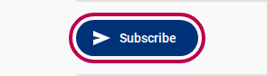
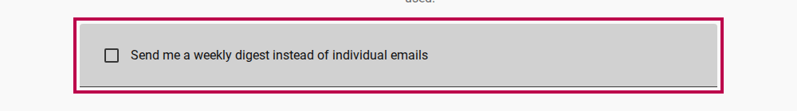

# Subscribing & Managing Delivery Preferences

This guide explains how users subscribe to a channel using either email commands or the web application, select language preferences, toggle weekly digest mode, and pause delivery via vacation mode.

---

## Method 1: Email Commands (Low-Connectivity Route)

Users in low-bandwidth or offline environments can manage subscriptions by sending simple email commands to the channel address (e.g. `channel-1@mg.a11ydata.com`). No web browser or password required.

### Supported Email Commands

Send an email to `{channel-id}@mg.a11ydata.com` with one of the following command keywords in the **subject line** or the **first line of the body**:

| Desired Action | English | French | Portuguese | Arabic |
| --- | --- | --- | --- | --- |
| **Subscribe** | `SUBSCRIBE` | `INSCRIRE` | `INSCREVER` | `اشتراك` |
| **Unsubscribe** | `UNSUBSCRIBE` / `SIGNOFF` | `DESINSCRIRE` | `DESCADASTRAR` | `إلغاء الاشتراك` |
| **Help & Guidelines** | `HELP` | `AIDE` | `AJUDA` | `مساعدة` |

```text
From: subscriber@example.com
To: channel-1@mg.a11ydata.com
Subject: SUBSCRIBE
```

::: tip Immediate Email Activation
Email commands originating directly from the user's mail address serve as proof of email ownership. Therefore, email command subscriptions are activated immediately without requiring a double opt-in click.
:::

---

## Method 2: Web Subscription (With Double Opt-In)

The web subscription form allows users to select preferred languages and delivery modes directly.

<figure>
  
  <figcaption>Public Subscription Form in the Listserv Web Application</figcaption>
</figure>

### Steps to Subscribe on the Web

1. Open the Listserv web application and click **Subscribe** in the top navigation.
2. Enter your email address in the **Email address** text field.

   <figure>
     
     <figcaption>Entering the subscriber's email address</figcaption>
   </figure>

3. Under **Preferred Language**, choose your primary language (e.g. English, French, Portuguese, Arabic).

   <figure>
     
     <figcaption>Choosing preferred delivery language</figcaption>
   </figure>

4. *(Optional)* Select **Send me a weekly digest instead of individual emails** if you prefer a single summary email per week.

   <figure>
     
     <figcaption>Toggling weekly digest mode option</figcaption>
   </figure>

5. Click **Subscribe**.

   <figure>
     
     <figcaption>Submitting the web subscription form</figcaption>
   </figure>

6. Check your inbox for a confirmation email containing a double opt-in link.
7. Click the confirmation link to activate your subscription.
8. Use the **complete your account** link in the same email to set a password, if you want to manage preferences in the app.

::: info Double Opt-In Security
Unconfirmed subscriptions remain pending. Unverified addresses do not receive broadcasts, which prevents unauthorized signups and protects the channel's sender reputation.
:::

### Complete your subscriber account

A confirmed subscription already receives broadcasts. Completing the account adds a password so you can sign in to manage it.

1. Open the completion link in the confirmation email (or in the reply to an email subscription).
2. Enter a password of at least six characters and confirm it.
3. Select **Set Password**.
4. Sign in with your email address and the new password.

If the link fails, it may have been used already or expired. Ask the channel administrator to resend it, or subscribe again with the same address.

---

## Managing Delivery Preferences

### Real-Time vs. Weekly Digest Mode

- **Individual Emails (Real-Time)**: Each broadcast arrives as a separate email immediately after approval. You can reply directly to any broadcast email to contribute to threaded discussions.
- **Weekly Digest Mode**: Broadcasts are held and compiled into a single consolidated summary email dispatched once a week by the automated scheduler. Digest emails are read-only; you cannot reply to start a threaded discussion.

<figure>
  
  <figcaption>Choosing between Individual Real-Time Emails and Weekly Digest Summaries</figcaption>
</figure>

### Pausing delivery with vacation mode

Vacation mode pauses delivery without ending the subscription. You keep your preferences and your place in the channel, but receive nothing until the pause is lifted.

Ask the channel administrator to set vacation mode for your address. There is no self-service switch on the subscription form, because an active subscriber record is still required for your account.

Do not unsubscribe for a temporary absence: unsubscribing removes you from the channel and you must subscribe again afterwards.

### Unsubscribing

You can unsubscribe at any time using either option:

1. Click the **1-Click Unsubscribe** link in the footer of any broadcast email.
2. Reply to a broadcast email with `UNSUBSCRIBE` in the subject line.

Unsubscribing takes effect immediately for future sends. Ask the channel administrator if you need help, and note that a digest subscriber may need to wait for the next digest before seeing the unsubscribe link.

---

## Related Content

- [Subscribing and Managing Delivery Preferences](./subscribing-and-managing-preferences.md)
- [Email & Web Routes Explanation](../explanation/dual-route-architecture.md)
- [Subscriber Accounts and Sign-In](../explanation/subscriber-identity-and-auth.md)
- [Real-Time Broadcasts and Weekly Digests](../explanation/mailing-list-and-digest-architecture.md)
- [Managing Subscribers](./managing-subscribers.md)
