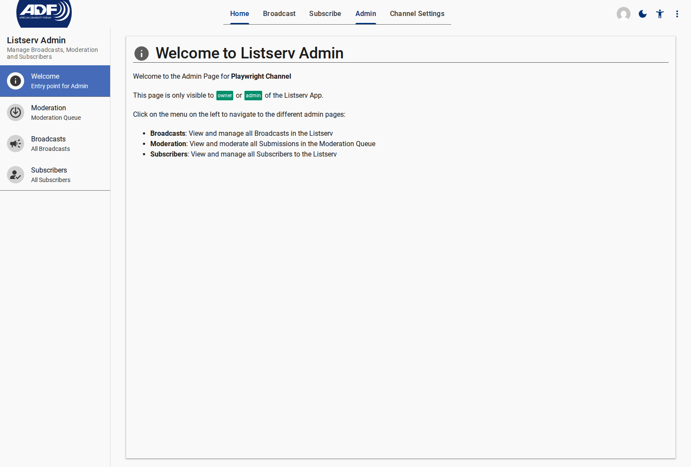
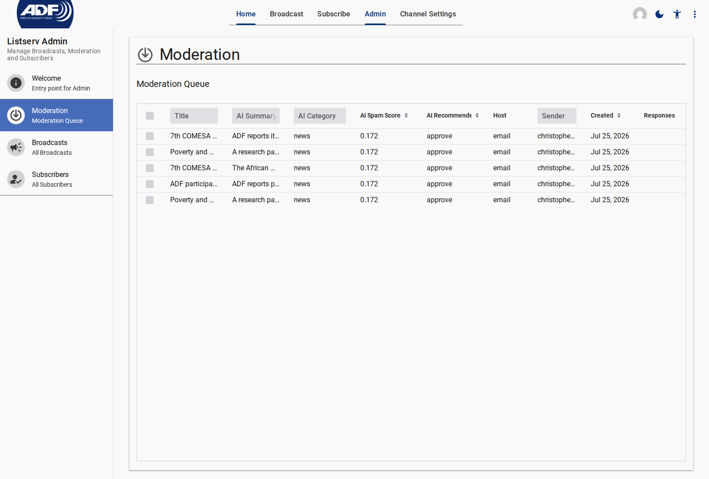
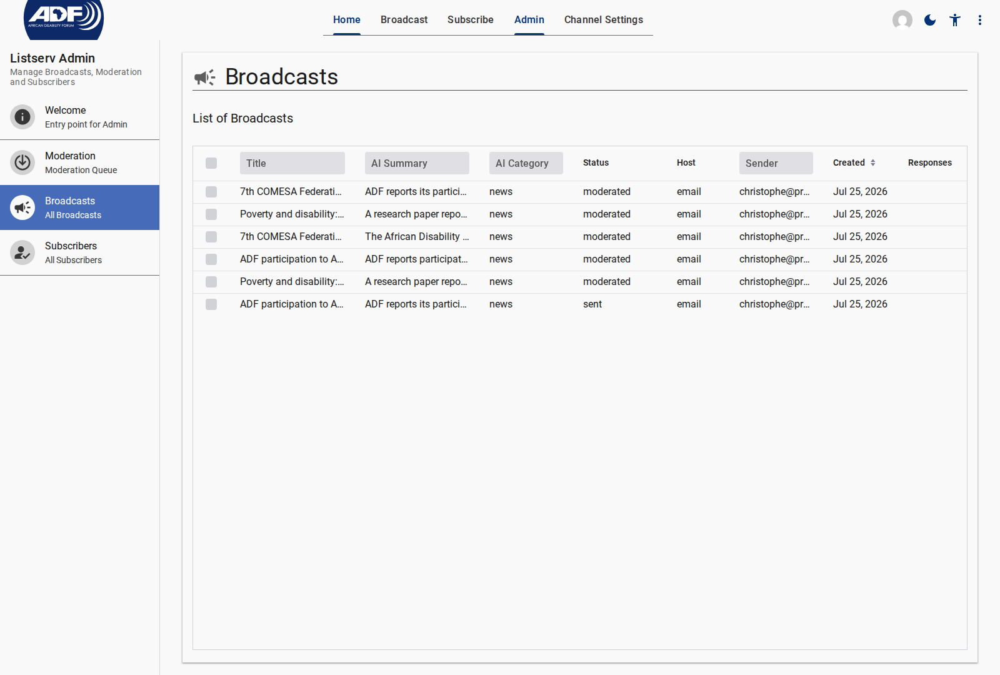
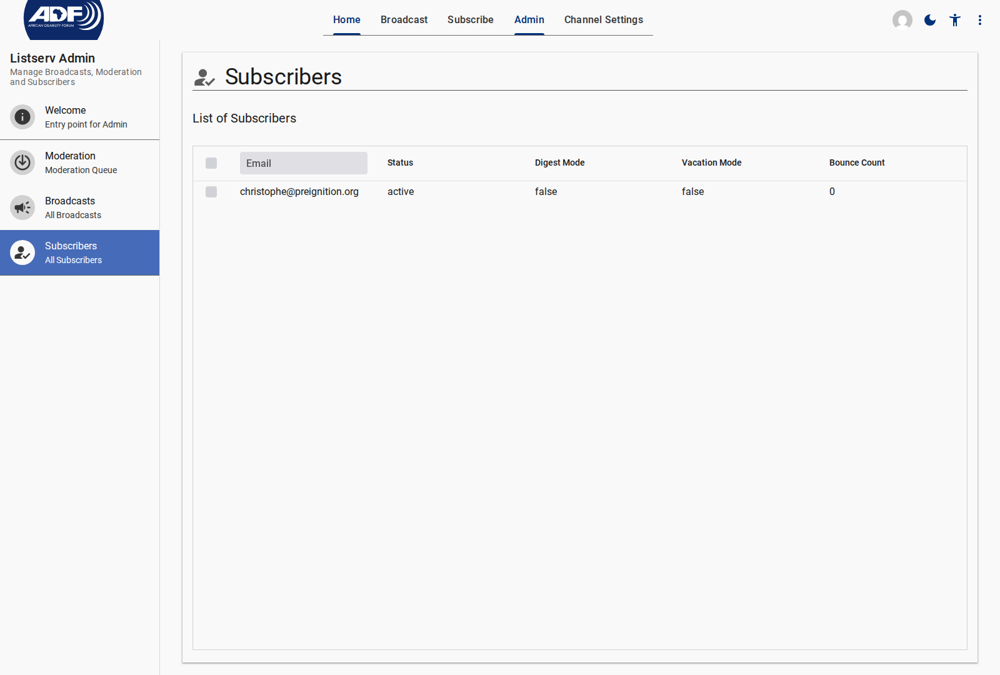
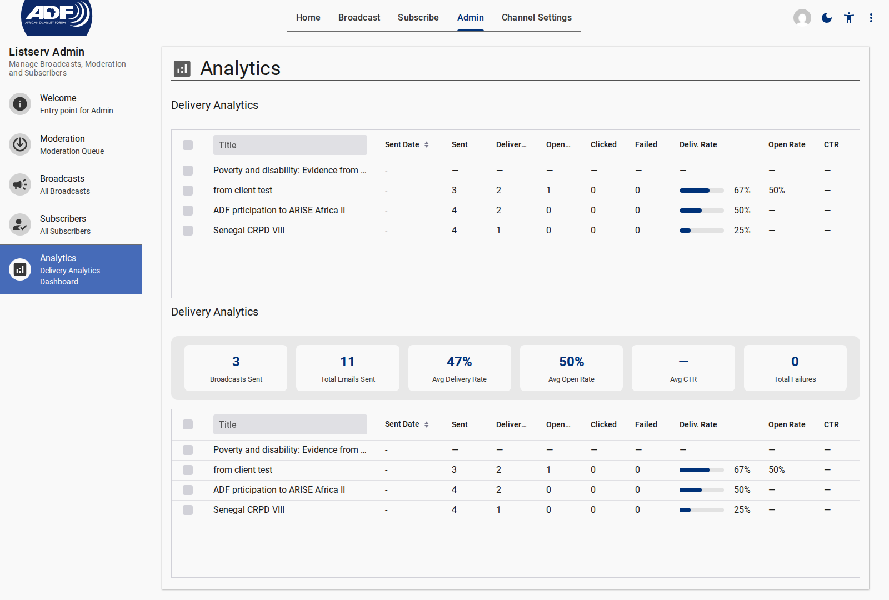

# Admin Pages

The admin workspace is available to channel owners, editors and moderators, depending on the section. It is reached from **Admin** in the top navigation.

## Welcome

<figure>
  
  <figcaption>The admin welcome screen with links to each section.</figcaption>
</figure>

The welcome page introduces the three working areas and links to them:

- **Broadcasts** — drafting, editing, sending and reviewing performance.
- **Moderation** — reviewing community submissions.
- **Subscribers** — the membership directory and delivery preferences.

## Moderation queue

<figure>
  
  <figcaption>Pending community submissions awaiting review.</figcaption>
</figure>

| Column | What it shows |
| --- | --- |
| **Sender** | The address the submission came from. |
| **Subject** | The submitted title. |
| **Submitted at** | When the post arrived, by email or web form. |
| **Category** | The automated classification: news, event, announcement, question or spam. |
| **Spam score** | A value from 0 to 1; higher means more likely spam. Advisory, not decisive. |
| **Actions** | **Approve**, **Edit & Approve**, **Reject**. |

Open a row to read the full post before deciding. The category and score help triage; they do not replace reading the submission.

## Broadcasts

<figure>
  
  <figcaption>The broadcast list with lifecycle status and response counts.</figcaption>
</figure>

| Column | What it shows |
| --- | --- |
| **Title** | The broadcast subject. |
| **Status** | Draft, submitted, approved, sending, sent or rejected. |
| **Origin** | Whether an administrator wrote it or a community member submitted it. |
| **Sent date** | When dispatch completed. |
| **Responses** | The number of subscriber replies in the thread. |

Expand a row for the broadcast editor, the language versions and the delivery and open metrics.

## Subscribers

<figure>
  
  <figcaption>The subscriber directory with status and delivery preferences.</figcaption>
</figure>

| Column | What it shows |
| --- | --- |
| **Email address** | The subscribed address. |
| **Status** | Pending, active, unsubscribed or bounced. |
| **Delivery mode** | Real-time or weekly digest. |
| **Vacation mode** | Whether delivery is paused without unsubscribing. |
| **Bounce count** | Consecutive hard failures recorded for the address. |

Administrators can change status, delivery mode and vacation mode for an individual subscriber, and can filter the list by any column. See [Managing Subscribers](../../how-to/managing-subscribers.md).

## Analytics

<figure>
  
  <figcaption>Channel-level delivery and engagement metrics.</figcaption>
</figure>

| Metric | What it measures |
| --- | --- |
| **Total sent** | Broadcasts dispatched across the channel. |
| **Delivery rate** | Share of dispatched messages accepted by recipient servers. |
| **Open rate** | Share of delivered broadcasts opened, counting each recipient once per broadcast. |
| **Responses** | Replies received across broadcasts. |

Metrics can be filtered by language to compare engagement between language communities. Click tracking is not collected, so there is no click or click-through figure.

## Related Content

- [Public Pages](../public/index.md): What subscribers see.
- [Channel Settings](../settings/index.md): Configuration and access roles.
- [Moderating Community Submissions](../../how-to/moderating-community-submissions.md): Reviewing a submission.
- [Analyzing Broadcast Performance](../../how-to/analyzing-broadcast-performance.md): Reading the metrics.
