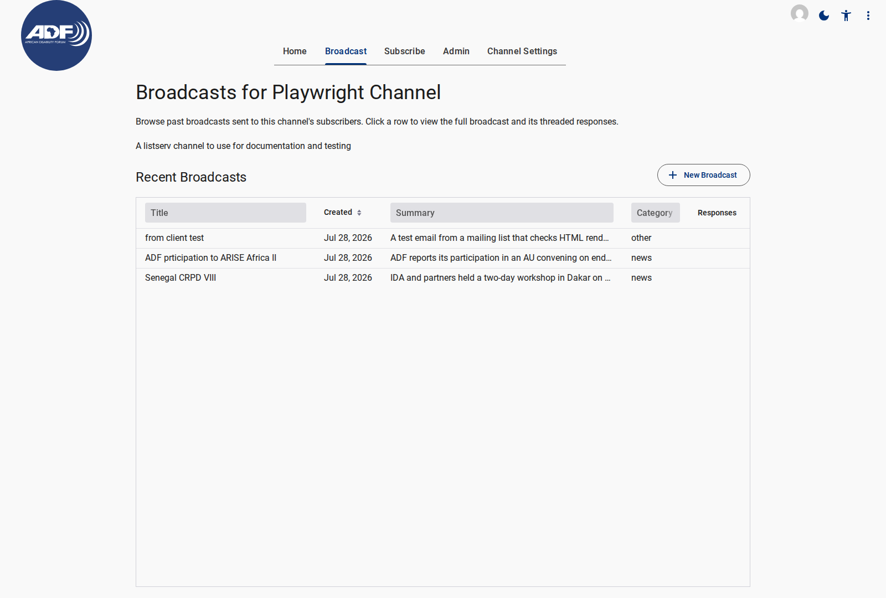
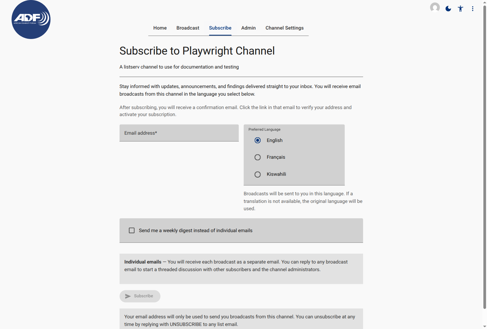

# Public Pages

Public pages are available without signing in, so anyone with the channel link can read sent announcements and subscribe. Some actions require an account or a channel role.

## Broadcast archive

The archive lists the channel's sent broadcasts, newest first, with a title, date, short summary, category and response count.

<figure>
  
  <figcaption>The public broadcast archive with sent announcements.</figcaption>
</figure>

- Select a row to read the full broadcast and its discussion thread.
- Sort by title, date or category, and search within the list.
- **New Broadcast** appears only for channel staff and signed-in subscribers of the channel.
- A **Subscribe** link is always available in the top navigation.

### Public and private channels

A **public** channel's archive is readable by anyone. A **private** channel shows a notice instead: signed-out visitors are asked to log in, and signed-in visitors who are not subscribers are asked to subscribe.

The channel's privacy notice, when configured, appears above the archive.

## Subscription form

<figure>
  
  <figcaption>The public subscription form.</figcaption>
</figure>

| Field | Required | What it does |
| --- | --- | --- |
| **Email address** | Yes | The address that will receive broadcasts; must be valid. Web subscriptions require confirmation. |
| **Preferred language** | Yes | A language the channel has activated; shown in its own language name. |
| **Weekly digest** | No | Off by default (real-time delivery). When enabled, sends one summary email a week instead. |

Selecting **Subscribe** starts the confirmation flow for web subscriptions. The page also shows the channel's privacy notice, covering archiving, indexing and how to unsubscribe.

The form shows an error when the address is malformed, the language is not active, or the channel cannot accept the subscription. Confirmation emails can take a few minutes; check spam before retrying.

## Subscriber web submissions

A signed-in subscriber of the channel can contribute a post from the web application instead of by email.

1. Sign in and open the channel.
2. Select **New Broadcast** in the archive, or open the submission form directly.
3. Write a subject and body in Markdown and choose the primary language.
4. Submit.

The submission becomes a draft in the channel's moderation queue, exactly like an email submission. The subscriber sees its progress in the app, and receives the same acknowledgment and moderation outcome as an email author.

Submissions are rate-limited per subscriber. A signed-out visitor, or a signed-in person who is not subscribed to this channel, cannot submit; the server checks the same condition as the interface.

Unlike an email submission, a web submission does not depend on the subscriber's mail client preserving formatting: the body is stored as written.

## Related Content

- [Subscribing and Managing Delivery Preferences](../../how-to/subscribing-and-managing-preferences.md): The subscription steps in detail.
- [Browsing and Searching Archives](../../how-to/browsing-and-searching-archives.md): Reading and searching sent broadcasts.
- [Admin Pages](../admin/index.md): What channel staff see after a submission.
- [Channel Settings](../settings/index.md): Public/private visibility and privacy notice.
