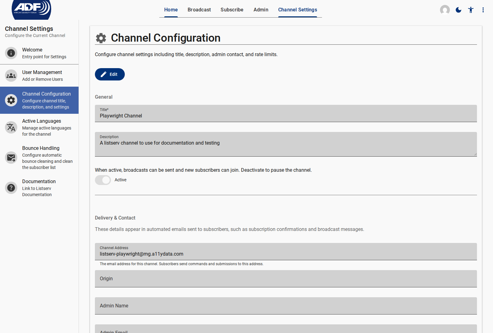
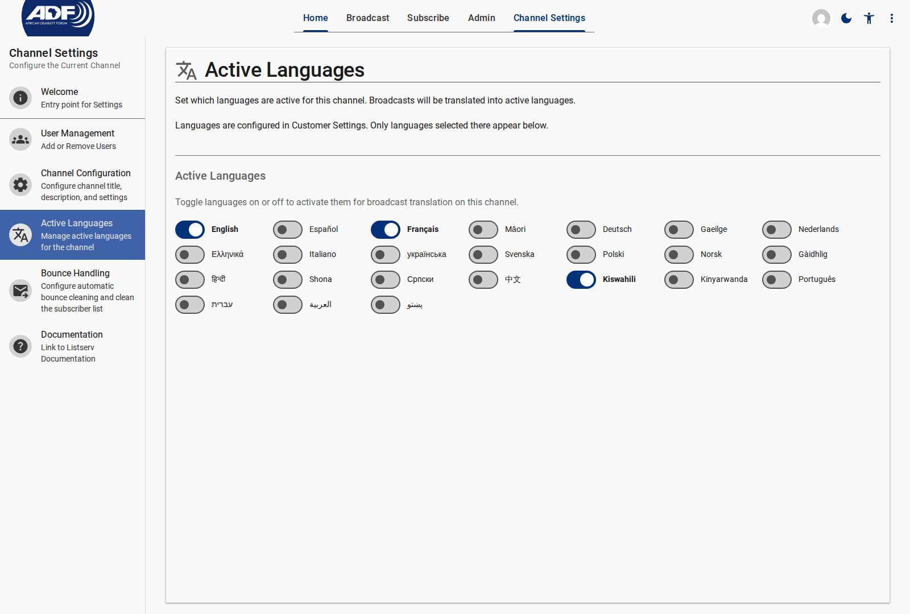
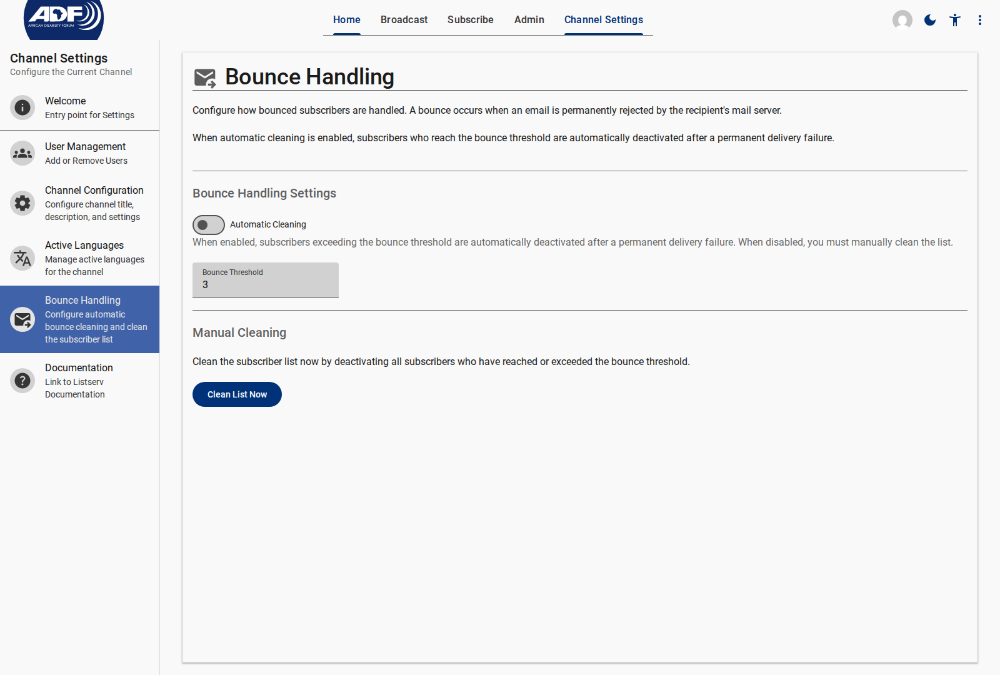
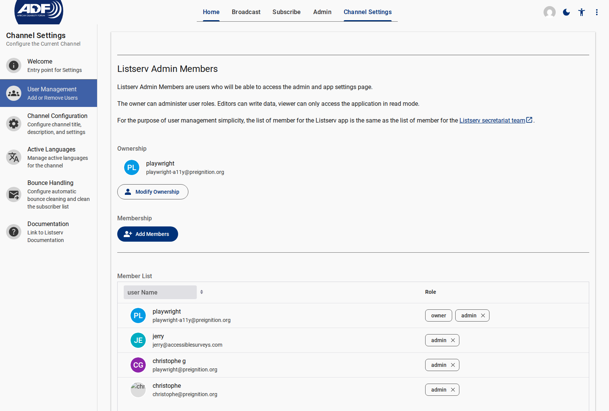

# Channel Settings

Channel owners and editors configure the channel from **Channel Settings**: its identity, languages, bounce handling, access roles and subscriber imports.

## Where channels come from

A Listserv channel belongs to a team and is provisioned in the **Customer Portal**. The Customer Portal team owns the channel's channels list; trial and plan quota, team membership and the team's language set are managed there. Channel Settings then governs how this channel behaves within that team.

If a channel is missing, or an owner needs to be changed at the organization level, start in the Customer Portal rather than in Listserv.

## Channel configuration

<figure>
  
  <figcaption>Channel configuration for identity and submission limits.</figcaption>
</figure>

| Field | What it controls |
| --- | --- |
| **Channel title** | The public name shown on the archive, the subscription form and email footers. |
| **Description** | A public overview of the channel's purpose. |
| **Admin contact** | Name, email and optional phone used in automated mail headers and footers. |
| **Rate limit** | Maximum community submissions per sender per hour (default 5). |
| **Privacy notice** | Legal text shown on public pages and in mail footers. |

## Active languages

<figure>
  
  <figcaption>Activating the languages the channel translates into.</figcaption>
</figure>

The switches list the languages the **organization** has enabled in the Customer Portal. A language must be enabled there before it can be activated here.

When a language is active:

- it appears on the subscription form;
- approved broadcasts are translated into it;
- subscribers who prefer it receive the translated version.

Deactivating a language stops new translations into it. Existing subscribers who chose it fall back to the broadcast's primary language.

## Bounce handling

<figure>
  
  <figcaption>Automatic cleaning, threshold and manual list cleaning.</figcaption>
</figure>

| Control | What it does |
| --- | --- |
| **Automatic cleaning** | Deactivates a subscriber when hard bounces reach the threshold. |
| **Bounce threshold** | Number of hard bounces before deactivation (default 3). |
| **Clean list now** | Reconciles the subscriber list against the provider's current bounce records. |

See [Bounce Handling and List Cleaning](../../explanation/bounce-handling-list-cleaning.md) for what happens to a deactivated subscriber.

## User access

<figure>
  
  <figcaption>Channel ownership and team roles.</figcaption>
</figure>

### Roles

| Role | What they can do |
| --- | --- |
| **Owner** | Full channel administration, settings and access delegation. |
| **Editor** | Compose broadcasts, moderate posts, manage subscribers, send. |
| **Moderator** | Review and moderate community submissions. |
| **Guest** | Read-only access to archives and analytics. |

### Membership controls

- **Modify ownership** transfers the owner role to another team member.
- **Add members** invites a person and assigns a role.
- **Member list** shows current members and roles; roles can be changed or revoked in place.
- **Pending invites** lists invitations not yet accepted.

Channel roles are not account roles. A person who administers the organization in the Customer Portal does not automatically get channel access, and a channel editor does not get organization administration.

## Audience import

**Audience Import** seeds channel subscribers from a reusable team audience managed in the Customer Portal.

- Choose an active or archived team audience, up to 10,000 unique recipients.
- Review a dry-run breakdown of new, linked, already subscribed, relinked, skipped and invalid records before writing anything.
- Confirm the lawful-basis warranty.
- Watch progress for long runs, and download an error report for invalid rows.
- Read the import history, which records each run and its outcome.

An import never modifies the source audience. Imported subscribers become active immediately and bypass individual double opt-in, which is why the warranty is mandatory. See [Importing a Team Audience](../../how-to/importing-a-team-audience.md).

## Related Content

- [Public Pages](../public/index.md): Where the configured identity and privacy notice appear.
- [Admin Pages](../admin/index.md): The working areas for staff.
- [Configuring Channel Settings](../../how-to/configuring-channel-settings.md): Step-by-step configuration.
- [Managing Subscribers](../../how-to/managing-subscribers.md): Working with the subscriber list.
