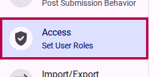
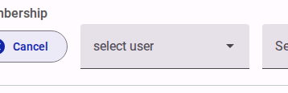
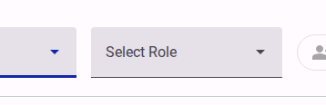

# How to set access rights for forms

As the creator (**Owner**) of a survey, you control who has access to view, edit, configure, or translate your questionnaire. By adding collaborators and assigning specific roles, your team can build and review surveys securely.

::: info Prerequisite: Team Membership
All members of your active team automatically have read-level visibility into surveys within the team workspace. To grant editing, publishing, or translation rights, you must explicitly assign a role to that user on this survey.

To collaborate, the colleague must already be an accepted [Team Member](../../customer/reference/team/members.md). For how account, team, and survey permissions relate, see [Understanding Access and Permissions](../../customer/explanation/understanding-access-and-permissions.md).
:::

## Step 1: Navigate to the Access view

1. Open your survey in the editor.
2. In the top bar, click the **Share** tab.
3. In the left drawer, select **Access**.

<figure>
  
  <figcaption>Click the 'Access' button in the Share drawer.</figcaption>
</figure>

## Step 2: Assign roles to team members

In the Access view, you can grant specific permissions to team members:

1. Select or enter the email address of the team member you wish to add.
2. Choose their role from the role selector:
   - **Admin**: Full configuration, publishing, and editing permissions, with the ability to manage other collaborators.
   - **Editor**: Comprehensive editing and configuration rights to build questions and update settings. Cannot delete the survey.
   - **Guest / Viewer**: Read-only access to inspect the survey structure and view response analytics.
   - **Translator**: Targeted permissions to translate questions and options for an assigned language without altering questionnaire structure.
3. Click **Add Access**.

<figure>
  
  <figcaption>Select a collaborator from your active team.</figcaption>
</figure>
<figure>
  
  <figcaption>Select the appropriate role level.</figcaption>
</figure>

Once added, the collaborator appears in the **User List** at the bottom of the page with their assigned permissions.

::: tip Ownership Transfer
A survey **Owner** can also transfer complete ownership of the survey to another team member from the actions menu on this page.
:::

## Related Content

- [Survey Access Reference](../reference/share/access/index.md) — Role definitions and permissions overview
- [Team Members Reference](../../customer/reference/team/members.md) — Managing workspace members in Customer Portal
- [Authorization Explanation](../explanation/authorization.md) — Access control rules and security architecture
