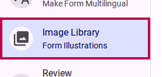

# How to add images to the image library

The **Image Library** provides a centralized repository for managing visual assets—such as Easy Read illustrations, organization logos, and explanatory diagrams—used throughout your survey. An image must first be added to the Image Library before it can be assigned to questions.

## Step 1: Navigate to the Image Library

From the Survey Builder drawer, select **Image Library** (located after **Localize**).

<figure>
  
  <figcaption>Click the 'Image Library' button in the builder drawer.</figcaption>
</figure>

## Step 2: Upload your images and media

Click **Upload Images ...** to select media from your device.

<figure>
  
  <figcaption>Click the 'Upload Images' button to add files from your computer.</figcaption>
</figure>

### Image Format and Sizing Best Practices

To ensure an optimal respondent experience, follow these guidelines when preparing images:

- **Recommended File Size:** While the platform accepts files up to **5 MB**, we strongly recommend keeping Easy Read images to **400 KB or less**. Keeping files lightweight ensures fast loading times for respondents on mobile devices and slower cellular networks.
- **Aspect Ratio & Consistency:** Square images (**1:1 ratio**) work best alongside question labels and Easy Read cards. Above all, maintain a consistent aspect ratio across all questions in your survey to prevent distracting layout shifts.
- **Format Choices:**
  - **PNG:** Ideal for illustrations, icons, and logos requiring sharp edges or transparent backgrounds.
  - **JPEG/JPG:** Best for photographs and real-world images with complex gradients.
  - **SVG & WebP:** Supported for modern, scalable vectors and high-efficiency compressed web images.
- **Resizing Images Before Upload:** Use free image editing tools (such as [Squoosh](https://squoosh.app/) or [Adobe Express](https://new.express.adobe.com/)) to crop images to a square ratio and scale dimensions (e.g. 500×500 px to 600×600 px) before uploading.

::: tip Media Upload Limits
The upload component enforces a hard limit of **5 MB** (`5,000,000` bytes) per file and accepts standard web image and video formats (`PNG`, `JPG`, `SVG`, `WebP`, `GIF`, `MP4`, `WebM`).
:::

## Step 3: Manage your uploaded images

Uploaded images appear in the media gallery. You can click an image to preview it in high resolution, download it back to your computer, or delete it from the library.

## Step 4: Use images in your survey questions

Once uploaded to the library, you can use your images in two primary ways:

### 1. Easy Read Illustrations

1. Navigate to **Build → Compose**.
2. Switch on **Easy Read Mode** in the bottom toolbar.
3. Select any question or section, click **Add Media for Easyread Mode**, and pick the image from your uploaded library.

### 2. Embedded in Question Content & Text Pages
In any question description or text block, use the rich text editor's image insertion tool or standard Markdown syntax:

```md

```

## Related Content

- [Image Library Reference](../reference/build/image-library.md) — Technical specifications and limits
- [Using Easy Read How-to Guide](./use-easy-read.md) — Attaching illustrations to Easy Read questions
- [Markdown Web Components Reference](../reference/content/markdown/available-web-components.md) — Formatting and embedding media
