# How to Analyze Respondent Behavior and Data Quality

::: info
Behavioral Analytics uses client-side paradata (interaction timing, answer revisions, paste bursts, and tab focus) to assess data quality and survey UX friction. Researchers can identify confusing questions, detect low-effort submissions, and audit or exclude problematic responses without compromising privacy.
:::

<figure>
  
  <figcaption>The Behavioral Analytics dashboard provides holistic visibility into respondent effort, friction, and submission integrity.</figcaption>
</figure>

## Before you begin: enable behavioral tracking

The Behavior tab only has data for surveys that enabled tracking **before** respondents took them. Turn it on once per survey:

1. Open the survey and switch on **Advanced Mode**.
2. Open **Share → Behavioral Tracking**.
3. Turn on **Activate Behavioral Tracking**.
4. To analyze abandonment as well as completed sessions, turn on **Monitor Drop Off**. This also turns tracking on; turning tracking off turns drop-off monitoring off.
5. Publish the survey.

Tracking applies to sessions that start after it is enabled. If the Behavior tab is empty, check this setting first — and note that behavioral tracking is available on some plans only. See [Behavioral Tracking Reference](../reference/share/behavioral-tracking.md) for what is recorded and the plan limitation.

## 1. Opening the Behavioral Analytics View

To access behavioral analytics:

1. Open your survey in the management console and click the **Analyze** tab in the main navigation.
2. In the secondary sub-navigation, click **Behavior**.
3. The dashboard loads behavioral paradata gathered from respondents during their survey sessions.

<figure>
  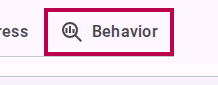
  <figcaption>Click the <strong>Behavior</strong> tab within the survey Analyze navigation bar.</figcaption>
</figure>

::: tip Privacy and Ethical Tracking
Behavioral analytics is non-invasive: the platform does not log keystrokes, record screen video, or capture biometric data. It measures event timings (active vs. idle duration, tab focus changes, choice revisions, and paste events) to evaluate aggregate survey health and question quality while respecting respondent privacy.
:::

## 2. Reading the Behavioral KPI Summary Strip

The top KPI strip provides a high-level summary of survey engagement and data integrity:

<figure>
  
  <figcaption>The KPI strip summarizes session duration, cognitive attention, data quality, and attrition at a glance.</figcaption>
</figure>

- **Median active time**: The typical time respondents spend actively interacting with questions (excluding idle time when the browser is inactive).
- **Mean focus ratio**: The average share of session time respondents were actively focused on the survey tab.
- **High confidence (≥ 70)**: The percentage of scored responses whose Confidence Index is 70 or higher.
- **Drop-off rate**: The percentage of started sessions that were discontinued before completion.
- **Paste / burst rate**: The proportion of tracked responses where long text answers were pasted or entered in single high-velocity bursts.

Hover, focus, or tap the info icon in the corner of each tile to read what the metric measures.

<figure>
  
  <figcaption>The dataset summary indicates total submissions and how many records match the active filters.</figcaption>
</figure>

## 3. Assessing Data Quality: Confidence Index and Quality Signals

The dashboard evaluates submission authenticity through two interactive visual charts:

### Confidence Index Distribution

The **Confidence Index** card displays a score histogram (from 0 to 100) classifying responses based on behavioral engagement:

<figure>
  
  <figcaption>The Confidence Index distribution classifies responses from high-confidence human engagement to potential speeders or bots.</figcaption>
</figure>

- **High Confidence (≥ 70):** Indicates steady reading dwell times, high focus ratios, and deliberate interaction.
- **Low Confidence (< 50):** Highlights responses exhibiting rapid click-through speeding, high idle gaps, or paste bursts.

::: info Rubric and Theory
For the exact mathematical penalties and heuristic scoring formulas, see [Confidence Index Scoring Rubric](../reference/analyze/behavior.md#confidence-index-scoring-rubric). For the scientific foundation and satisficing research, see [Understanding Respondent Behavior and Data Quality](../explanation/confidence-index.md).
:::

### Quality Signals Breakdown

The **Quality Signals** chart categorizes responses into behavioral indicator flags:

- **Attentive:** Complete sessions meeting human reading dwell thresholds.
- **Revised choices:** Respondents who altered their initial choice selection, indicating deliberation.
- **Paste / burst:** Instantaneous text entry flagging copy-pasting or automated script injection.
- **Too fast:** Submissions completed faster than human reading limits allow (speeders).
- **Zero edits:** Direct single-pass submissions without revisions.
- **Dropped off:** Abandoned partial sessions.

<figure>
  
  <figcaption>Quality signal flags categorize specific behavioral indicators across all completed and partial submissions.</figcaption>
</figure>

Clicking any score bucket or signal bar immediately filters the entire dashboard to that respondent cohort.

## 4. Diagnosing Drop-Off Points

When respondents abandon a survey, identifying the exact exit location is critical for UX improvement. Use the segmented toggle above the drop-off card to switch between analysis levels:

### Drop-Off by Page

Identifies the overall survey section or page where abandonment occurred:

<figure>
  
  <figcaption>Page-level drop-off distribution highlights which survey stage experiences respondent attrition.</figcaption>
</figure>

### Drop-Off by Question

Pinpoints the exact question where respondents halted their participation:

<figure>
  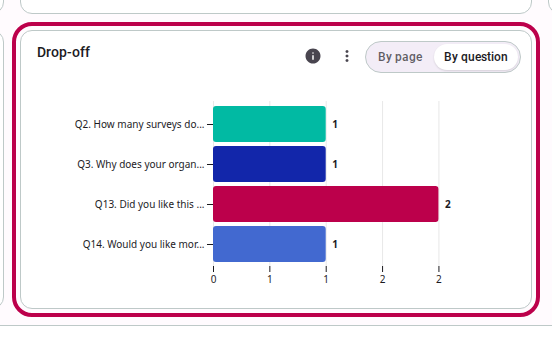
  <figcaption>Question-level drop-off isolates the exact question where respondents discontinued their session.</figcaption>
</figure>

::: tip Remediation Strategy
If a specific question exhibits a drop-off spike, consider whether it asks for sensitive information, contains confusing instructions, or is excessively long.
:::

## 5. Per-Question Attention and Cognitive Friction

The **Per-Question Attention & Friction** card analyzes response latency across every question to detect cognitive stumbling blocks:

### Median Duration Mode

Displays the median dwell time per question against the overall survey median:

- Questions with dwell times at least twice the survey median are automatically flagged as **Hesitation Hotspots**.
- Hotspots indicate questions requiring disproportionate cognitive effort, complex phrasing, or confusing layout.

<figure>
  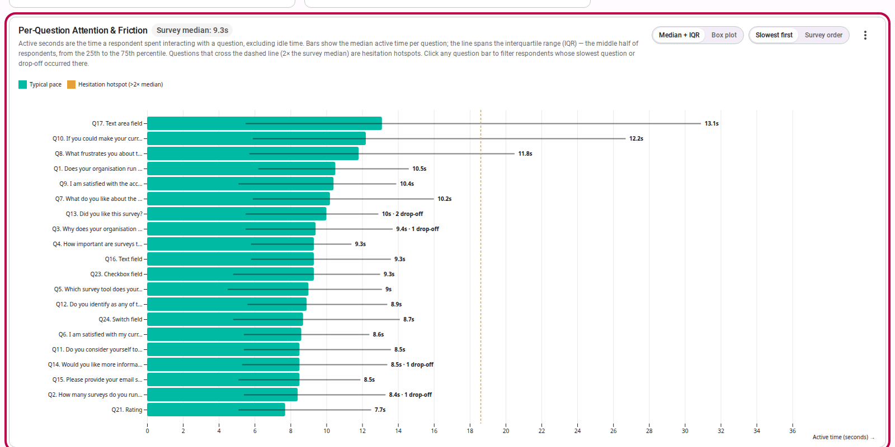
  <figcaption>The median friction chart flags hesitation hotspots requiring disproportionate cognitive effort.</figcaption>
</figure>

### Boxplot Mode

Use the **Median + IQR** / **Box plot** toggle in the card header and select **Box plot** to visualize dispersion:

- Displays the median, the interquartile range (IQR, from the first quartile to the third quartile), and minimum/maximum whiskers.
- Reveals answer latency spread and distribution skewness, helping distinguish questions that trouble all respondents from questions that only confuse a subset.
- Dots beyond the whiskers are outliers.

<figure>
  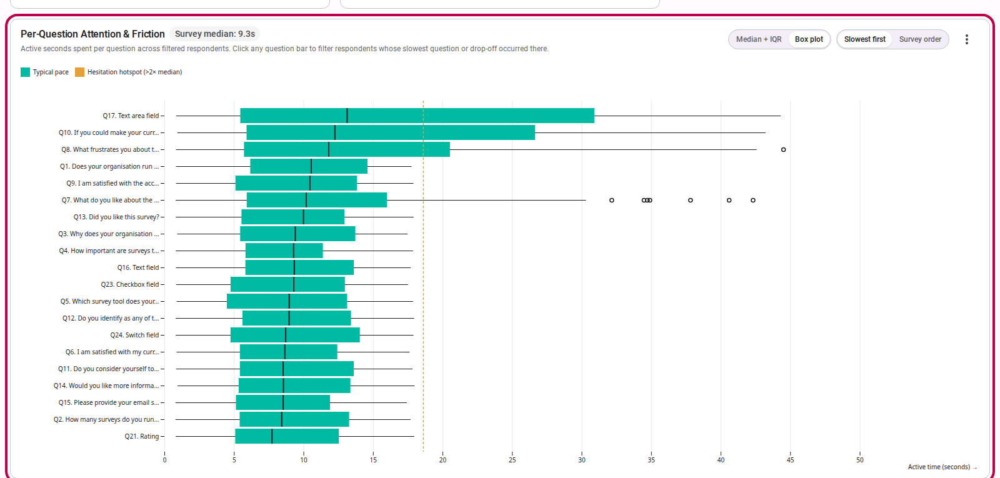
  <figcaption>Box plot mode displays response time dispersion, interquartile ranges (IQR), and outliers per question.</figcaption>
</figure>

### Chart Options and Export

The card header also holds the sort toggle. You can:

- Switch between **Median + IQR** and **Box plot** representations.
- Switch sort order between **Slowest first** (prioritizing friction) and **Survey order** (following question order).
- Hover or focus a toggle to read a tooltip explaining what its representation shows.
- Export the friction visualization as high-resolution **PNG** or **SVG** from the card menu (three dots).

<figure>
  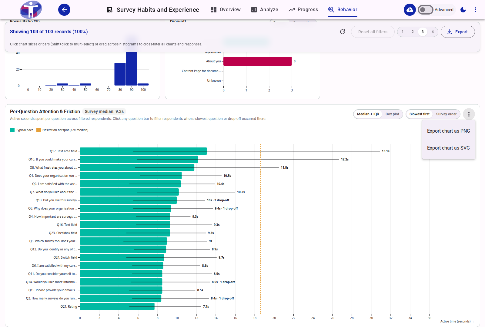
  <figcaption>The card menu exports the friction chart; the representation and sort toggles sit in the card header.</figcaption>
</figure>

## 6. Interactive Behavioral Cross-Filtering

Every behavioral chart mark serves as a dynamic cross-filter. Clicking any element filters the entire behavioral view to that cohort:

1. Click any quality signal bar (e.g. `Paste / burst` or `Too fast`) or a Confidence Index score bucket.
2. The active filter chip appears in the summary bar.

   <figure>
     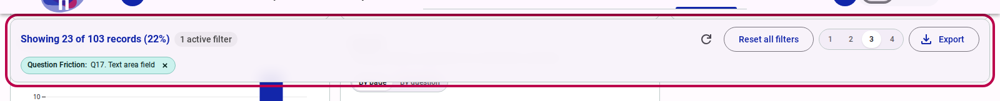
     <figcaption>Active behavioral filter chips isolate subsets (e.g. low-confidence or high-friction respondents).</figcaption>
   </figure>

3. The entire KPI strip and respondent log immediately recalculate to reflect only that cohort:

   <figure>
     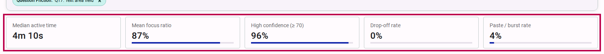
     <figcaption>All KPI metrics update instantly to reflect the characteristics of the filtered cohort.</figcaption>
   </figure>

4. To reset filters, click the **×** on the filter chip or click **Reset all filters** in the toolbar.

## 7. Auditing Responses in the Behavioral Respondent Log

The tabular **Behavioral Respondent Log** below the charts provides an auditable row-by-row breakdown of each session:

<figure>
  
  <figcaption>The Respondent Log provides an auditable breakdown of timing, edits, and quality signals per response.</figcaption>
</figure>

Columns include:

- **Checkbox**: Selection control for bulk exclusion.
- **Submitted**: Submission date and time.
- **Status**: Completed (`Submitted`) or partial (`Drop-off`).
- **Confidence**: Color-coded Confidence score badge (green for scores of 70 or more, amber for 40 to 69, red below 40).
- **Quality Signals**: Active flags assigned to the respondent.
- **Active Time & Idle Time**: Clean separation of active interaction versus idle wait time.
- **Focus %**: Proportion of session time spent inside the survey tab.
- **Choice edits & Paste bursts**: Raw event counts.
- **Slowest question**: The specific question where this respondent spent the most time.

You can sort by any column header or use the column filter inputs to isolate specific patterns (for example a confidence score below 50, or an active time below 10 seconds).

## 8. Inspecting Individual Respondent Timelines

To analyze a specific respondent's trajectory through the survey:

1. Click any row in the Respondent Log to open the **Respondent Inspector** dialog.
2. The inspector displays:
   - Overall session metrics (active time, idle time, focus %, speed penalties, and interaction scores).
   - Question-by-question horizontal bar timeline displaying dwell time per question.
   - Distinct highlight for the respondent's slowest question and drop-off point.

<figure>
  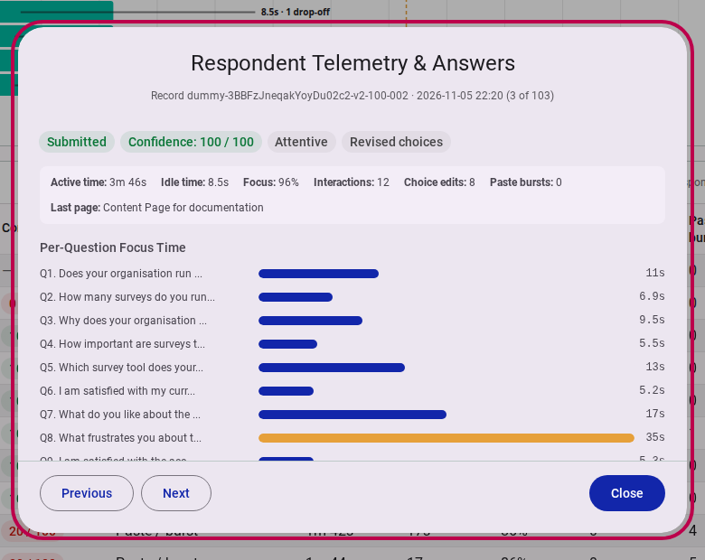
  <figcaption>The respondent inspector details question-level attention and identifies individual slowest questions.</figcaption>
</figure>

## 9. Excluding and Restoring Low-Quality Responses

When suspicious, automated, or invalid responses are identified, researchers can exclude them from the analytical dataset while preserving complete audit compliance:

### Excluding Responses

1. In the Behavioral Respondent Log, select the checkboxes next to the responses you want to remove (this requires edit rights on the survey). The header checkbox selects every row in the current filter.
2. The table header shows **N selected**; click **Remove from dataset…**:

   <figure>
     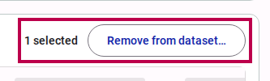
     <figcaption>Selected rows are counted above the log, next to the <strong>Remove from dataset…</strong> action.</figcaption>
   </figure>

3. In the exclusion dialog, select an auditable **Reason**:
   - **Test data**: pre-launch checks, internal trials, and QA submissions.
   - **Likely bot**: automated submissions flagged by instantaneous text entry or impossible completion speeds.
   - **Duplicate**: multiple entries from the same respondent or device.
   - **Other**: any other reason; a **Note** is required and explains what it was.
4. Add a **Note** when needed and click **Remove**.

   <figure>
     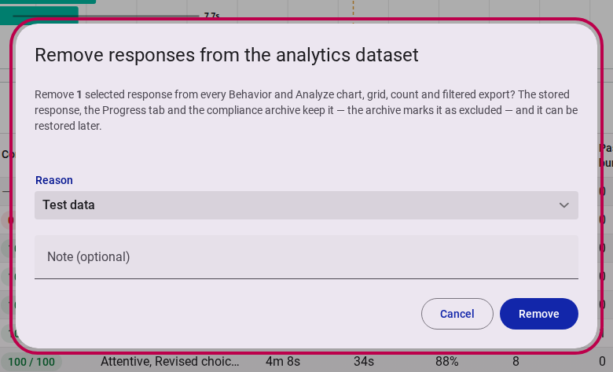
     <figcaption>The removal dialog records a reason and, for <strong>Other</strong>, a required explanatory note.</figcaption>
   </figure>

Excluded responses are immediately omitted from all Analyze charts, behavioral KPIs, and filtered browser exports. The same removal tool is available on the Analyze tab: turn on **Advanced** and use the response grid.

::: info Archival and Audit Preservation
Exclusion never permanently deletes survey data. The original submission remains safely stored in the response database, the raw Progress tab, and the compliance archive.
:::

### Reviewing and Restoring Excluded Responses

1. When excluded responses exist, an **Excluded (N)** button appears in the toolbar showing the count.
2. Click the button to open the list of excluded records. Each entry shows the exclusion reason, note, submission date, and the operator and timestamp of the exclusion.
3. Click **Restore** next to any record to reinstate it into the analytical dataset.

## 10. Advanced Behavioral Statistics

Toggle on **Advanced** in the top toolbar to display a live statistical summary strip below each behavioral card:

- **Numeric Metrics (Confidence Index):** Displays **n**, **Missing**, **Mean**, **SD**, **Median**, **IQR**, and **Range**.
- **Categorical Metrics (Quality Signals):** Displays **n**, **Missing**, **Top** signal with percentage share, and total **Categories**.

<figure>
  
  <figcaption>Advanced mode adds mean, standard deviation, median, IQR, and range to the Confidence Index card.</figcaption>
</figure>

<figure>
  
  <figcaption>Quality Signals gains a top-signal share and category count below its chart.</figcaption>
</figure>

See [Behavioral Analytics Reference](../reference/analyze/behavior.md#statistical-indicators) for complete metric specifications and formulas.

## 11. Exporting Behavioral Datasets

To analyze timing paradata or train statistical models outside the platform:

1. Click the **Export** button in the behavioral toolbar.
2. Tick **I understand my responsibilities** to acknowledge the data privacy notice.
3. Select **Download from this browser** to download the behavioral dataset matching your active filters.

<figure>
  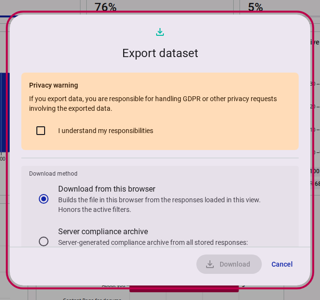
  <figcaption>The Behavior tab uses the shared export dialog; browser downloads honor the active behavioral filters.</figcaption>
</figure>

The browser download generates a row-by-row dataset with all Behavioral Respondent Log indicators and question-level active durations.

::: tip Detailed Export Options
For complete instructions on configuring metadata columns, raw codes vs. humanized labels, multi-value separators, or downloading the full server compliance archive, see [How to Export Survey Data](./exporting-survey-data.md#exporting-behavioral-paradata).
:::

---

## Related Content

- [How to Analyze Survey Responses](./survey-analytics.md): Explore question distributions, cross-filter demographic cohorts, and customize chart views.
- [How to Export Survey Data](./exporting-survey-data.md): Export behavioral paradata or the full server compliance archive.
- [Behavioral Analytics Reference](../reference/analyze/behavior.md): Mathematical formulas, scoring algorithms, quality signal predicates, and exclusion taxonomy.
- [Survey Analytics Workbench Reference](../reference/analyze/survey.md): Specifications for UI controls, card parameters, and statistical formulas.
- [Understanding Respondent Behavior and Data Quality](../explanation/confidence-index.md): Conceptual background on satisficing theory, paradata history, cognitive latency, and survey methodology literature.
