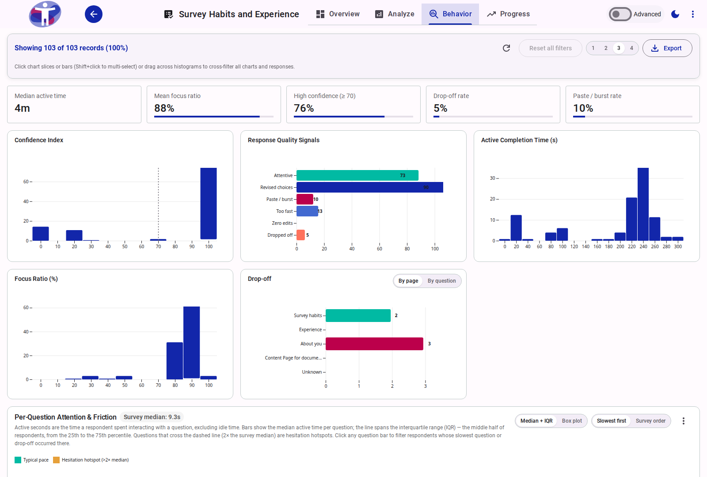
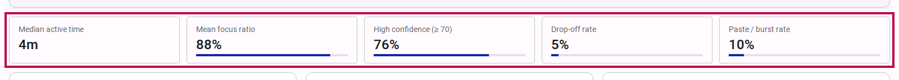
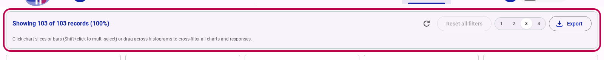
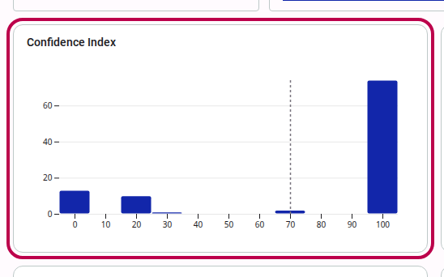
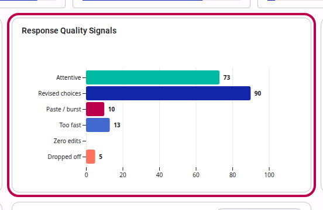
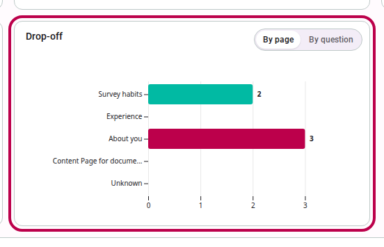
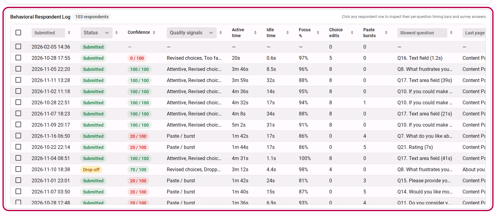
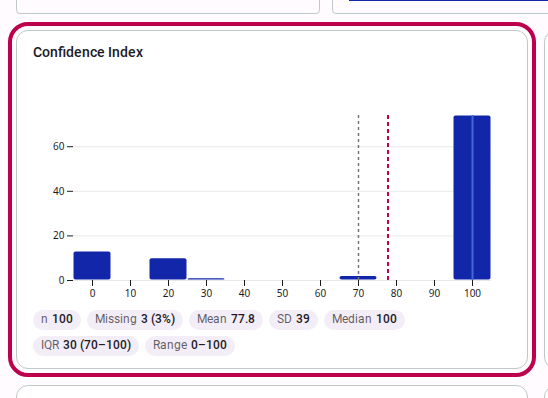
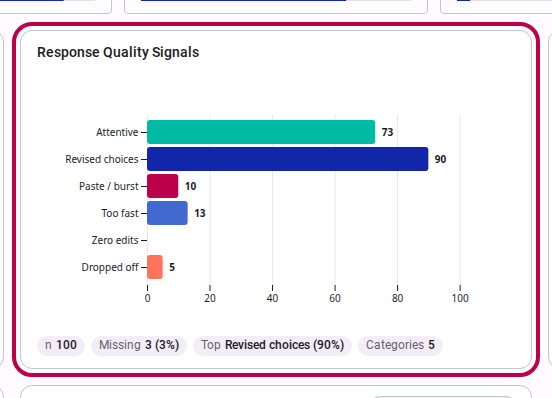

# How to Analyze Respondent Behavior and Data Quality

::: info
Behavioral Analytics uses client-side paradata (interaction timing, answer revisions, paste bursts, and tab focus) to assess data quality and survey UX friction. Researchers can identify confusing questions, detect low-effort submissions, and audit or exclude problematic responses without compromising privacy.
:::

<figure>
  
  <figcaption>The Behavioral Analytics dashboard provides holistic visibility into respondent effort, friction, and submission integrity.</figcaption>
</figure>

## 1. Opening the Behavioral Analytics View

To access behavioral analytics:

1. Open your survey in the management console and click the **Analyze** tab in the main navigation.
2. In the secondary sub-navigation, click **Behavior**.
3. The dashboard loads behavioral paradata gathered from respondents during their survey sessions.

<figure>
  
  <figcaption>Click the <strong>Behavior</strong> tab within the survey Analyze navigation bar.</figcaption>
</figure>

::: tip Privacy and Ethical Tracking
Behavioral analytics is non-invasive: the platform does not log keystrokes, record screen video, or capture biometric data. It measures event timings (active vs. idle duration, tab focus changes, choice revisions, and paste events) to evaluate aggregate survey health and question quality while respecting respondent privacy.
:::

## 2. Reading the Behavioral KPI Summary Strip

The top KPI strip provides a high-level summary of survey engagement and data integrity:

<figure>
  
  <figcaption>The KPI strip summarizes session duration, cognitive attention, data quality, and attrition at a glance.</figcaption>
</figure>

- **Tracked Respondents**: The count of responses with recorded behavioral paradata compared to total submissions.
- **Median Active Time**: The typical time respondents spend actively interacting with questions (excluding idle time when the browser is inactive).
- **Mean Focus %**: The average ratio of active in-tab time to total session duration.
- **High Confidence**: The percentage of responses achieving a Confidence Index score of 70 or higher without dropping off.
- **Drop-off Rate**: The percentage of started sessions that were discontinued before completion.
- **Paste / Burst Rate**: The proportion of responses where long text answers were pasted or entered in single high-velocity bursts.

<figure>
  
  <figcaption>The dataset summary indicates total submissions and the number of behaviorally tracked records.</figcaption>
</figure>

## 3. Assessing Data Quality: Confidence Index and Quality Signals

The dashboard evaluates submission authenticity through two complementary visual tools:

### Confidence Index Distribution

The **Confidence Index** assigns each submission a score from 0 to 100 based on behavioral heuristics:

- **100**: Represents high-confidence human engagement characterized by steady reading times, focus, and deliberate interaction.
- **Scores below 50**: Warrant closer inspection for automated bot patterns, rapid click-through speeding, or disengaged completion.

<figure>
  
  <figcaption>The Confidence Index distribution classifies responses from high-confidence human engagement to potential speeders or bots.</figcaption>
</figure>

### Quality Signals Breakdown

The **Quality Signals** chart categorizes responses into discrete behavioral flags:

- **Attentive**: High-confidence completed submissions with healthy reading and dwell times.
- **Revised choices**: Respondents who changed their mind on choice questions, providing a strong signal of genuine human deliberation.
- **Paste / burst**: Text input entered instantaneously rather than typed incrementally, flagging copy-paste operations or script injection.
- **Too fast**: Sessions completed significantly faster than human reading speed allows (speeders).
- **Zero edits**: Submissions where answers were never adjusted or revisited during the session.
- **Dropped off**: Incomplete sessions saved after respondent inactivity.

<figure>
  
  <figcaption>Quality signal flags categorize specific behavioral indicators across all completed and partial submissions.</figcaption>
</figure>

## 4. Diagnosing Drop-Off Points

When respondents abandon a survey, identifying the exact exit location is critical for UX improvement. Use the segmented toggle above the drop-off card to switch between analysis levels:

### Drop-Off by Page

Identifies the overall survey section or page where abandonment occurred:

<figure>
  
  <figcaption>Page-level drop-off distribution highlights which survey stage experiences respondent attrition.</figcaption>
</figure>

### Drop-Off by Question

Pinpoints the exact question where respondents halted their participation:

<figure>
  
  <figcaption>Question-level drop-off isolates the exact question where respondents discontinued their session.</figcaption>
</figure>

::: tip Remediation Strategy
If a specific question exhibits a drop-off spike, consider whether it asks for sensitive information, contains confusing instructions, or suffers from excessive length.
:::

## 5. Per-Question Attention and Cognitive Friction

The **Per-Question Attention & Friction** card analyzes response latency across every question to detect cognitive stumbling blocks:

### Median Duration Mode

Displays the median dwell time per question against the overall survey median:

- Questions with dwell times at least twice the survey median are automatically flagged as **Hesitation Hotspots**.
- Hotspots indicate questions requiring disproportionate cognitive effort, complex phrasing, or confusing layout.

<figure>
  
  <figcaption>The median friction chart flags hesitation hotspots requiring disproportionate cognitive effort.</figcaption>
</figure>

### Boxplot Mode

Click the card options menu (three dots) and select **Boxplot mode** to visualize dispersion:

- Displays the median, the interquartile range (IQR, from the first quartile to the third quartile), and minimum/maximum whiskers.
- Reveals answer latency spread and distribution skewness, helping distinguish questions that trouble all respondents from questions that only confuse a subset.

<figure>
  
  <figcaption>Boxplot mode displays response time dispersion, interquartile ranges (IQR), and skewness per question.</figcaption>
</figure>

### Chart Options and Export

Using the card menu, you can:

- Toggle between **Median duration** and **Boxplot** representations.
- Switch sort order between **Slowest questions first** (prioritizing friction) and **Survey sequence** (following question order).
- Export the friction visualization directly as high-resolution **PNG** or **SVG**.

<figure>
  
  <figcaption>Toggle display modes (Median vs Boxplot), sort order, or export high-resolution chart images.</figcaption>
</figure>

## 6. Interactive Behavioral Cross-Filtering

Every behavioral chart mark serves as a dynamic cross-filter. Clicking any element filters the entire behavioral view to that cohort:

1. Click any quality signal bar (e.g. `Paste / burst` or `Too fast`) or a Confidence Index score bucket.
2. The active filter chip appears in the summary bar.

<figure>
  
  <figcaption>Active behavioral filter chips isolate subsets (e.g. low-confidence or high-friction respondents).</figcaption>
</figure>

1. The entire KPI strip and respondent log immediately recalculate to reflect only that cohort:

<figure>
  
  <figcaption>All KPI metrics update instantly to reflect the characteristics of the filtered cohort.</figcaption>
</figure>

1. To reset filters, click the **×** on the filter chip or click **Reset all filters** in the toolbar.

## 7. Auditing Responses in the Behavioral Respondent Log

The tabular **Behavioral Respondent Log** below the charts provides an auditable row-by-row breakdown of each session:

<figure>
  
  <figcaption>The Respondent Log provides an auditable breakdown of timing, edits, and quality signals per response.</figcaption>
</figure>

Columns include:

- **Checkbox**: Selection control for bulk exclusion.
- **Submitted**: Submission date and time.
- **Status**: Completed (`Submitted`) or partial (`Drop-off`).
- **Confidence**: Color-coded Confidence score badge (green for scores of 70 or more, amber for 40 to 69, red below 40).
- **Quality Signals**: Active flags assigned to the respondent.
- **Active Time & Idle Time**: Clean separation of active interaction versus idle wait time.
- **Focus %**: Proportion of session time spent inside the survey tab.
- **Choice edits & Paste bursts**: Raw event counts.
- **Slowest question**: The specific question where this respondent spent the most time.

You can sort by any column header or use the column filter inputs to isolate specific patterns (for example a confidence score below 50, or an active time below 10 seconds).

## 8. Inspecting Individual Respondent Timelines

To analyze a specific respondent's trajectory through the survey:

1. Click any row in the Respondent Log to open the **Respondent Inspector** dialog.
2. The inspector displays:
   - Overall session metrics (active time, idle time, focus %, speed penalties, and interaction scores).
   - Question-by-question horizontal bar timeline displaying dwell time per question.
   - Distinct highlight for the respondent's slowest question and drop-off point.

<figure>
  
  <figcaption>The respondent inspector details question-level attention and identifies individual slowest questions.</figcaption>
</figure>

## 9. Excluding and Restoring Low-Quality Responses

When suspicious, automated, or invalid responses are identified, researchers can exclude them from the analytical dataset while preserving complete audit compliance:

### Excluding Responses

1. In the Behavioral Respondent Log, select the checkboxes next to the responses you want to remove.
2. Click **Remove from dataset…** in the table header.
3. In the exclusion dialog:
   - Select an auditable **Reason** from the dropdown (*Test submission*, *Bot or script*, *Speeder / low effort*, *Duplicate*, *Data quality issue*, or *Inappropriate content*).
   - Add an optional **Note** explaining the decision.
4. Click **Remove**.
5. Excluded responses are immediately omitted from all Analyze charts, behavioral KPIs, and filtered exports.

::: info Archival and Audit Preservation
Exclusion never permanently deletes survey data. The original submission remains safely stored in the response database, the raw Progress tab, and the compliance archive.
:::

### Reviewing and Restoring Excluded Responses

1. When excluded responses exist, an **Excluded responses** button appears in the toolbar showing the count.
2. Click the button to view the list of excluded records along with the exclusion reason, timestamp, and operator username.
3. Click **Restore** next to any record to reinstate it into the analytical dataset.

## 10. Advanced Behavioral Statistics

For formal research reporting, access parametric statistics for behavioral metrics:

1. Hover over the Confidence Index or Quality Signals card and click the statistical information icon.
2. The modal displays parametric distribution indicators:
   - Mean, sample variance, standard deviation, and standard error.
   - Skewness and kurtosis metrics illustrating distribution shape.
   - 95% Confidence Intervals.

<figure>
  
  <figcaption>Statistical analysis of the Confidence Index distribution across all respondents.</figcaption>
</figure>

<figure>
  
  <figcaption>Distribution moments and frequencies for behavioral quality signals.</figcaption>
</figure>

## 11. Exporting Behavioral Datasets

To perform multivariate regression modeling or methodology reporting in external tools:

1. Click the **Export** button in the behavioral toolbar.
2. Select **CSV** or **JSON**.
3. Choose whether to export the full dataset or only the currently filtered cohort.
4. The exported file includes all raw survey answers enriched with behavioral paradata columns (`activeTimeSec`, `idleTimeSec`, `focusRatio`, `confidenceScore`, `qualityFlags`, and per-question dwell times).

<figure>
  
  <figcaption>Export enriched paradata and behavioral metrics alongside survey responses.</figcaption>
</figure>

---

## Related Content

- [How to Analyze Survey Responses](./survey-analytics.md): Explore question distributions, cross-filter demographic cohorts, and customize chart views.
- [Behavioral Analytics Reference](../reference/analyze/behavior.md): Mathematical formulas, scoring algorithms, quality signal predicates, and exclusion taxonomy.
- [Survey Analytics Workbench Reference](../reference/analyze/survey.md): Specifications for UI controls, card parameters, and statistical formulas.
- [Understanding Respondent Behavior and Data Quality](../explanation/confidence-index.md): Conceptual background on satisficing theory, paradata history, cognitive latency, and survey methodology literature.
