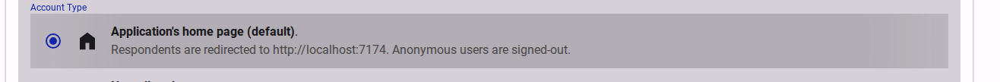
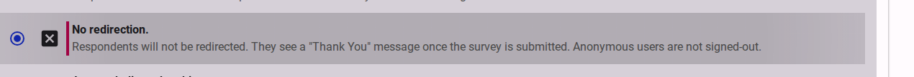
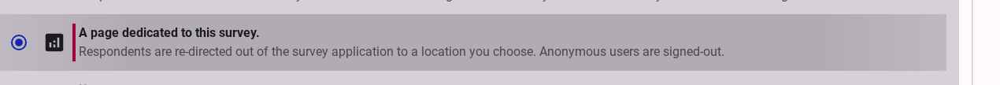

# Configuring Survey Redirection

When respondents submit a completed survey, you can control where they are routed next. Redirection settings are configured under **Share → Redirection**.

## Available Redirection Options

Navigate to **Share → Redirection** in the survey editor to choose your post-submission behavior:

### 1. Application's Home Page (Default)

Redirects respondents to the platform's main landing page (`accessiblesurveys.com`). Anonymous sessions are automatically signed out upon redirection.

<figure>
  
  <figcaption>Click on Application's home page.</figcaption>
</figure>

### 2. No Redirection

Respondents remain on the final survey screen after submission and see a standard "Thank You" message. Anonymous sessions are kept active, allowing respondents to review confirmation details.

<figure>
  
  <figcaption>Select the No redirection option.</figcaption>
</figure>

### 3. A Page Dedicated to the Survey (External URL)

Redirects respondents out of the survey to an external web page you specify (e.g., your organization's website, a debriefing page, or a study resource portal):

1. Select **A page dedicated to this survey**.
2. In the **Redirect Location** field, enter the full destination URL (e.g., `https://example.org/thank-you`).

<figure>
  
  <figcaption>Select A page dedicated to this survey and provide an external URL.</figcaption>
</figure>

### 4. User Space (Upcoming)

*Note: User Space is currently disabled.* When released, this option will direct registered respondents to a personalized dashboard to track participation across surveys.

## Configuring Redirect Timeout

When redirecting to the **Application's home page** or an **External URL**, you can adjust the **Redirect Timeout**:

- **Default:** `8` seconds
- Enter the desired delay in seconds. This ensures respondents have sufficient time to read the completion confirmation message before the browser navigates to the destination URL.

## Related Content

- [Redirection Reference](../reference/share/redirection/index.md) — Technical details of post-submission routing
- [Publishing a Survey](./publishing-a-survey.md) — Deploying your survey to production
