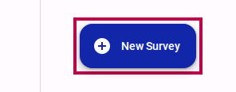
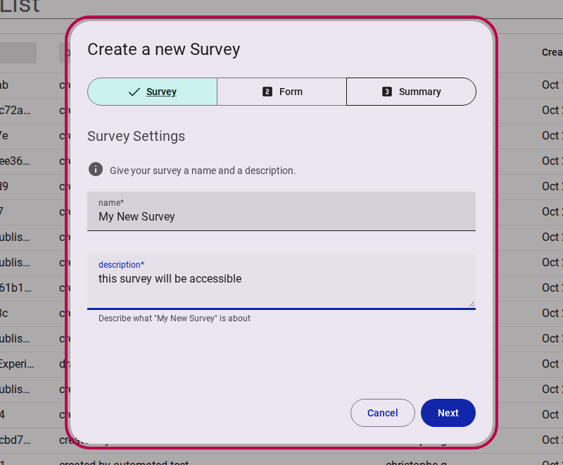
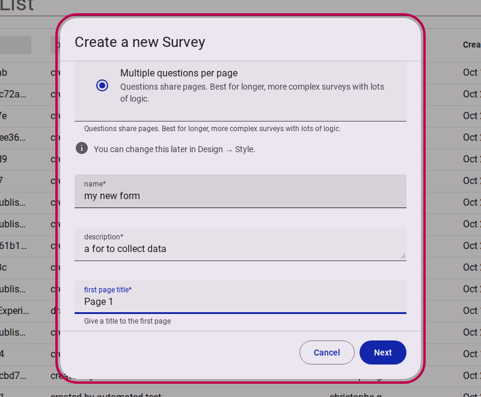
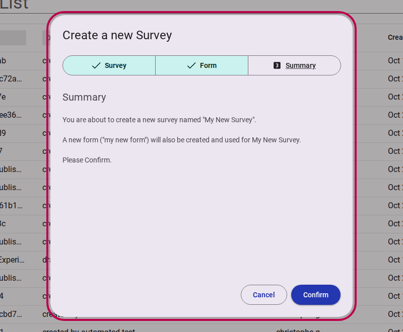

# Creating a new survey

::: info
A step by step guide to creating a new survey
:::

## Step 1: Start the creation process

Select **New Survey** on your survey workspace.

<figure>
  
  <figcaption>Click new survey button</figcaption>
</figure>

## Step 2: Provide survey details

Give your survey a **Name** and a brief **Description**.

<figure>
  
  <figcaption>Fill in name and description</figcaption>
</figure>

::: warning
You will not be able to move to the next step until the survey has a name and description.
:::

Then, select **Next**.

<figure>
  
  <figcaption>Press next button</figcaption>
</figure>

## Step 3: Choose or create a form

Surveys use 'Forms' to collect data. Each survey creates its own form to store question definitions. If you want to reuse existing questions or sections from other surveys, you can embed them later using the [Section Library](./how-to-share-section.md).

Fill in the necessary form details.

<figure>
  
  <figcaption>Fill in form details</figcaption>
</figure>

Then, select **Next**.

## Step 3b: Choose the layout

When creating a new form, you are asked which **layout** your questions use:

- **One question per page** — each question gets its own page. Best for short, simple surveys — and ideal on phones.
- **Multiple questions per page** — questions share pages. Best for longer, more complex surveys with lots of logic.

::: tip
You can change your layout selection later under **Build → Form Behavior → Layout**.
:::

<figure>
  
  <figcaption>Press next button</figcaption>
</figure>

## Step 4: Review and Confirm

On the summary page, you will be asked to confirm your choices and verify that you want to create the new survey with these settings.

<figure>
  
  <figcaption>Review survey details</figcaption>
</figure>

Click **Confirm**.

<figure>
  
  <figcaption>Press confirm button</figcaption>
</figure>

::: tip
Congratulations, you have successfully created a new survey! You will now be redirected to the survey editor.
:::

## Related Content

- [Tutorial: Session 1 — Creating a New Survey](../tutorial/session-1-creating-a-new-survey.md)
- [How to Edit a Survey](./editing-a-survey.md)
- [How to Generate a Survey with AI or a Document](./generate-a-survey.md)
- [How to Test a Form](./testing-a-form.md)
- [Survey Workspace Reference](../reference/workspace.md)
