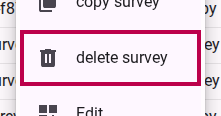
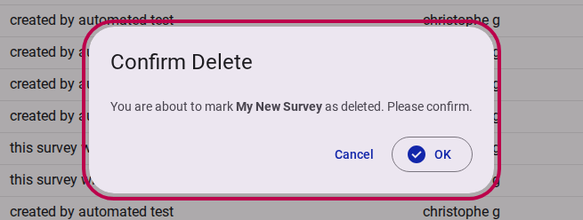

# Deleting a survey

Deleting a survey removes it from active workspace listings and takes all public and test links offline immediately.

::: warning Reversibility & Data Cleanup
Deleting a survey is a **soft delete**: it flags the survey as deleted, unpublishes live links, and archives the workspace record.

If your goal is to wipe collected responses, sessions, and consent records while keeping the survey structure usable for another study, use [Purge collected data](./purging-collected-data.md) instead of deleting the survey.
:::

## Step 1: Open the survey context menu

1. Navigate to the **Survey Workspace** overview.
2. Locate the survey you wish to delete in the list.
3. Right-click on the survey row (or click the three-dots context menu) and select **Delete survey**.

<figure>
  
  <figcaption>Open the survey context menu and select Delete survey.</figcaption>
</figure>

## Step 2: Confirm the deletion

A confirmation dialog appears detailing the impact of deleting the survey:

<figure>
  
  <figcaption>Review the deletion confirmation dialog.</figcaption>
</figure>

1. Confirm the survey name.
2. Click **Confirm Action** to delete the survey.

<figure>
  
  <figcaption>Click Confirm Action to finalize deletion.</figcaption>
</figure>

## Related Content

- [Purge the Data a Survey Collected](./purging-collected-data.md) — Wipe response datasets while keeping the questionnaire
- [Survey Status Reference](../reference/share/status/index.md) — Pausing or closing a survey without deleting it
