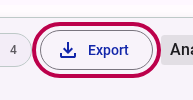
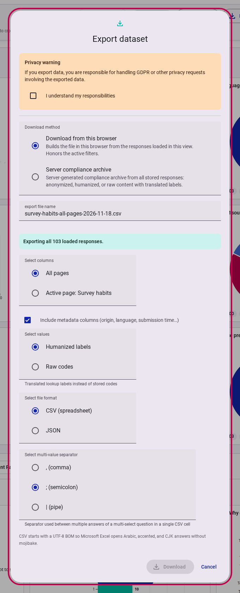
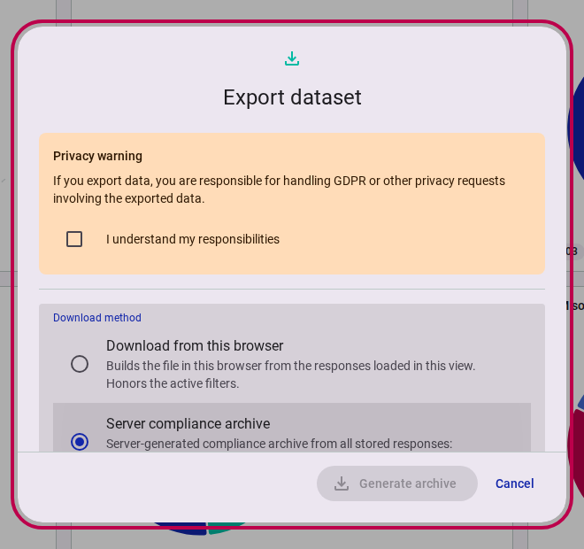
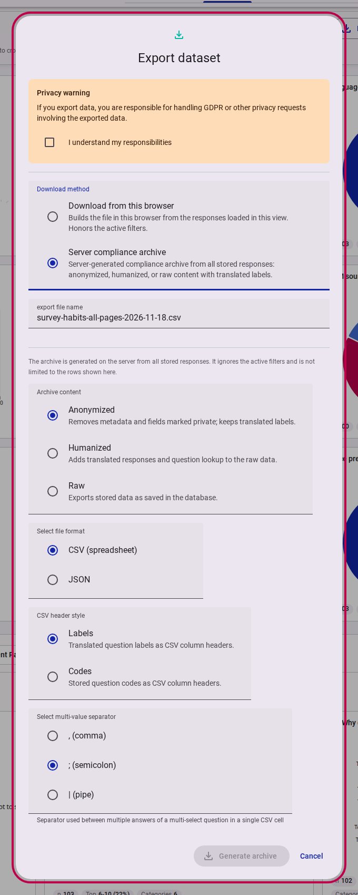
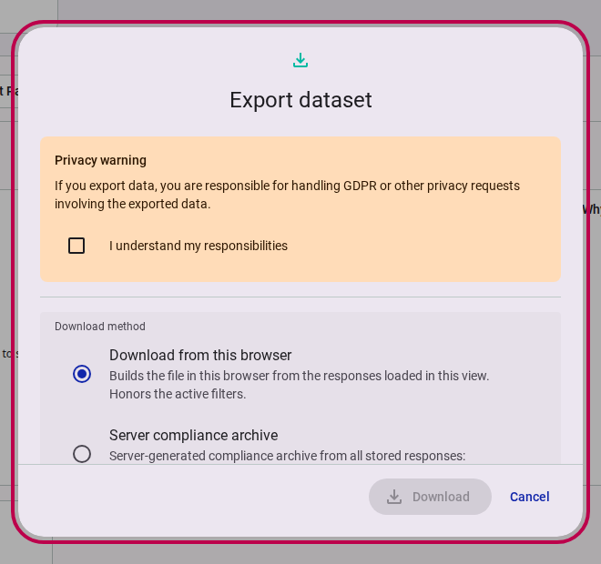

# How to Export Survey Data

::: warning Data Privacy and Compliance
When exporting survey data from the platform, you are responsible for maintaining respondent privacy. Exported datasets must be handled in compliance with relevant data protection regulations such as the [GDPR](https://eur-lex.europa.eu/eli/reg/2016/679/oj) and the [CCPA](https://oag.ca.gov/privacy/ccpa). Never share raw survey files containing identifiable personal information outside authorized teams.
:::

::: info Permissions Required
Exporting survey datasets is a restricted administrative action. You must have Editor, Admin, or Owner permissions on the survey to export data.
:::

## 1. Locating the Export Action

Survey data is exported directly from the **Analyze** workspace:

1. Open your survey and navigate to the **Analyze** tab.
2. In the analytics toolbar, click the **Export** button.

<figure>
  
  <figcaption>Click the <strong>Export</strong> button in the analytics toolbar to open the dataset export dialog.</figcaption>
</figure>

The same **Export** button on the **Behavior** tab downloads the behavioral dataset for the current cohort. The dialog and its options are shared by both tabs.

## 2. Configuring the Export Options

The **Export dataset** dialog opens over the workbench. Its content scrolls inside the dialog, so the two figures below show the top of the dialog and the complete set of options.

<figure>
  
  <figcaption>Read the privacy warning, choose a download method, and name the file.</figcaption>
</figure>

<figure>
  
  <figcaption>All browser export options: columns, metadata, value labels, format, and multi-value separator.</figcaption>
</figure>

1. **Privacy warning**: Read the notice at the top and tick **I understand my responsibilities** before exporting.
2. **Download method**:
   - **Download from this browser**: Builds the file in your browser from the responses currently loaded in the workbench. This method honors the active filters and is limited to the rows shown.
   - **Server compliance archive**: Generates a complete archive on the server from all stored responses. It ignores the active filters and offers anonymized, humanized, or raw content with translated labels. Use it for compliance, privacy requests, or exports that must cover the full dataset.
3. **Export file name**: The default filename follows the pattern `{survey-name}-all-pages-{date}.csv`, or `{survey-name}-{page-name}-{date}.csv` when exporting a single page. The extension follows the selected format; a renamed file without an extension gets one automatically.
4. **Select columns** (browser export only): Choose **All pages** for the whole dataset or **Active page** to export only the questions on the page shown in the workbench. On the Behavior tab the only scope is **All behavioral columns**.
5. **Include metadata columns** (browser export only): Adds record metadata such as origin, language, and submission time. Clear the box to export answers only.
6. **Select values**: Choose **Humanized labels** for readable option text, or **Raw codes** for the stored option codes used in the database. Raw codes also use the stored question identifiers as column headers.
7. **Select file format**:
   - **CSV (spreadsheet)**: Comma-separated tabular data. Opens directly in spreadsheet applications (Microsoft Excel, Google Sheets) and statistical environments (R, SPSS, Stata, Python/pandas). Multiple answers of a multi-select question share one cell, separated by the chosen multi-value separator. CSV files start with a UTF-8 BOM so Excel opens non-Latin answers without mojibake.
   - **JSON**: Hierarchical structured data. Multi-value answers stay arrays and numeric answers stay numbers, which suits automated data pipelines, custom web integrations, and database ingest.
8. **Select multi-value separator** (CSV only): Pick **comma**, **semicolon**, or **pipe** to separate multiple answers inside one cell.
9. Click **Download** to save the browser-generated file.

### Exporting the Server Compliance Archive

Choose **Server compliance archive** as the download method to generate the archive on the server:

<figure>
  
  <figcaption>Selecting the server archive switches the dialog to archive options.</figcaption>
</figure>

<figure>
  
  <figcaption>Choose the archive content, format, CSV header style, and multi-value separator.</figcaption>
</figure>

1. **Archive content**:
   - **Anonymized**: Removes record metadata and fields marked private, keeping translated labels.
   - **Humanized**: Adds translated responses and question lookup to the raw data.
   - **Raw**: Exports data as stored in the database.
2. **Select file format**: **CSV** or **JSON**.
3. **CSV header style** (CSV only): **Labels** uses translated question labels; **Codes** uses stored question codes.
4. **Select multi-value separator** (CSV only): comma, semicolon, or pipe.
5. Click **Generate archive** to start the server export.

::: info
The server archive always covers every stored response and ignores the active filters. It also keeps responses excluded from analytics, marking them with an `excluded` column and their exclusion reason.
:::

## 3. Exporting Filtered Subsets

The browser export is linked to the analytics cross-filtering system:

- **Full batch export**: When no chart filters are applied, the dialog indicates *Exporting all loaded responses* and downloads the entire dataset.
- **Filtered cohort export**: If you have filtered the dataset by clicking chart marks or metadata chips (e.g., respondents from a specific country or who answered a particular question), the dialog automatically scopes the export to that cohort.

<figure>
  
  <figcaption>When cross-filters are active, the export dialog automatically restricts the download to the filtered cohort.</figcaption>
</figure>

The server compliance archive ignores these filters and always covers all stored responses.

## 4. Exporting Behavioral Paradata

To export enriched behavioral paradata (including Confidence Index scores, quality flags, active interaction duration, idle time, focus ratios, and question-level dwell times):

1. Navigate to the **Behavior** tab in the survey Analyze navigation.
2. Apply any desired behavioral filters (e.g. filtering to respondents with high confidence or specific quality signals).
3. Click the **Export** button in the behavioral toolbar.
4. Tick the privacy acknowledgement and choose **Download from this browser**. The exported file lists one row per response with the Behavioral Respondent Log columns plus one **active seconds** column per survey question.
5. Choose **Server compliance archive** instead when you need the compliance archive: it contains survey answers rather than behavioral columns, but covers every stored response.

## 5. Handling Anonymous and Sensitive Data

The platform enforces data protection rules at export time:

- **Private & Anonymous Fields**: Questions configured with the *Anonymous* setting in Advanced Mode have their personal data excluded from exports.
- **Excluded Responses**: Any response excluded from the analytics dataset is omitted from browser exports. Exclusions can be made from the **Behavior** respondent log or from the response grid on the **Analyze** tab in Advanced Mode. The server compliance archive keeps excluded responses and marks them with an `excluded` column and their exclusion reason.

---

## Related Content

- [How to Analyze Survey Responses](./survey-analytics.md): Interactive cross-filtering and cohort analysis.
- [How to Analyze Respondent Behavior and Data Quality](./behavior-analytics.md): Inspecting timing paradata, quality signals, and excluding low-effort submissions.
- [Data Privacy and Security](../explanation/data-privacy-and-security.md): Architectural principles behind respondent anonymization and account separation.
