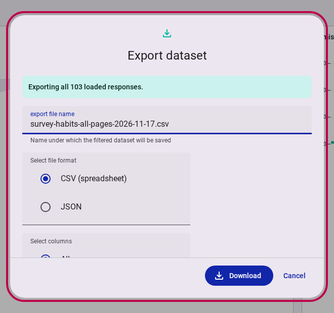

# How to Export Survey Data

::: warning Data Privacy and Compliance
When exporting survey data from the platform, you are responsible for maintaining respondent privacy. Exported datasets must be handled in compliance with relevant data protection regulations such as GDPR and CCPA. Never share raw survey files containing identifiable personal information outside authorized teams.
:::

::: info Permissions Required
Exporting survey datasets is a restricted administrative action. You must have Editor, Admin, or Owner permissions on the survey to export data.
:::

## 1. Locating the Export Action

Survey data is exported directly from the **Analyze** workspace:

1. Open your survey and navigate to the **Analyze** tab.
2. In the top toolbar, click the **Export** button.

<figure>
  
  <figcaption>Click the <strong>Export</strong> button in the analytics toolbar to open the dataset export dialog.</figcaption>
</figure>

## 2. Configuring the Export Options

The **Export dataset** dialog opens over the workbench:

<figure>
  
  <figcaption>Configure the export filename, file format, and column selection.</figcaption>
</figure>

1. **Export file name**: The default filename follows the pattern `{survey-name}-all-pages-{date}.csv`. You can rename the file before downloading.
2. **Select file format**:
   - **CSV (spreadsheet)**: Comma-separated tabular data. Opens directly in spreadsheet applications (Microsoft Excel, Google Sheets) and statistical environments (R, SPSS, Stata, Python/pandas).
   - **JSON**: Hierarchical structured data. Ideal for automated data pipelines, custom web integrations, and database ingest.
3. **Select columns**:
   - **All**: Exports all standard metadata fields, submission timestamps, and decoded question answers.

## 3. Exporting Filtered Subsets

The export engine is linked to the analytics cross-filtering system:

- **Full batch export**: When no chart filters are applied, the dialog indicates *Exporting all loaded responses* and downloads the entire dataset.
- **Filtered cohort export**: If you have filtered the dataset by clicking chart marks or metadata chips (e.g., respondents from a specific country or who answered a particular question), the dialog automatically scopes the export to that cohort.

<figure>
  
  <figcaption>When cross-filters are active, the export dialog automatically restricts the download to the filtered cohort.</figcaption>
</figure>

1. Click **Download** to save the file to your computer.

## 4. Exporting Behavioral Paradata

To export enriched behavioral paradata (including Confidence Index scores, quality flags, active interaction duration, idle time, focus ratios, and question-level dwell times):

1. Navigate to the **Behavior** tab in the survey Analyze navigation.
2. Apply any desired behavioral filters (e.g. filtering to respondents with high confidence or specific quality signals).
3. Click the **Export** button in the behavioral toolbar.
4. The downloaded file contains all survey responses enriched with behavioral paradata columns for statistical regression and data hygiene reporting.

## 5. Handling Anonymous and Sensitive Data

The platform enforces data protection rules at export time:

- **Private & Anonymous Fields**: Questions configured with the *Anonymous* setting in Advanced Mode have their personal data excluded from exports.
- **Excluded Responses**: Any response excluded using the *Remove from dataset* action in the Behavioral Respondent Log is omitted from analytical exports, ensuring clean downstream reporting.

---

## Related Content

- [How to Analyze Survey Responses](./survey-analytics.md): Interactive cross-filtering and cohort analysis.
- [How to Analyze Respondent Behavior and Data Quality](./behavior-analytics.md): Inspecting timing paradata, quality signals, and excluding low-effort submissions.
- [Data Privacy and Security](../explanation/data-privacy-and-security.md): Architectural principles behind respondent anonymization and account separation.
