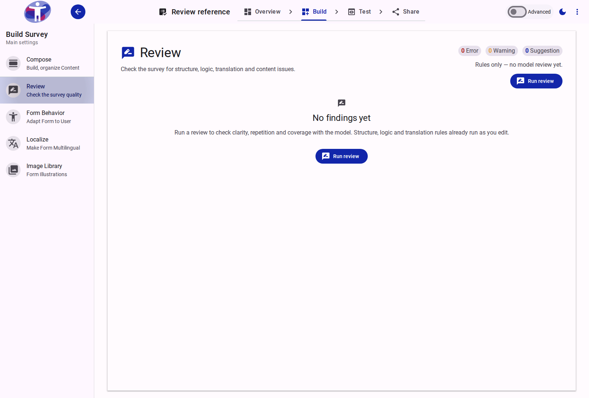
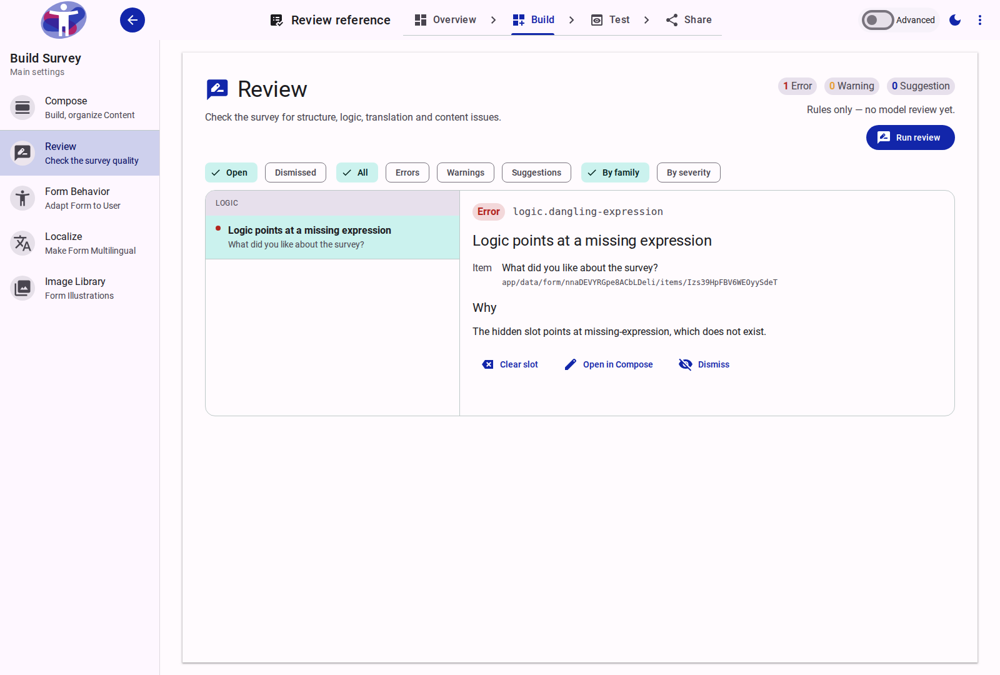

# How to Review a Survey

**Review** collects the quality problems in a form — broken logic, missing translations, accessibility barriers, unclear wording — and, where a fix can be mechanical, offers the action that applies it. Nothing changes until you act.

## Step 1: Open Review

1. Open the survey in **Build**.
2. Select **Review** in the Build drawer.
3. Alternatively, when open findings exist, select the **Review** button in the Compose toolbar to jump straight to them.

The panel shows an empty state until a review has run.

<figure>
  
  <figcaption>The Review panel before a run; <strong>Run review</strong> starts the checks.</figcaption>
</figure>

## Step 2: Run the review

Select **Run review**. One run evaluates both sources:

- **Rule findings** — deterministic checks of structure, logic, translation, accessibility and content. Computed in the browser; no model call.
- **Model findings** — the newest model review, tagged **Model**: clarity, content quality, repetition and coverage.

If review metering is enabled, a run costs **1 AI credit**; the header shows the remaining balance and disables the action at zero. A run moves through running, done and failed, and the header shows its age.

Re-runs are explicit. Applying a mechanical fix refreshes the rule findings without starting a new model run.

## Step 3: Read the findings

Each finding shows its severity (`error`, `warning`, `suggestion`), check id and, for model findings, the **Model** tag. The detail pane adds:

- the item's label;
- **Why** — the evidence;
- a proposed change, when there is one;
- the actions available for that finding.

Use the toolbar to narrow the list:

- **Open** (default), **Dismissed**, **Applied**;
- **All**, **Errors**, **Warnings**, **Suggestions**;
- group **By family** (Structure, Logic, Translation, Accessibility, Content) or **By severity**.

The header counts are not affected by the severity filter.

<figure>
  
  <figcaption>A selected finding with its reason and available actions.</figcaption>
</figure>

## Step 4: Act on findings

| Finding | Action |
| --- | --- |
| Missing translation | **Translate this item**, or **Translate all missing into ⟨language⟩**. |
| Logic points at a missing expression, or has none | **Clear slot**. |
| Expression lists an unused dependency | **Remove dependency**. |
| Shared section is not published | **Activate** the section. |
| A proposed field text (`accessibility.clarity`, `content.quality`) | **Apply**, with **Undo** where available. |
| A proposed new item (`content.*`) | **Insert**; it still passes through the generated-content review queue. |
| Any finding | **Dismiss** to hide it; **Restore** from the Dismissed view. |
| Any finding with a tree row | **Open in Compose** jumps to the item. |

Translation applies have no undo in v1; inserted items are undone by rejecting them in the generated-content queue. Actions are disabled with a reason when the item is frozen, unreadable, no longer has the proposed field, or a new item has no valid parent.

## Step 5: Follow the markers in Compose

In Compose's **Settings Mode**, the review column marks items with open findings:

- the marker uses the highest severity's color;
- a badge shows the number of open findings on that item;
- selecting the marker opens Review filtered to that item;
- the column header filters the tree to items with open findings only.

Dismissed and applied findings do not produce markers.

## Step 6: Re-check after changes

A model run is **stale** when the form changed since it ran: the panel says **Survey changed since this review** and keeps the old findings visible. Run the review again before publishing if you changed content after the last run.

A failed run shows its incident message and **Run again**.

## Review at publish time

The publish flow renders the same panel and folds in the last build report, so build warnings appear beside live findings. Resolve duplicate question codes and missing references before building. See [Publishing a Survey](./publishing-a-survey.md).

## Suggested routine

1. Run Review after a drafting session, before sharing the survey.
2. Fix errors first, then warnings; leave suggestions for a deliberate pass.
3. Dismiss only findings you have decided not to fix, and be able to say why.
4. Re-run after applying fixes; a fix can reveal the next issue.
5. Run once more before publishing, after the final content change.

## Related Content

- [Review Reference](../reference/build/review.md): Every check family, action and marker behavior.
- [How to Use Form Logic](./logic-expression.md): Repairing logic findings.
- [How to Localize a Survey](./localize-survey.md): Completing the translations Review reports.
- [How to Publish and Distribute a Survey](./publishing-a-survey.md): Where the build report joins the review.
- [How to Test a Form](./testing-a-form.md): Trying the form as a respondent.
