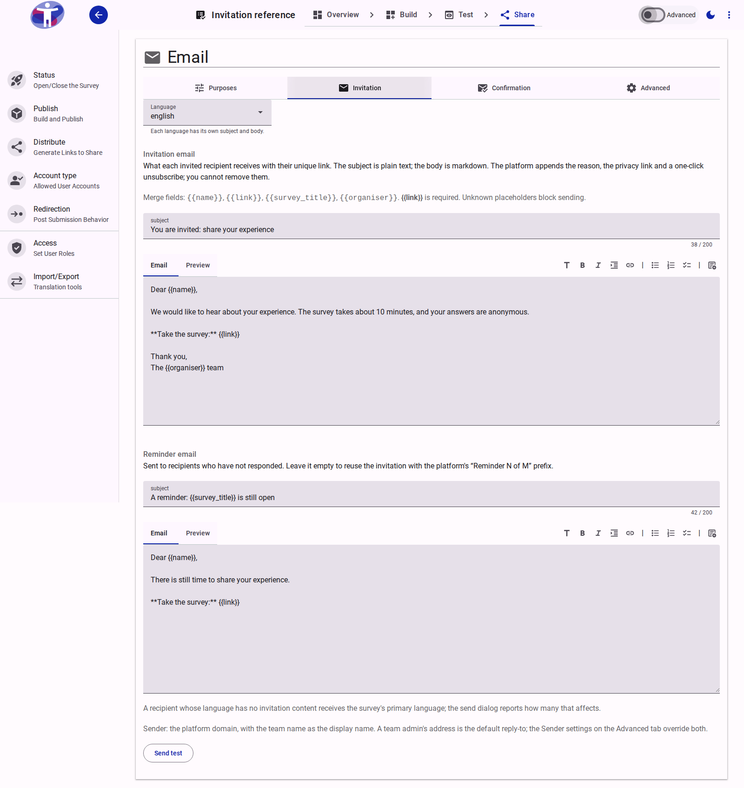
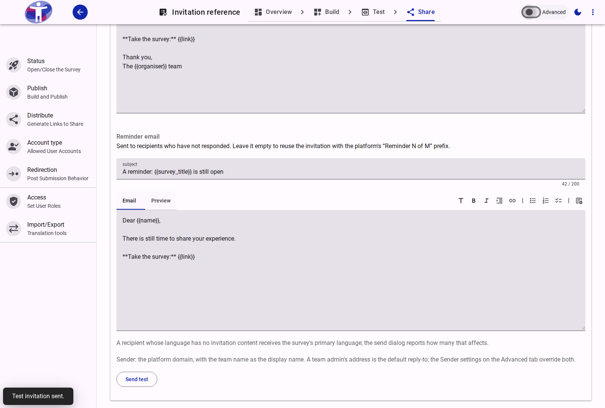

# How to Send Invitations to a Team Audience

Invitations let you distribute a survey to a known list of recipients by email. Each recipient receives a unique link (`/v2/{surveyId}/i/{token}`), allowing you to track delivery, opens, starts, and submissions in the **Progress** tab and send automated or manual reminders — while keeping survey answers completely unlinked from recipient email addresses.

::: info Data Controller Responsibility
Your organization is the data controller of the recipient list; Accessible Surveys sends the invitations on your instruction. Before importing a CSV, you must confirm that your team has a lawful basis to contact those people and their permission to send them the survey. Purchased or scraped lists are not permitted.
:::

---

## Step 1: Add a New Audience to the Team

Team audiences are reusable recipient lists stored in **Team Settings**. A person is stored once per team even if they belong to multiple audiences.

### 1. Create the audience

1. Open the Customer Portal and navigate to **Team Settings → Audiences** (`/customer/{teamId}/team/audiences`).
2. Click **New audience** in the top-right corner.
3. In the **New audience** dialog, enter a **Name** (for example, `Policy Impact Lab panel`) and an optional **Description** (for example, `Panel members who agreed to take part in research`).
4. Click **Create**.

<figure>
  
  <figcaption>Create a named audience in Team Settings → Audiences.</figcaption>
</figure>

### 2. Import recipients from a CSV file

1. Select the newly created audience card.
2. Click **Choose a CSV file** (or drag and drop a `.csv` file onto the upload zone). The file must contain an **email** column and may optionally include **name**, **language**, and **external_id** columns (up to 10,000 rows and 5 MB).
3. In the **Import recipients** dialog, review the parsed preview:
   - **Summary counts:** `Created`, `Updated`, `Unchanged`, `Suppressed`, and `Invalid` rows.
   - **Column mapping:** Verify how each CSV header maps to `Email`, `Name`, `Language`, `External id`, or `Ignore`.
   - **Errors and warnings:** Inspect any invalid rows or download the error report with **Download error CSV**.
4. Tick the confirmation checkbox to warrant that your team has a lawful basis and permission to contact these people.
5. Click **Import**.

<figure>
  
  <figcaption>Review the row counts, verify the column mappings, and accept the warranty before importing.</figcaption>
</figure>

Once the import completes, the audience card updates its recipient count and the **Recipient grid** lists every member with their **Name**, **Email**, **Language**, **Status** (`Active` or `Suppressed`), and row actions.

<figure>
  
  <figcaption>The imported recipients appear in the audience table with header filters for Name, Email, Language, and Status.</figcaption>
</figure>

::: tip Safe Re-imports and Suppression
Invalid rows never block valid rows from being imported, and re-importing the same CSV file is idempotent. If an address has previously unsubscribed, complained, or hard-bounced across your organization, it is added to the audience with a **Suppressed** badge and automatically excluded from every invitation send.
:::

---

## Step 2: Write the Invitation Email

Before you can send an invitation run, configure the email subject and body on the survey's **Email** page.

1. Open your survey in the Survey Editor and go to **Share**.
2. Enable the **Advanced** mode toggle in the top toolbar so the **Email** section appears in the left navigation drawer, then click **Email**.
3. Select the **Invitation** tab.
4. If your survey is multilingual, choose the target language from the **Language** dropdown. Write a translation for each language your audience uses (recipients whose language has no translation automatically fall back to the survey's primary language).
5. Under **Invitation email**, enter:
   - **Subject:** Plain-text subject line (up to 200 characters), for example `You are invited: share your experience`.
   - **Email body:** Markdown message body. Use the **Preview** tab above the editor to inspect the rendered formatting.
6. Include the required `{{link}}` merge field in the body, along with any optional merge fields:
   - `{{link}}` *(required)* — the recipient's unique survey URL (`/v2/{surveyId}/i/{token}`).
   - `{{name}}` — the recipient's name from the audience record.
   - `{{survey_title}}` — the title of the survey.
   - `{{organiser}}` — your team's display name.
7. Under **Reminder email**, optionally write a dedicated **Subject** and **Email body** for scheduled or manual reminders. If you leave the reminder email empty, reminders reuse the invitation email with a `Reminder N of M:` prefix.

<figure>
  
  <figcaption>Compose the invitation email and optional reminder email on the Email page's Invitation tab.</figcaption>
</figure>

::: info Mandatory Footer and Validation
The platform automatically appends the organiser attribution, a link to the privacy policy, and a one-click unsubscribe link to every invitation and reminder. Missing `{{link}}` or using an unknown `{{placeholder}}` blocks sending.
:::

---

## Step 3: Send a Test Email

Before inviting your audience, verify how the email looks in an inbox.

1. At the bottom of the **Invitation** tab on the **Email** page, click **Send test**.
2. The platform sends a rendered preview of the active language's invitation email to the email address of your signed-in account and displays a **Test invitation sent.** notification.

<figure>
  
  <figcaption>Click Send test to receive a preview in your own inbox without creating an invitation record.</figcaption>
</figure>

Sending a test email does not create an invitation run, does not generate a live respondent token, and does not count toward recipient statistics.

---

## Step 4: Send Invitations from Distribute

Once your invitation email is ready, launch the invitation run from the **Distribute** page.

1. In the **Share** navigation drawer, click **Distribute** and scroll to the **Invitations** section.
2. Select your target list from the **Audience** dropdown (for example, `Policy Impact Lab panel`). Click **Refresh counts** at any time to re-evaluate the audience.
3. Choose the **Survey access** mode:
   - **Open:** Both unique invitation links and the public survey link accept responses.
   - **Invitation only:** Only respondents opening a valid invitation link can submit the survey.
4. Under **Reminders**, choose how many automated reminders to send (`No reminders`, `1 reminder`, `2 reminders`, or `3 reminders`) and set the delay in days after the previous send (for example, `3` days for Reminder 1 and `7` days for Reminder 2).
5. Check the **Ready to send** summary panel on the right, which breaks down the audience into:
   - **Invited:** Eligible active recipients who have not yet been invited to this survey.
   - **Suppressed:** Recipients on the organization-wide suppression list (excluded).
   - **Already invited:** Recipients who already received an invitation in an earlier active run of this survey (excluded).
   - **Deselected:** Excluded memberships.
6. Click **Review and send**.
7. In the **Send invitations?** confirmation dialog, review the final recipient count, exclusion summary, and language fallback notice, then click **Send**.

<figure>
  
  <figcaption>Select the audience, access mode, and reminder schedule, then check the Ready to send counts.</figcaption>
</figure>

<figure>
  
  <figcaption>Confirm the invitation run in the Send invitations? dialog.</figcaption>
</figure>

An invitation run freezes its recipient set at creation time: later edits to the team audience do not retroactively add or remove recipients from an existing run.

---

## Step 5: View Progress and Manage Recipients in Analytics

As soon as the run starts sending, the app opens **Analytics → Progress** (`/s/analyze/survey/{surveyId}/progress/progress`).

### 1. Monitor the run funnel and rates

1. At the top of the **Progress** page, select the run card (for example, `Policy Impact Lab panel`) if your survey has multiple invitation waves.
2. Review the **Run detail** metric tiles:
   - **Funnel stages:** `Invited`, `Sent`, `Delivered`, `Link opened`, `Started`, and `Submitted`.
   - **Rates and delivery outcomes:** `Response rate` (`Submitted ÷ Invited`), `Completion rate` (`Submitted ÷ Started`), `Drop-off` (`Started − Submitted`), `Bounced`, `Unsubscribed`, `Complained`, and `Failed`.
3. Use the top toolbar actions to manage the run:
   - **Refresh:** Reloads the latest funnel counts and recipient statuses.
   - **Download status CSV:** Exports the run's delivery and participation statuses with masked email addresses.
   - **Send reminder now:** Checks how many recipients are currently eligible for a manual reminder and prompts for confirmation before sending.
   - **Cancel run:** Immediately deactivates all unopened invitation links and stops any remaining batches or scheduled reminders.
4. Check the **Reminders** card at the bottom of the page for a log of every scheduled and manual reminder pass (`Pass`, `When`, `Who`, `Sent`, and `Failed`).

<figure>
  
  <figcaption>Track the invitation funnel, response and completion rates, and reminder passes in Analytics → Progress.</figcaption>
</figure>

### 2. Inspect per-recipient details and take individual actions

1. Inside the **Run detail** card, click **Load details** to fetch the per-recipient status rows.
2. Filter or sort the recipient table using the column headers:
   - **Name:** Text filter and column sorter.
   - **Email:** Text filter on the masked address (for example, `j***@accessiblesurveys.com` or `c***@preignition.org`). Full addresses are never shown in survey analytics.
   - **Language:** Dropdown filter by recipient language code.
   - **Status:** Dropdown filter (`Invited`, `Sent`, `Opened`, `Started`, `Submitted`, `Unsubscribed`, `Bounced`, `Complained`, `Failed`).
   - **Last activity:** Sortable timestamp of the most recent lifecycle event.
   - **Reminders:** Number of reminders sent to that recipient (and any failed attempts).
3. Use the row **Actions** on any non-terminal invitation:
   - **Remind:** Sends a single manual reminder to that recipient (subject to a 24-hour cooldown, up to 2 manual reminders and 5 total reminders per recipient).
   - **Resend:** Re-sends the invitation email using the existing link.
   - **Reissue link:** Immediately invalidates the previous token, generates a fresh unique link, and emails it to the recipient.

<figure>
  
  <figcaption>Expand Load details to filter recipients by status and trigger individual Remind, Resend, or Reissue link actions.</figcaption>
</figure>

::: warning Privacy and Anonymity Boundary
The **Progress** view tells you **whether** a recipient has opened, started, or submitted the survey, never **which answers** they gave. No invitation ID, token, email address, or audience membership is ever written into response documents or survey data exports.
:::

---

## Related Content

- [Team Audiences Reference](../../customer/reference/team/audiences.md) — Specifications for team audiences, CSV import rules, and recipient management
- [Email Configuration Reference](../reference/share/email/index.md) — Reference for the Invitation tab, merge fields, and respondent email purposes
- [Distribute Your Survey Reference](../reference/share/distribute/index.md) — Reference for the Invitations composer, access modes, and Link Builder
- [Invitation Progress Reference](../reference/analyze/progress.md) — Reference for the Progress funnel counters, statuses, and run actions
- [Data Privacy and Security](../explanation/data-privacy-and-security.md#invitation-records) — How invitation records, masked addresses, and customer-wide suppressions protect respondent privacy
- [Publishing a Survey](./publishing-a-survey.md) — How to build and take a survey to production
