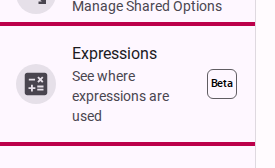
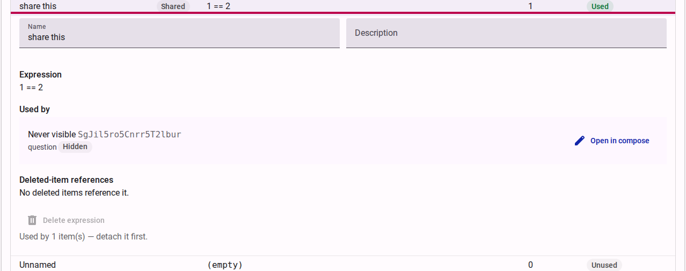

# Sharing Logical Expressions

When you build complex surveys, you may find yourself using the same visibility rules or logical conditions for multiple questions or sections. Instead of rebuilding the same logic each time, you can name a logical expression to make it "shared", allowing you to easily reuse it elsewhere in your form.

## Step 1: Create and Name a Logical Expression

First, navigate to an item that already has the logical expression you want to share.

1. Select the item (e.g., a question) in the Compose view.
2. Activate **Visibility Mode** by clicking the Visibility Mode button in the toolbar.
3. In the logic editor, provide a **Name** for your expression. This action automatically makes the expression available to other items.

<figure><figcaption>Set a name to share your logical expression.</figcaption></figure>

You can also optionally provide a description to help you and your team understand the purpose of this logic later.

<figure><figcaption>Add a description for more clarity.</figcaption></figure>

## Step 2: Reuse the Logical Expression

Now that your logic is shared, you can apply it to any other item.

1. Select the item where you want to apply the same logic.
2. Ensure **Visibility Mode** is active.
3. Instead of creating new logic, click on the **Select an existing expression** dropdown menu.
4. Choose the named expression you created in Step 1.

<figure><figcaption>Select the shared expression from the dropdown to apply it to the new item.</figcaption></figure>

::: tip
Changes made to a shared expression affect all items that use it, so you can update your survey logic from a single place.
:::

## Step 3: Manage Expressions from the Expressions Page

As your survey grows, you can inspect, rename, and clean up every logical expression—whether shared or unnamed—from a single place.

1. Enable **Advanced Mode** using the toggle in the top toolbar.
2. In the **Build** navigation drawer, select **Expressions**.

   <figure><figcaption>Open the Expressions page from the Build menu in Advanced Mode.</figcaption></figure>

3. Review the list of expressions for the form. The grid displays each expression's **Name** (or **Unnamed**, with a **Shared** badge on named expressions), a readable preview of the **Expression** using question and choice labels, the number of items under **Used by**, and its **Status** (**Used**, **Unused**, **Deleted ref**, or **Used · deleted ref**). The badge next to the heading shows how many expressions are currently unused.
4. Use the header filters to narrow the list by **Name**, **Expression** text or item label, or **Status**.

   <figure><figcaption>Filter and audit all named and unnamed expressions across your form.</figcaption></figure>

## Step 4: Inspect Usage, Rename, or Delete an Expression

Click any row in the **Expressions** grid to expand its details panel:

1. **Inspect usage and jump to items:** Under **Used by**, view every question, section, page, or survey text that references the expression, along with the logic slot it controls (**Hidden**, **Required**, **Read-only**, or **Invalid**). Click **Open in compose** to jump straight to that item in the Compose view.
2. **Rename or unshare:** Update the **Name** or **Description** fields directly. Giving an unnamed expression a name shares it; clearing the **Name** field unshares it so it no longer appears in the **Select an existing expression** dropdown, while keeping the logic intact on items that already use it.
3. **Delete unused expressions:** Click **Delete expression** and confirm to remove an unused expression. If you need it back later, recover it from **Build → Restore**.

<figure><figcaption>Expand an expression to edit its name or description, jump to items that use it, or delete it when unused.</figcaption></figure>

::: warning
You can delete an expression only when no active item uses it and no soft-deleted item references it. If a deleted item still points to the expression, its status shows **Deleted ref** and deletion is blocked—restore or permanently adjust that item first so restoring it later does not leave broken logic.
:::

## Related Content

- [How to use form logic](./logic-expression.md)
- [How to control content visibility](./controlling-visibility.md)
- [How to share content across multiple forms and surveys](./sharing-content.md)
- [Understanding Form Logic](../explanation/understanding-form-logic.md)
- [Logic Expressions Reference](../reference/content/logic-expression/index.md)
- [Restore Reference](../reference/build/restore.md)
