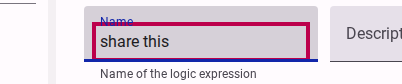
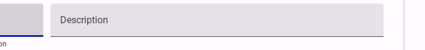
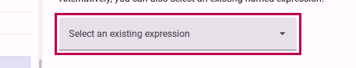

# Sharing Logical Expressions

When you build complex surveys, you may find yourself using the same visibility rules or logical conditions for multiple questions or sections. Instead of rebuilding the same logic each time, you can name a logical expression to make it "shared", allowing you to easily reuse it elsewhere in your form.

## Step 1: Create and Name a Logical Expression

First, navigate to an item that already has the logical expression you want to share.

1. Select the item (e.g., a question) in the Compose view.
2. Activate **Visibility Mode** by clicking the Visibility Mode button in the toolbar.
3. In the logic editor, provide a **Name** for your expression. This action automatically makes the expression available to other items.

<figure><figcaption>Set a name to share your logical expression.</figcaption></figure>

You can also optionally provide a description to help you and your team understand the purpose of this logic later.

<figure><figcaption>Add a description for more clarity.</figcaption></figure>

## Step 2: Reuse the Logical Expression

Now that your logic is shared, you can apply it to any other item.

1. Select the item where you want to apply the same logic.
2. Ensure **Visibility Mode** is active.
3. Instead of creating new logic, click on the **Select an existing expression** dropdown menu.
4. Choose the named expression you created in Step 1.

<figure><figcaption>Select the shared expression from the dropdown to apply it to the new item.</figcaption></figure>

::: tip
Changes made to a shared expression affect all items that use it, so you can update your survey logic from a single place.
:::

## Manage Expressions from the Expressions Page

The **Expressions** page is the form-level index of every expression, whether or not it has a name. Enable **Advanced Mode** in the builder toolbar, then open **Build → Expressions**.

The grid shows the expression's **Name** (or **Unnamed**), a preview of the expression, the number of items that use it under **Used by**, and a **Status**: **Used**, **Unused**, **Deleted ref**, or **Used · deleted ref**. Named expressions also carry a **Shared** badge.

1. Use the column filters in the grid header: type in **Name** or **Expression**, or choose a **Status** (**Used**, **Unused**, **Deleted ref**, or **Used · deleted ref**). The number of unused expressions is shown next to the heading.
2. Expand a row to see every item that uses the expression, which logic setting it controls (for example, **Hidden**), and an **Open in compose** link to the item.
3. Edit **Name** or **Description** in the expanded row. Naming an expression shares it; clearing the name stops offering it in the **Select an existing expression** dropdown, while the expression and the items that already use it keep working.
4. To delete an expression, expand its row and choose **Delete expression**. Deleted expressions can be restored from **Build → Restore**.

::: warning
You can delete an expression only when no item uses it and no deleted item references it. An expression referenced by a deleted item is marked **Deleted ref**; restore that item before deleting the expression, so the restored item does not lose its logic.
:::
