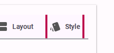
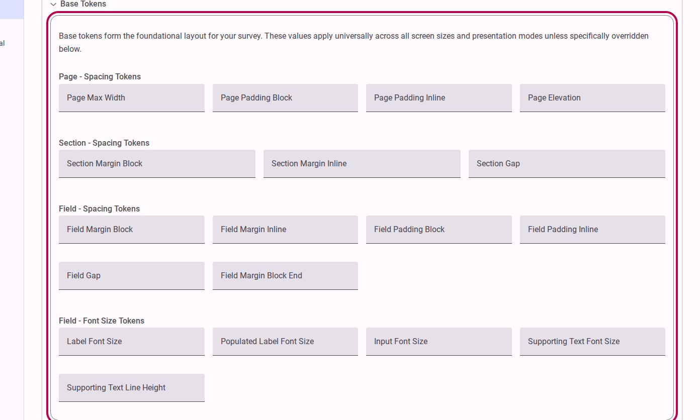

# Styling a Survey

Accessible Surveys provides a robust styling engine that allows you to customize the look and feel of your survey to match your brand while maintaining strict accessibility standards.

Because respondents can switch between high-contrast, dark, and light modes via the accessibility menu, styling tools are designed to adapt automatically. This ensures your survey remains legible regardless of the active accessibility mode.

## Step 1: Navigate to the Style Tab

To access styling options, open the survey builder's **Form Behavior** section.

1. Go to the **Form Behavior** view in the left drawer.
2. Click the **Style** tab at the top of the interface.

<figure>
  
  <figcaption>Click the Style tab to access visual customization tools.</figcaption>
</figure>

## Step 2: Configure the Master Scale Settings

::: tip Design Standards
Default styling tokens respect [Material Design 3](https://m3.material.io/) specifications. If you choose to deviate from these defaults, test your design across multiple screen sizes to maintain a high-quality respondent experience.
:::

The most efficient way to adjust your survey's density and readability is through the two **master scale settings**, shown as cards at the top of the Style tab:

1. **Base Font Size** (Default: `1rem`): Controls all typography—headings, question labels, input text, and supporting text all scale from this single value. Use the slider or the Small/Normal/Large/X-Large presets.
2. **Spacing Scale** (Default: `1`): A multiplier for all spacing (margins, paddings, gaps). Lower values (e.g., `0.75`) create a more compact design, while higher values (e.g., `1.25`) add more white space. Use the slider or the Compact/Default/Roomy presets.

Both cards show a live preview of the effect. Leave a master setting at its default to inherit the value from your **Customer Theme**; values you set here apply to this survey only.

<figure>
  
  <figcaption>Use the master scale settings for quick, global adjustments to look and feel.</figcaption>
</figure>

## Step 3: Fine-Tuning Individual Tokens (Advanced Mode)

For granular control, enable **Advanced Mode** in the toolbar. This reveals collapsible token groups:

### 1. Base Tokens
Base tokens form the foundational layout for your survey. Settings defined here apply universally across all screen sizes and presentation modes, unless specifically overridden in the groups below.

### 2. Mobile Overrides
Provide mobile-specific values that automatically take precedence whenever the respondent's screen is narrow. You only need to define tokens you want to change (e.g., reducing page padding inline for mobile phones).

### 3. Easy Read Overrides
Applies only when Easy Read mode is active (highest priority). Its Base Font Size defaults to a larger, easy-read-friendly value.

::: info One-Question-Per-Page Layout
The **One Question Per Page** layout has no separate override group: Base Tokens apply, with a larger default Base Font Size (`1.5rem`). Adjust the Base Font Size master to override it.
:::

### Spacing vs. Typography Units

- **Layout & Spacing Tokens:** Page, Section, and Field spacing accept standard CSS units (`px`, `rem`, `em`, or `%`).
- **Typography Tokens:** To ensure reliable zooming for persons with low vision or custom browser font settings, **font size tokens must use `rem` units** (e.g., `1.2rem`, `0.875rem`). Pixels are not permitted.

### Tracking Configured Tokens

The summary header of each token group displays a badge indicating how many custom tokens have been configured within it.

## How Theming Works

By default, the styles applied to a survey inherit their baseline properties from your overarching [Customer Theme](../../customer/reference/customer/theme.md). Adjustments made here in the survey builder define survey-specific overrides that take precedence over organization-wide settings.

## Previewing Your Styles

Always switch to the **Test** tab to see how your styles look in a live simulation. Use the Test workbench's accessibility menu to preview your survey in Dark Mode and High Contrast Mode.

## Related Content

- [Form Behavior Reference](../reference/build/behavior.md) — Behavior settings and layout options
- [Customer Theme Reference](../../customer/reference/customer/theme.md) — Organization-level theme and color palettes
- [Understanding CSS Variables](../explanation/understanding-css-variables.md) — Conceptual guide to survey CSS tokens
- [Understanding CSS Units](../explanation/understanding-css-units.md) — Choosing between rem, em, px, and percentages
