# How to Analyze Survey Responses

::: info
The Survey Analytics workbench provides real-time, interactive exploration of survey responses. Every chart serves as both a visualization and an interactive cross-filter, powered by an in-memory multidimensional data cube that coordinates all views in under 30 milliseconds.
:::

<figure>
  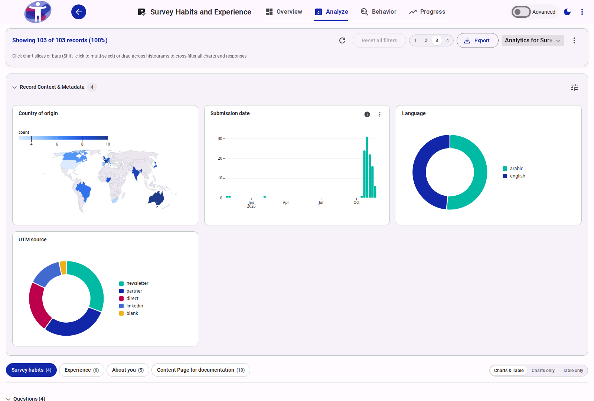
  <figcaption>The Survey Analytics workbench showing metadata charts, question cards, and view controls.</figcaption>
</figure>

## 1. Opening Survey Analytics

To access survey analytics:

1. Open your survey in the management console.
2. Select the **Analyze** tab in the top navigation bar.
3. By default, the analytics workbench opens on the **Overview** sub-tab showing responses for your survey's active batch.

<figure>
  
  <figcaption>Select <strong>Analyze</strong> in the top navigation to enter the analytics workbench.</figcaption>
</figure>

The header summary bar indicates how many records are loaded for the current batch, how many match the active filters (for example `Showing 103 of 103 records (100%)`), and adds an active filter badge when filters are applied. Use **Reset all filters** to restore the full dataset and the refresh icon to reload it.

<figure>
  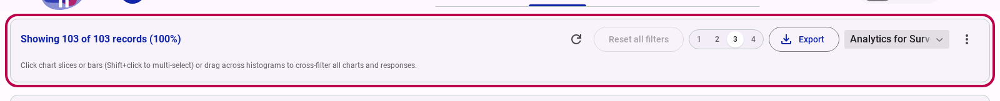
  <figcaption>The selection summary toolbar displays total responses, filter reset, layout density, and export controls.</figcaption>
</figure>

::: tip
If your survey uses multiple distribution batches, switch between batches in the Share settings to focus your analysis on specific respondent waves.
:::

## 2. Viewing Record Context and Metadata

The top section of the workbench displays **Record Context & Metadata** charts. These cards visualize survey paradata that is independent of specific question responses:

- **Submission date**: Response arrival frequency over time.
- **Language**: Distribution of locales selected by respondents.
- **Country of origin**: Geographic distribution derived from respondent connection metadata.
- **UTM source**: Marketing and distribution campaign identifiers.
- **Accessibility & display preferences**: Theme, color mode, font size, and touch input usage.

<figure>
  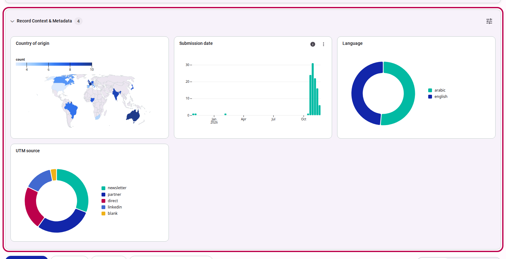
  <figcaption>Record context charts display submission metadata such as language, country, and submission date.</figcaption>
</figure>

::: info Persistent Top Band
Metadata charts remain pinned in the top band as you navigate between different survey pages, allowing you to filter by demographic or environment variables without losing context.
:::

### Customizing Visible Metadata Charts

To change which metadata cards appear in the top band:

1. Click the settings gear icon in the **Record Context & Metadata** header.
2. In the modal dialog, select or unselect metadata fields (e.g. toggle *Touchscreen*, *Theme*, or *UTM Source*).
3. Use the up and down arrow buttons next to each field to reorder the cards.
4. Click **Close**. Your chosen metadata order is saved with your current Analytics View.

## 3. Navigating Survey Pages and Question Cards

Survey questions are organized under the **Pages** tab bar beneath the metadata band:

1. Select any page tab (e.g. *Survey habits*, *Experience*, *About you*, *Content Page*) to view the question cards belonging to that page.

<figure>
  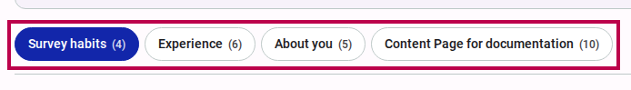
  <figcaption>The page tabs bar organizes questions by survey pages.</figcaption>
</figure>

1. Within a page, questions are grouped into collapsible sections matching your survey composition. Click any section header to collapse or expand its question cards.
2. Each question card displays the question text, response distribution chart, and sample size (n).

<figure>
  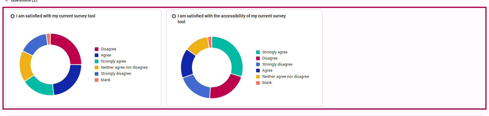
  <figcaption>Survey questions displayed as cards grouped under their respective survey page tab.</figcaption>
</figure>

Question cards automatically select the optimal chart representation based on the question type:

- **Single-choice questions**: Donut charts or horizontal bar charts showing category proportions.
- **Multiple-choice questions**: Horizontal bar charts displaying multi-select frequency.
- **Numeric, rating, and Likert scales**: Histograms displaying continuous distributions and bin counts.

A question-type icon sits before each card title (single-choice, multiple-choice, rating, ranking, numeric, date, yes/no, map, or text). Hover the icon to read its label, or the info icon beside the card menu to read the question description.

## 4. Interactive Cross-Filtering

Every chart element functions as a live filter. You can isolate any cohort across the entire survey with a single click:

1. Click any chart mark (a slice of a donut chart, a bar, or a histogram bin).

<figure>
  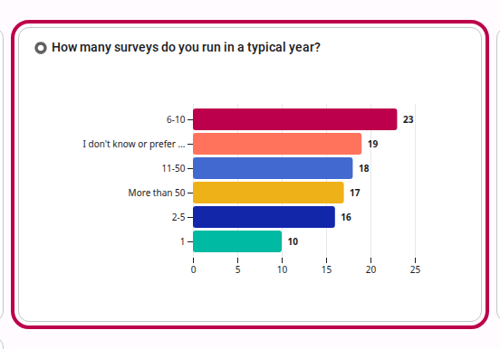
  <figcaption>Clicking a chart mark instantly cross-filters all other charts across the entire survey.</figcaption>
</figure>

1. The selected mark highlights, and every other chart across all pages immediately recalculates to display only responses matching that criterion.
2. The summary toolbar updates instantly, displaying the count and percentage of matching respondents (e.g. `10 / 103 (10%)`), accompanied by an active filter chip.

<figure>
  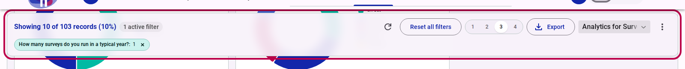
  <figcaption>The active filter chip shows the current criteria and updates the matching respondent count.</figcaption>
</figure>

1. All other charts in the workbench reflect the filtered distribution:

<figure>
  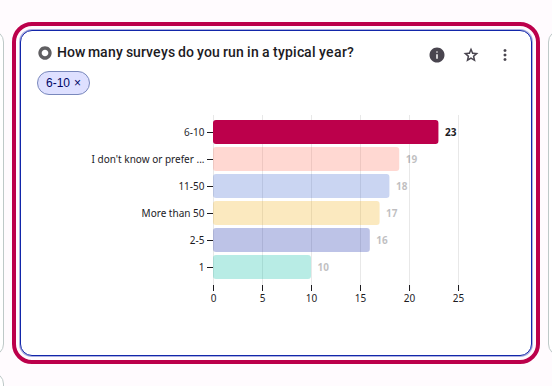
  <figcaption>Question cards update their distributions and sample sizes to reflect the filtered cohort.</figcaption>
</figure>

### Combining Multiple Filters

You can click additional chart marks across different questions or metadata fields to narrow your cohort further (e.g. `Language: English` AND `Device: Touchscreen` AND `Answer: Yes`). All active filter chips appear sequentially in the toolbar.

### Clearing Filters

To reset filters:

- Click the **×** (remove) icon on any individual filter chip to drop that specific filter.
- Click the highlighted slice or bar on the originating chart to toggle the filter off.
- Click **Reset all filters** in the toolbar to restore the entire dataset.

## 5. Inspecting Individual Responses

Below the question cards, the Responses table lists all individual submissions matching the active filters:

<figure>
  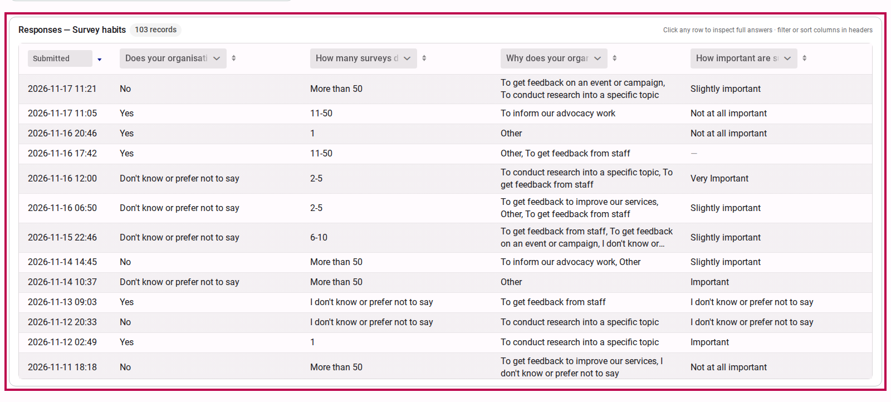
  <figcaption>The responses table lists individual records matching the active filter criteria.</figcaption>
</figure>

To drill down into full answers:

1. Click any row in the responses table.
2. The Response Inspector dialog opens, displaying the complete answers submitted by that respondent.
3. Use the pagination controls to step through matching respondent submissions one by one.

<figure>
  
  <figcaption>The response inspector displays individual submissions matching the current filter criteria.</figcaption>
</figure>

### Response IDs and removing responses (advanced mode)

Turn on **Advanced** in the top toolbar to audit individual records in the responses table:

- A **Response ID** column appears (filterable and sortable), showing the stored record identifier used by the Progress tab and the compliance archive.
- Each row gains a checkbox for editors with edit rights. Select one or more responses, or use the header checkbox to select every row visible under the current filters. The header then shows **N selected** and a **Remove from dataset…** button:

<figure>
  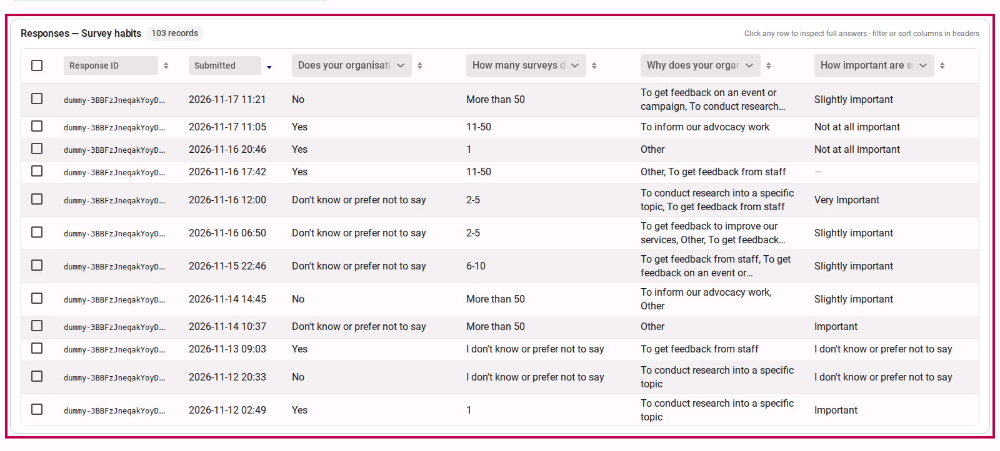
  <figcaption>Advanced mode adds the filterable Response ID column and a checkbox on every row.</figcaption>
</figure>

<figure>
  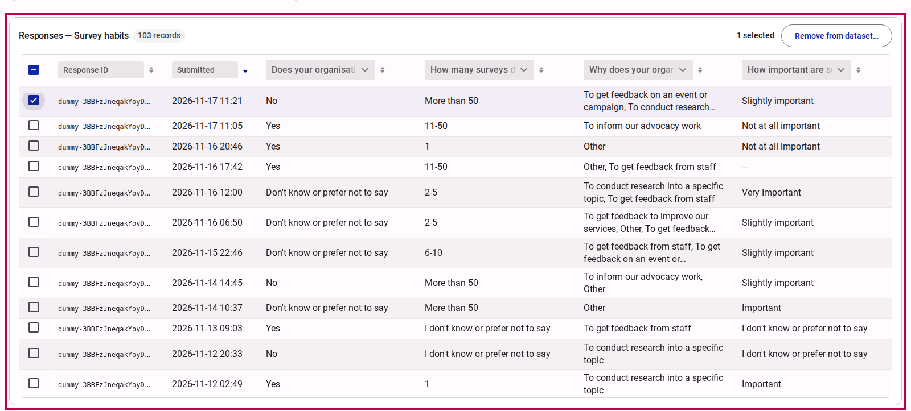
  <figcaption>Selected rows are counted in the grid header, next to the <strong>Remove from dataset…</strong> action.</figcaption>
</figure>

1. Click **Remove from dataset…** to open the removal dialog.
2. Choose a reason — **Test data** or **Other** — and add a note when you pick **Other** (the note is required for that reason).

<figure>
  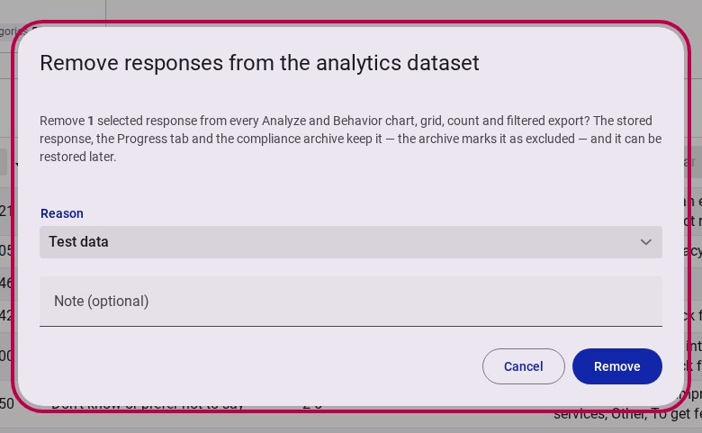
  <figcaption>Removal is auditable: choose a reason and, for <strong>Other</strong>, explain it in the note.</figcaption>
</figure>

Click **Remove**. Removed responses disappear from every Analyze and Behavior chart, count, grid and filtered browser export, but they are not deleted: the stored response, the Progress tab and the compliance archive keep it (the archive marks it as excluded). The **Include test** switch does not bring an excluded response back; restore it from the **Excluded (N)** list on the Behavior tab.

::: warning
Removal affects the whole analytics dataset, not just the page or the rows currently on screen.
:::

## 6. Pinning Key Charts to the Top Band

When comparing question responses against key demographic or outcome variables across different pages, pin the primary charts to the top band:

1. Locate the question card you want to keep visible (e.g. an overall satisfaction or primary outcome question).
2. Hover over the card to reveal the actions and click the **Star** (pin) button.

<figure>
  
  <figcaption>Hover over a question card and click the star button to pin it to the top band.</figcaption>
</figure>

1. The card immediately moves into the **Pinned Charts** band situated above the survey page tabs.

<figure>
  
  <figcaption>Pinned charts remain visible at the top as you navigate through different survey pages.</figcaption>
</figure>

1. As you switch page tabs, the pinned chart remains accessible for continuous cross-filtering.
2. To unpin a chart, hover over the pinned card and click the star icon again.

## 7. Customizing Card Display and Exporting Charts

Every card features a context menu for visual customization and presentation export:

1. Hover over any question or metadata card and click the **Options** menu button (three vertical dots).

<figure>
  
  <figcaption>The card options menu provides chart type toggles, width adjustments, and SVG/PNG exports.</figcaption>
</figure>

1. Choose from the available options:
   - **Export chart as PNG**: Downloads a high-resolution raster image suitable for slide decks, reports, or documents.
   - **Export chart as SVG**: Downloads a vector graphic file that preserves crisp typography and scalability at any print or digital resolution.
   - **Chart type**: Toggle between **Donut** and **Horizontal bar** for choice questions. Bar charts are especially helpful for questions with longer label text.
   - **Card width**: Adjust the card's column span between **1 column**, **2 columns**, or **Full width** to emphasize complex questions.
   - **Position**: Move the card earlier or later in the section sequence.
   - **Hide chart**: Remove the card from the current page. Restore hidden cards from the **Hidden (N)** button in the toolbar.
   - **Reset card defaults**: Revert the card's width and chart representation to system defaults.

<figure>
  
  <figcaption>Categorical question card toggled from donut to horizontal bar representation.</figcaption>
</figure>

## 8. Adjusting Grid Density

You can adapt the workbench layout to your monitor size and analytical focus using the column switcher in the top toolbar:

- **1 column**: Linear, single-column stream ideal for narrow viewports or full-width detailed review.
- **2 columns**: Balanced layout offering generous width for answer labels and bar lengths.
- **3 columns**: Default balanced layout for standard desktop monitors.
- **4 columns**: High-density dashboard view displaying maximum cards on wide displays.

<figure>
  
  <figcaption>Two-column layout optimized for wide charts and extended option labels.</figcaption>
</figure>

<figure>
  
  <figcaption>Four-column compact layout providing a high-density dashboard overview.</figcaption>
</figure>

## 9. Managing Analytics Views and Sorting Charts

### Creating and Switching Views

Analytics Views allow you to preserve distinct analytical perspectives (e.g. "Accessibility Cohort", "Regional Comparison", "Executive Overview") without overwriting the default configuration:

1. Click the view selector dropdown in the top toolbar to switch between saved views.
2. Click the **View actions** menu (three dots beside the view selector) to manage views:
   - **Save**: Persist current filter settings, pinned charts, column widths, and metadata order to the active view.
   - **Save as new view…**: Create a named snapshot with current filters and layout.
   - **Rename…**: Change the name of the active view.
   - **Discard unsaved changes**: Revert modifications made since the last save.
   - **Copy view link**: Share a direct link with collaborators that opens the survey directly into this view configuration.
   - **Delete view…**: Permanently remove a custom view (the default view cannot be deleted).

<figure>
  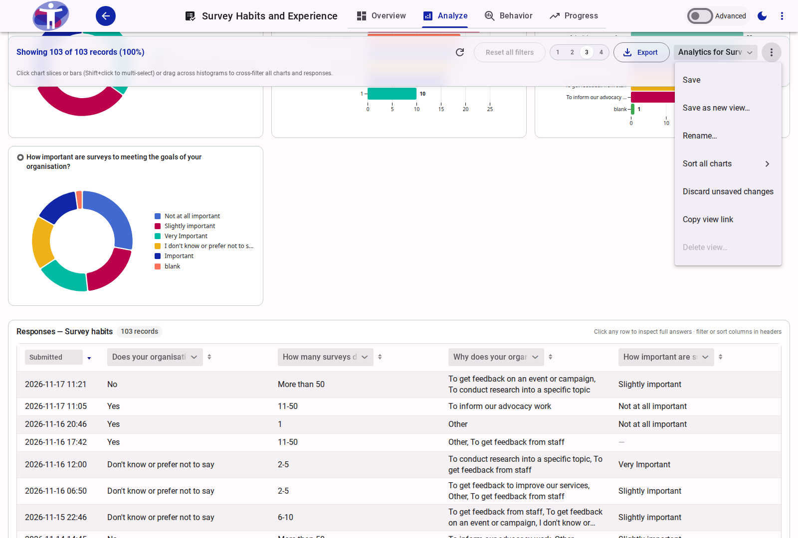
  <figcaption>The View actions menu allows saving, renaming, duplicating, and sorting analytics views.</figcaption>
</figure>

<figure>
  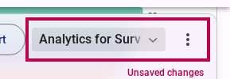
  <figcaption>Switch between saved analytics views to immediately restore custom layouts and filter sets.</figcaption>
</figure>

### Sorting All Charts

To reorganize chart categories consistently across the entire survey:

1. Open the **View actions** menu in the toolbar.
2. Hover over or click **Sort all charts**.
3. Select a sort order:
   - **Survey order**: Preserves the original option order defined during survey authoring.
   - **Largest first**: Orders categories in descending frequency so top answers appear first.
   - **Smallest first**: Orders categories in ascending frequency to spotlight niche or underrepresented options.

## 10. Advanced Statistical Indicators

Turn on **Advanced** in the top toolbar to add a live statistical summary strip below every chart. The strip recalculates with the active filters, and its chips depend on the question type:

- **All questions**: **n** (valid answers) and, when answers are missing, **Missing** with its count and share.
- **Numeric questions**: **Mean**, **SD** (standard deviation), **Median**, **IQR** (the interquartile range, from Q1 to Q3), and **Range** (minimum–maximum).
- **Rating/Likert scales**: **Median** and **Mode** (the most frequent answer and its share), plus **Mean** and **SD** when the scale is numeric.
- **Single-choice and multiple-choice questions**: **Top** answer with its share, and **Categories** (the number of distinct answers observed).
- **Date questions**: **Span** from the earliest to the latest answer.
- **Ranking questions**: **Top #1** (the item most often ranked first) and **Mean rank**.

<figure>
  
  <figcaption>In Advanced mode, every card ends with a statistical summary strip computed on the filtered cohort.</figcaption>
</figure>

Cards that were hidden with **Hide chart** can be restored from the **Hidden (N)** menu in the toolbar:

<figure>
  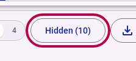
  <figcaption>The <strong>Hidden (N)</strong> menu restores cards hidden from the current page.</figcaption>
</figure>

## 11. Exporting the Filtered Dataset

You can export the survey dataset at any time, reflecting all active filter criteria:

1. Click the **Export** button in the analytics toolbar.
2. Read the privacy warning and tick **I understand my responsibilities**.
3. Choose the download method:
   - **Download from this browser**: builds the file locally from the responses currently loaded in the workbench and honors the active filters.
   - **Server compliance archive**: generates a complete archive on the server from all stored responses, ignoring the active filters. Choose anonymized, humanized, or raw content for compliance or privacy requests.
4. Set the **export file name** (the default follows `{survey-name}-all-pages-{date}.csv`).
5. For a browser download, choose the columns (**All pages** or **Active page**), whether to **include metadata columns**, the value labels (**Humanized labels** or **Raw codes**), and the **file format** (**CSV** or **JSON**). For CSV, also pick the **multi-value separator** (comma, semicolon, or pipe).
6. For a server archive, choose the **archive content**, the **file format**, and, for CSV, the **header style** (**Labels** or **Codes**) and **multi-value separator**.
7. Click **Download** (or **Generate archive** for a server export).

<figure>
  
  <figcaption>The export dialog asks for explicit privacy acknowledgement and a download method.</figcaption>
</figure>

<figure>
  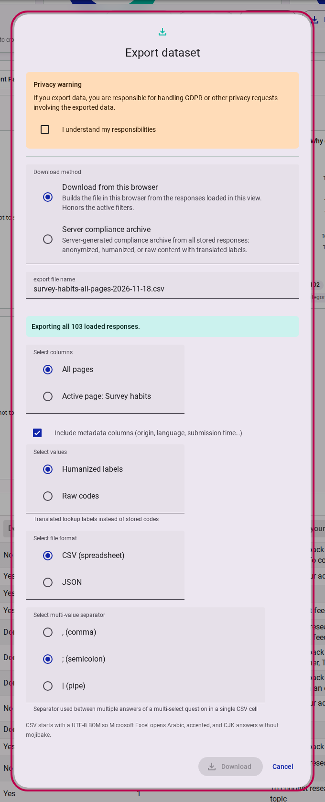
  <figcaption>Browser exports can keep all pages or the active page, include metadata, and use humanized labels or raw codes.</figcaption>
</figure>

::: tip
The browser export always covers the currently filtered cohort; clear the filters first to export every loaded response. The server archive always covers all stored responses and marks excluded ones with an `excluded` column.
:::

See [How to Export Survey Data](./exporting-survey-data.md) for the full option reference.

---

## Related Content

- [How to Analyze Respondent Behavior and Data Quality](./behavior-analytics.md): Inspect timing paradata, quality signals, drop-offs, and exclude low-effort responses.
- [How to Export Survey Data](./exporting-survey-data.md): Export the filtered dataset or the full server compliance archive in CSV or JSON.
- [Survey Analytics Workbench Reference](../reference/analyze/survey.md): Complete specifications for UI controls, card parameters, view schemas, and statistical formulas.
- [Behavioral Analytics Reference](../reference/analyze/behavior.md): Algorithmic rules, scoring rubrics, and formulas for behavioral metrics.
- [Understanding Respondent Behavior and Data Quality](../explanation/confidence-index.md): Conceptual background on satisficing, paradata, response latency, and survey methodology literature.
