# Testing a form

::: info
The 'Test' feature provides an easy way for you to see how your form will appear to respondents. You can try out any changes and make edits directly from the test page.
:::

## Step 1: Navigate to the Test View

In the form builder, select the **test** option in the top menu. This renders the form as a respondent would see it, in a separate environment that allows you to test accessibility modes without affecting the form being edited.

<figure>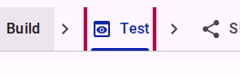<figcaption>Click the test link in the top menu.</figcaption></figure>

The form will open in a new tab, and you can interact with it as if you were a respondent. This allows you to experience the form from the respondent's perspective and identify any issues or areas for improvement:

<figure>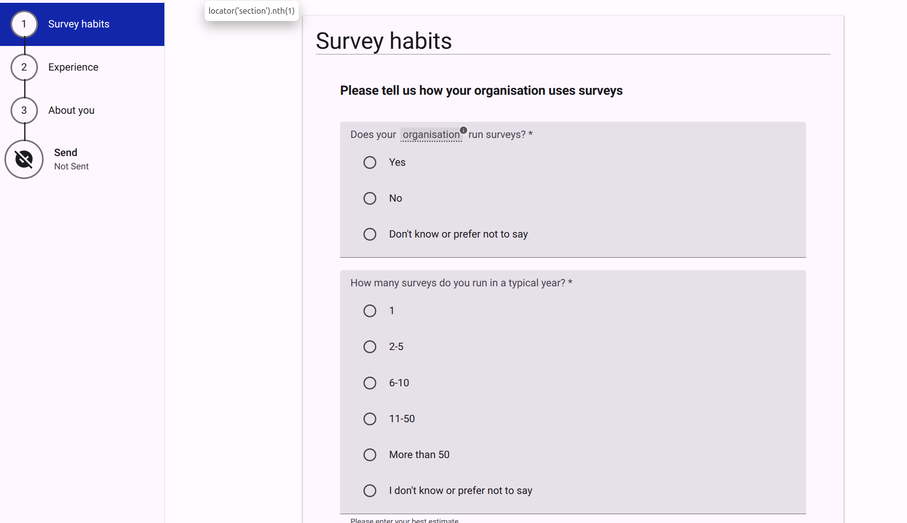<figcaption>Test view of the form, simulating the respondent's experience.</figcaption></figure>

## Step 2: Using the Test Toolbar

While in Test mode, you will see a toolbar that provides several options to simulate different environments and test functionalities:

<figure>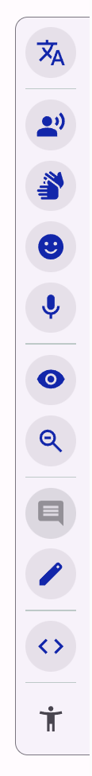<figcaption>Test toolbar with various options to simulate different environments.</figcaption></figure>

| Feature | Description | Screenshot |
| ------- | ----------- | ---------- |
| Test the form in different languages | Preview your form in any language you have activated. | 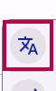 |
| Activate Read Aloud | Test the text-to-speech functionality. | 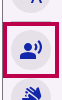 |
| Activate Sign Language | Test the sign language videos. | 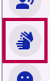 |
| Activate Easyread emulate mode | Preview the simplified interface. | 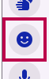 |
| Activate Voice Recording | Test the audio response inputs. | 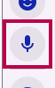 |
| View all items | Display all questions and content regardless of logic conditions. | 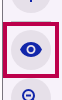 |
| Adjust zoom level | See more of the form in a single view. | 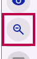 |
| Activate edit mode | Edit the form structure directly from the test view. | 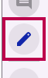 |
| View form data | See how the data being collected is structured in the background. | 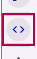 |
| Open accessibility menu | Preview the global accessibility settings available to the respondent. | 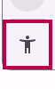 |

## Step 3: Edit the form directly from the Test view

If you notice an issue while testing, turn on the **edit** control in the test toolbar. Each item then shows a pencil button that opens a modal for editing that item in place.

Edits from the dialog are saved to the current draft, not to the test session, so the form changes as soon as you save. Use **Compose** for structural changes such as moving or adding items.

<figure>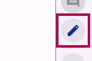<figcaption>Activate Edit mode in the test toolbar to make changes directly from the test view.</figcaption></figure>

<figure>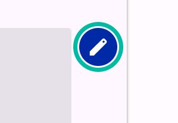<figcaption>Edit a question directly from the test view.</figcaption></figure>

The modal dialog edits the selected question:

<figure>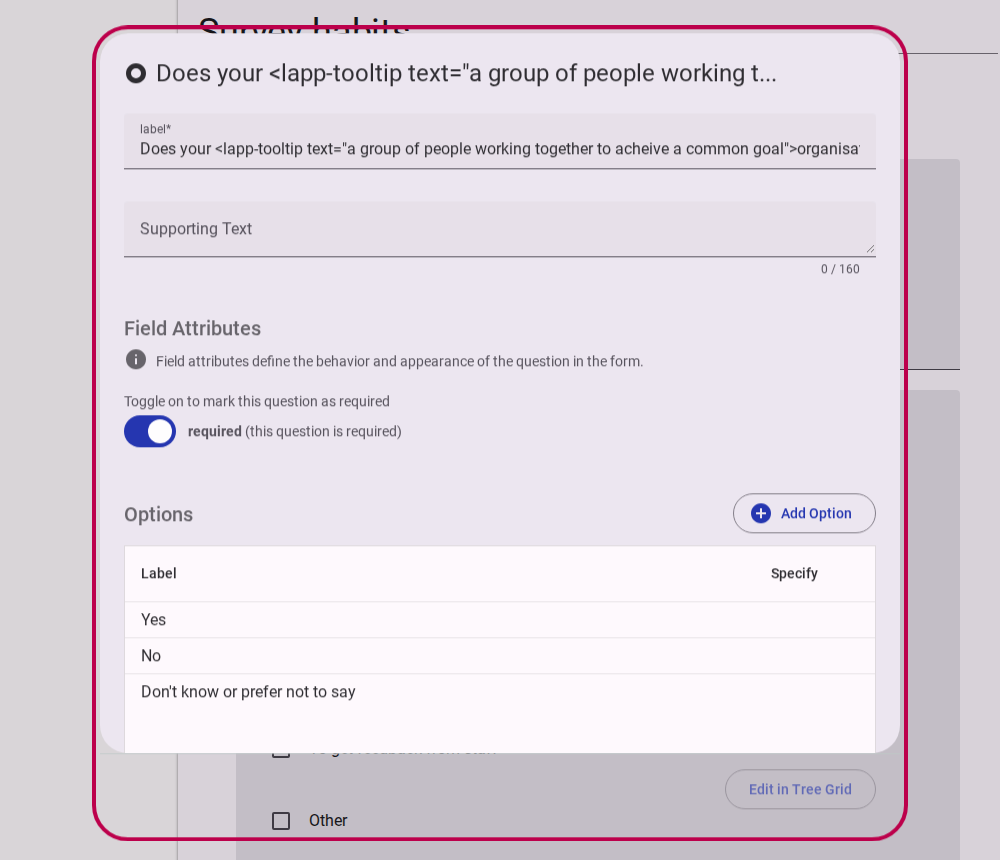<figcaption>Edit question dialog opened directly from the test view.</figcaption></figure>

## Step 4: Sharing Test Links with Collaborators

While the interactive Test toolbar (Steps 1–3) tests your live working draft directly, sharing a standalone test preview with colleagues requires compiling a test build:

1. **Build a Test Version:** Navigate to **Share → Publish** and build a new version so all draft edits are compiled (see [Publishing a survey — Build a New Version](./publishing-a-survey.md#step-2-build-a-new-version)).
2. **Generate the Test Link:** In **Share → Distribute**, click **Display Link for Test** to copy your test preview URL (`/v2test/{surveyId}`). Test responses submitted through this link are never recorded into production datasets or counted against survey quota.

<figure>
  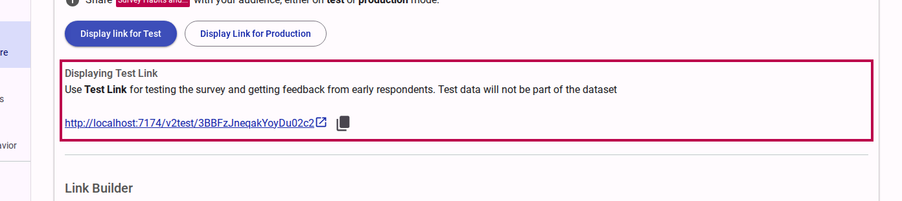
  <figcaption>Click Display Link for Test in Distribute to copy and share the test preview link.</figcaption>
</figure>

See [Publishing a survey](./publishing-a-survey.md) for complete instructions on versioning, quota management, and taking surveys to production.

## Related Content

- [Test Survey Reference](../reference/test/index.md): Every test toolbar control, the sandbox behavior and inline editing.
- [How to Review a Survey](./review-a-survey.md): Automated checks before a test session.
- [How to Publish and Distribute a Survey](./publishing-a-survey.md): Test builds and production links.
- [Form Behavior Reference](../reference/build/behavior.md): Enabling the modes the toolbar toggles.
