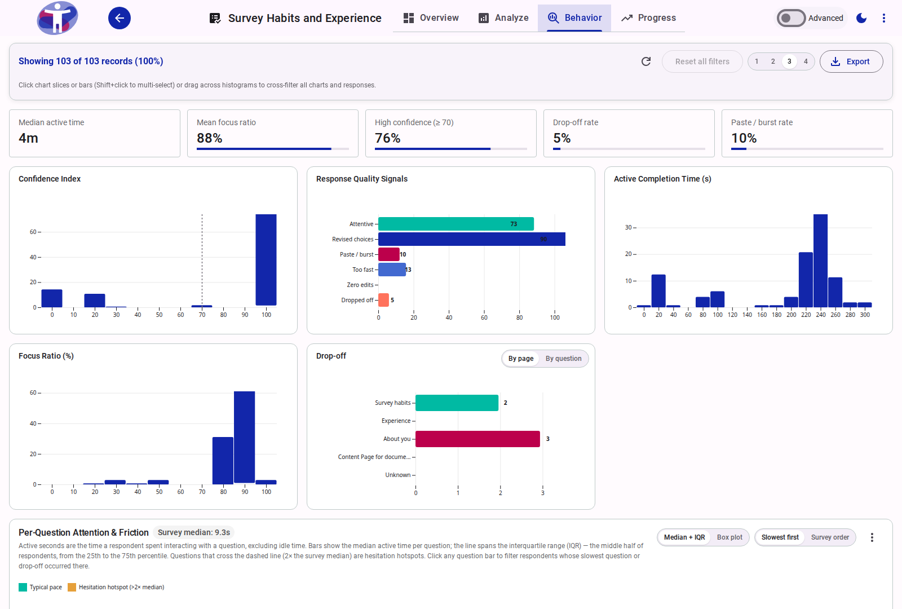

# Behavioral Analytics Reference

The **Behavioral Analytics** reference documents the session paradata indicators, Confidence Index scoring rubrics, quality flag definitions, cognitive friction metrics, and response exclusion mechanisms available in the Behavioral view.

<figure>
  
  <figcaption>The Behavioral Analytics workspace displaying respondent KPIs, quality signals, and attention metrics.</figcaption>
</figure>

---

## 1. Session Timing and Paradata Indicators

When behavioral tracking is enabled for a survey, the platform collects client-side interaction events throughout the respondent's session without logging keystrokes or sensitive content:

| Metric | Measurement | Description |
| :--- | :--- | :--- |
| **Active Time** | Seconds | The cumulative time the respondent actively interacted with the survey page (scrolling, clicking options, or typing). Periods where no interaction occurs for more than 15 seconds are classified as idle time and excluded. |
| **Idle Time** | Seconds | Accumulated pauses where the survey tab was left open without interaction or when the browser tab lost focus. |
| **Focus Percentage** | Percentage (0–100%) | The proportion of total session duration during which the respondent was actively focused on the survey tab rather than multitasking in other browser tabs or windows. |
| **Choice Edits** | Event count | The total number of times a respondent altered an existing answer selection across choice questions (e.g., selecting option A, then changing their mind to option B). |
| **Paste Bursts** | Event count | Instances where a significant volume of text was entered instantaneously into a text field in a single burst rather than typed key by key. |
| **Question Dwell Time** | Seconds | The active interaction duration spent answering each individual question, measured between question focus and progression. |
| **Last Page & Last Question** | Form position | The specific page and question reached before a session was discontinued (used for drop-off diagnostics). |

---

## 2. Confidence Index Scoring Rubric

The **Confidence Index** evaluates the authenticity and effort of each submission on a scale from **0 to 100**:

- **A score of 100** indicates strong confidence in human engagement, characterized by steady reading cadence, focused interaction, and answer deliberation.
- **Scores between 50 and 69** reflect moderate confidence, indicating fast completion or minor distraction.
- **Scores below 50** warrant closer inspection for automated bot patterns, rapid click-through speeding, or disengaged completion.

The score starts at a baseline of **100 points**, with deductions applied based on two distinct penalty components:

### Speed Penalty

The speed evaluation compares the respondent's active time against a minimum human reading threshold. Research indicates a human reader requires at least **3 seconds per question** on average to read, comprehend, and answer:

- **Sufficient Duration**: If active session time meets or exceeds 3 seconds per question, zero speed penalty is applied.
- **Accelerated Duration**: If active time falls significantly below this reading threshold, a penalty is applied proportional to the time deficit. Submissions completed in mere seconds across many questions receive up to a 100-point speed penalty.

### Interaction Penalty

The interaction evaluation examines answer modification patterns and input delivery:

- **Baseline Modification Penalty**: An initial deduction is applied if a respondent answers without ever modifying or refining any response, or if overall interactions fall below 30% of the total question count.
- **Paste / Burst Penalty**: An additional 30-point deduction is applied if text answers were delivered in instant, single-event bursts, typical of automated injection or copy-pasting.
- **Choice Modification Reward**: A 20-point positive adjustment is granted if the respondent revised an existing choice answer, acknowledging deliberate cognitive reflection.

---

## 3. Quality Signals Catalog

Each completed or partial response is categorized under discrete behavioral flags based on observable interaction patterns:

| Quality Signal | Classification | Definition and Trigger Criteria |
| :--- | :--- | :--- |
| **Attentive** | High Effort | Assigned to completed submissions achieving a Confidence score of 70 or higher without dropping off. |
| **Revised choices** | High Deliberation | Assigned when a respondent changed their mind and modified at least one choice-based answer during the session. |
| **Paste / burst** | Potential Bot / Shortcut | Assigned when text fields were populated through instantaneous data dumps rather than incremental human typing. |
| **Too fast** | Speeder | Assigned when total session duration fell significantly below the minimum human reading threshold. |
| **Zero edits** | Minimal Interaction | Assigned when a respondent submitted answers without ever revising, editing, or correcting an earlier entry. |
| **Dropped off** | Incomplete Session | Assigned to sessions where the respondent exited the survey prior to reaching the completion stage. |

---

## 4. Question Attention, Friction, and Dispersion

The **Per-Question Attention & Friction** analysis evaluates how respondents distribute their time across individual questions:

### Survey Median Baseline

The survey median represents the typical active time respondents spend on a standard question across the entire survey. It acts as the benchmark against which every individual question is evaluated.

### Hesitation Hotspots

A question is classified as a **Hesitation Hotspot** when its median dwell time equals or exceeds **twice the survey median**. Hesitation hotspots indicate questions that impose high cognitive burden, suffer from ambiguous phrasing, require extensive reading, or present complex interaction requirements.

### Boxplot Dispersion Metrics

When viewing friction in Boxplot mode, the distribution of respondent times for each question is described using standard five-number dispersion metrics:

- **Median**: The middle value of all respondent durations for that question (50th percentile). Half of the respondents answered faster than this time, and half answered slower.
- **First Quartile (Q1)**: The 25th percentile. One-quarter of respondents answered faster than this time.
- **Third Quartile (Q3)**: The 75th percentile. Three-quarters of respondents answered faster than this time.
- **Interquartile Range (IQR)**: The difference between the third and first quartiles (Q3 minus Q1). Measures the spread of the middle 50% of respondents. A wide IQR indicates wide variance in how long different respondents take to understand the question.
- **Whiskers and Outliers**: Upper and lower boundaries derived using standard Tukey fences (1.5 times the IQR beyond the quartiles). Values falling outside the whiskers highlight individual respondents who experienced extreme hesitation or finished unusually quickly.

---

## 5. Response Exclusion Taxonomy

When managing data quality, administrators can exclude low-quality, automated, or test responses from the analytical dataset. Excluded responses are immediately omitted from all charts, behavioral KPIs, analytics counts, and the filtered client-side export, but are **never permanently deleted**. They remain preserved in the underlying response archive and can be restored at any time. The marker is written to the raw, humanized and anonymized copies, so server compliance archive exports keep every stored response and mark the excluded ones with an `excluded` column and their exclusion reason.

| Reason | Label | Explanatory Note | Typical Use Case |
| :--- | :--- | :--- | :--- |
| **`test`** | Test data | Optional | Pre-launch authoring checks, internal team trials, and QA submissions. |
| **`bot`** | Likely bot | Optional | Automated submissions flagged by instantaneous burst text entry and impossible completion speeds. |
| **`duplicate`** | Duplicate | Optional | Multiple entries submitted by the same respondent or device. |
| **`other`** | Other | **Required** | Any other reason; the note explains what it was. |

### Audit Metadata

Every exclusion action records an immutable audit entry containing:

- The exclusion reason and optional explanatory note.
- The ISO timestamp when the exclusion was performed.
- The user identifier of the administrator who executed the action.

The **Excluded (N)** button in the toolbar displays the current count of excluded records, opens the audit history list, and allows administrators to restore any record with a single click. The same removal flow is available on the Analyze tab in Advanced Mode, from the response grid.
