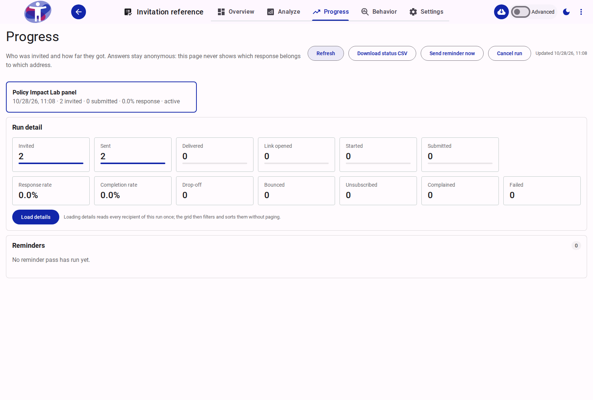
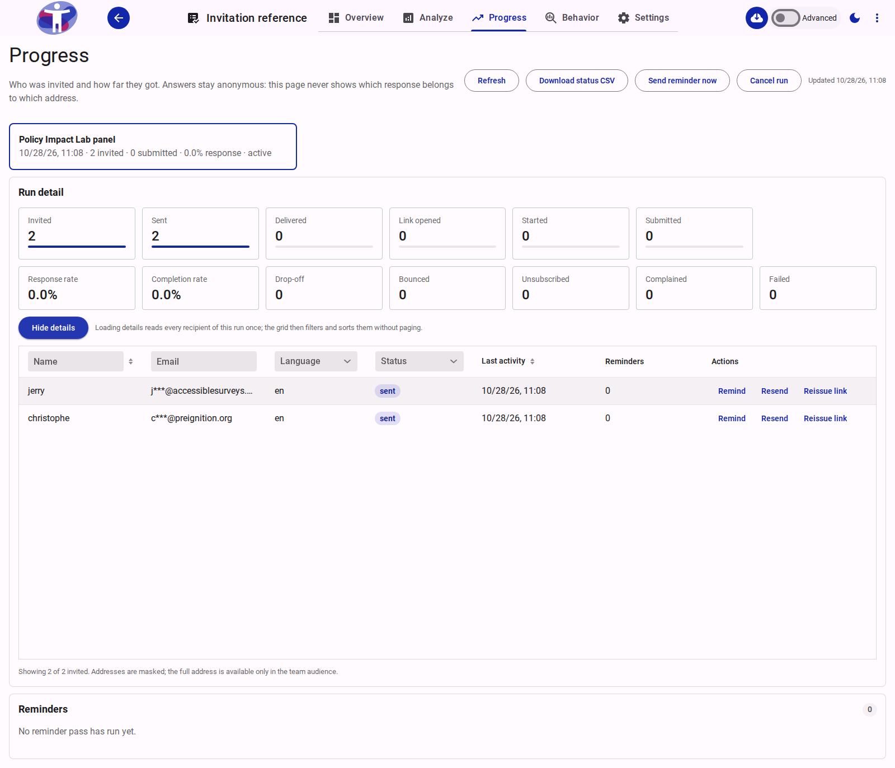

# Progress

The **Progress** tab in the Survey Analytics workspace (`/s/analyze/survey/{surveyId}/progress/progress`) tracks the delivery, engagement, and completion funnel of a survey's invitation runs.

It is designed around a strict privacy boundary: organizers see **who was invited and how far they progressed**, but survey responses remain anonymous and are never linked to an invitation, token, or email address.

<figure>
  
  <figcaption>The Progress workspace displaying the active invitation run, funnel counters, rates, and reminder history.</figcaption>
</figure>

---

## Run Selector Cards

Each invitation wave sent from **Share → Distribute** appears as an interactive card at the top of the page. Clicking a card loads its funnel counters and reminder log.

Each run card displays:

- **Audience name:** The name of the team audience the run targeted.
- **Sent timestamp:** When the run started sending.
- **Summary metrics:** `invitedCount`, `submittedCount`, and the computed `response` percentage.
- **Run status:**
  - `sending` — batches are actively being dispatched.
  - `active` — initial send completed; links are live and scheduled reminders are active.
  - `paused` — automatically paused by the deliverability/reputation guard (high bounce or complaint rate after 1,000 sends) or a mail provider failure.
  - `cancelled` — stopped by an editor; unopened links are deactivated and no further batches or reminders are sent.

---

## Run Toolbar Actions

The header toolbar provides run-level controls for the currently selected run:

| Action | Availability | Description |
| :--- | :--- | :--- |
| **Refresh** | Always | Reloads the run's funnel counters and, if open, refreshes the per-recipient table. |
| **Download status CSV** | Team Owners, Admins, Editors | Exports a CSV (`invitation-progress-{surveyId}.csv`) of the run's recipients containing masked email addresses, statuses, timestamps, and reminder counts. Never includes full email addresses or survey answers. |
| **Send reminder now** | Active / Sending runs | Runs a dry-run check (`remindInvitationRun` with `dryRun: true`) to count eligible recipients, prompts for confirmation with the exact count, and dispatches a manual reminder pass. |
| **Send remaining** | When `sentCount < invitedCount` (and not paused/cancelled) | Sends the next batch of invitations when a large run was partially deferred by the 20,000/day team email cap. |
| **Resume run** | Paused runs only | Clears the pause state on a run so remaining invitations and reminders can resume. |
| **Cancel run** | Non-cancelled runs | Prompts for confirmation, marks the run `cancelled`, invalidates all unopened invitation links, and stops any remaining batches or scheduled reminders. |

---

## Run Detail: Funnel and Rate Tiles

The **Run detail** card renders two aligned rows of `lapp-stat` metric tiles read directly from the run document's aggregate counters.

### Row 1: Monotonic Funnel Stages

Each stage tile includes a progress bar showing its ratio against `Invited`. Downstream stages are cumulative (an invitation that opened or submitted also counts toward earlier stages):

| Stage Tile | Counter Field | Definition |
| :--- | :--- | :--- |
| **Invited** | `invitedCount` | Total eligible recipients frozen into the run at creation time. |
| **Sent** | `sentInvitationCount` | Invitations accepted by the mail service (stage `>= 1`). |
| **Delivered** | `deliveredCount` | Invitations confirmed delivered by the mail provider webhook (stage `>= 2`). |
| **Link opened** | `openedCount` | Recipients who opened their unique `/v2/{surveyId}/i/{token}` link (stage `>= 3`). |
| **Started** | `startedCount` | Recipients who began answering the survey (stage `>= 4`). |
| **Submitted** | `submittedCount` | Recipients who completed and submitted the survey (stage `5` / `submittedAt` present). |

### Row 2: Rates and Negative Outcomes

| Tile | Formula / Field | Definition |
| :--- | :--- | :--- |
| **Response rate** | `Submitted ÷ Invited` | Percentage of invited recipients who submitted the survey (formatted to 1 decimal place). |
| **Completion rate** | `Submitted ÷ Started` | Percentage of respondents who submitted after starting the survey. |
| **Drop-off** | `max(Started − Submitted, 0)` | Number of recipients who started the survey but have not submitted yet. |
| **Bounced** | `bouncedCount` | Invitations that hard-bounced (or reached three consecutive soft bounces). Added to the customer-wide suppression list. |
| **Unsubscribed** | `unsubscribedCount` | Recipients who used the one-click unsubscribe link. Added to the customer-wide suppression list. |
| **Complained** | `complainedCount` | Recipients who reported the email as spam. Added to the customer-wide suppression list. |
| **Failed** | `failedCount` | Sends rejected by the mail service before delivery (cleared if a later retry succeeds). |

---

## Recipient Details Grid

Per-recipient rows are loaded on demand when a team owner, admin, or editor clicks **Load details**. Survey guests and non-team collaborators see the aggregate funnel tiles only.

<figure>
  
  <figcaption>The recipient details grid showing masked addresses, status badges, and row-level Remind, Resend, and Reissue link actions.</figcaption>
</figure>

Loading details performs a single read of the run's invitation documents so the browser grid can filter and sort across the entire run without server paging.

### Columns and Filters

| Column | Header Control | Description |
| :--- | :--- | :--- |
| **Name** | Text filter + Sorter | Recipient's name (or `—` when unset). |
| **Email** | Text filter | Masked email address keeping only the first character of the local part and the domain (for example, `j***@accessiblesurveys.com`). Full addresses are only visible in **Team Settings → Audiences**. |
| **Language** | Select filter | Language code used for the recipient's invitation. |
| **Status** | Select filter | Exclusive lifecycle status badge: `invited`, `sent`, `opened`, `started`, `submitted` (green), `unsubscribed` (amber), `bounced` (red), `complained` (red), or `failed` (red). Note that provider delivery (`delivered`) displays as `sent` in the status column. |
| **Last activity** | Column sorter | Timestamp of the most recent lifecycle event for that invitation. |
| **Reminders** | Static header | Total reminders sent to this recipient, plus a `(N failed)` note if any reminder attempts failed. |
| **Actions** | Row action buttons | Per-recipient recovery and reminder actions (see below). |

### Per-Recipient Row Actions

| Action | Enabled When | Behavior |
| :--- | :--- | :--- |
| **Remind** | Status is not `submitted`, `unsubscribed`, `bounced`, `complained`, or `failed` | Sends a manual reminder to this recipient (`remindInvitation`). Enforces a **24-hour cooldown** since the last reminder, a maximum of **2 manual reminders**, and a maximum of **5 total reminders** per recipient. |
| **Resend** | Status is not `submitted`, `unsubscribed`, `bounced`, or `complained` | Re-sends the invitation email with the recipient's existing link (`resendInvitation`). Used to recover from a `failed` send or a lost email. |
| **Reissue link** | Status is not `submitted`, `unsubscribed`, `bounced`, or `complained` | Prompts for confirmation, immediately invalidates the old invitation token, generates a new `/v2/{surveyId}/i/{token}` link, and emails it to the recipient (`reissueInvitation`). |

---

## Reminders History Card

The **Reminders** card at the bottom of the page lists every scheduled and manual reminder pass recorded on the run (`reminderHistory`):

- **Pass:** `Reminder 1`, `Reminder 2`, `Reminder 3` (for scheduled passes) or `Manual` (for editor-triggered passes).
- **When:** Local timestamp of the pass.
- **Who:** `Scheduled job` or the editor who triggered a manual pass.
- **Sent:** Number of reminder emails accepted by the mail service during the pass.
- **Failed:** Number of reminder emails that failed during the pass.

If scheduled reminders fail three times in a row (`reminderErrorAt`), the card displays a warning banner advising the editor to inspect the recipient list and mail settings before retrying.

---

## Related Content

- [How to Send Invitations to a Team Audience](../../how-to/send-invitations.md)
- [Distribute Your Survey](../share/distribute/index.md)
- [Email Configuration](../share/email/index.md)
- [Team Audiences](../../../customer/reference/team/audiences.md)
- [Data Privacy and Security — Invitation Records](../../explanation/data-privacy-and-security.md#invitation-records)
