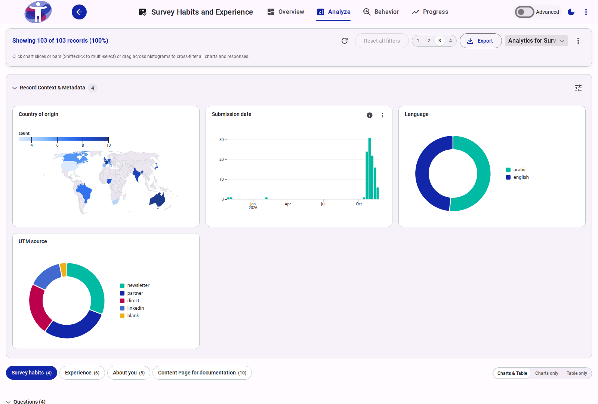

# Survey Analytics Reference

The **Survey Analytics** reference documents the interface elements, metadata classifications, display options, saved view mechanisms, and statistical indicators available in the analytics workbench.

<figure>
  
  <figcaption>The Survey Analytics workbench interface and analytical controls.</figcaption>
</figure>

---

## 1. Workbench Interface Elements

### Toolbar and Navigation

- **Response Counter**: Displays `Showing X of Y records (Z%)`, where *Y* is the number of responses loaded for the current batch and *X* the number matching all active filters.
- **Refresh**: Reloads the dataset. When new responses arrive, a **+N new — Refresh** button appears next to the counter.
- **Reset All Filters**: Clears every active cross-filter and restores the full dataset.
- **Filter Summary Bar**: Displays active filter chips representing selected cohorts. Each chip displays the filter dimension and chosen value, with a **×** to remove it.
- **View Selector**: Dropdown menu allowing organizers to switch between the default view and custom saved views.
- **View Actions Menu**: Provides administrative controls for the active view:
  - *Save*: Updates the current view with active filters, card widths, chart representations, and metadata choices.
  - *Save as new view…*: Prompts for a name and creates a new saved view preserving the current state.
  - *Rename…*: Modifies the display name of the active view.
  - *Sort all charts*: Applies a universal sort order across all question cards simultaneously.
  - *Discard unsaved changes*: Reverts layout and filter modifications to the last saved snapshot.
  - *Copy view link*: Copies a persistent URL to the clipboard that loads the survey directly into this view configuration.
  - *Delete view…*: Permanently deletes a custom view (the default view cannot be deleted).
- **Column Density Switcher**: Adjusts the workbench grid between one, two, three, and four columns to accommodate different screen widths and visual densities.
- **Hidden (N)**: Appears when cards are hidden and opens the list of hidden fields so they can be restored.
- **Advanced Mode**: Adds the statistical summary strip to every card, the Response ID column and row checkboxes to the responses table, and the **Include test** switch; metadata fields hidden from the top band also appear in the **Hidden (N)** restore menu.
- **Export Action**: Opens the export dialog to download the active dataset in tabular or structured file formats.

---

## 2. Record Context and Metadata Fields

Metadata cards capture context and technical paradata collected alongside survey responses. They remain fixed in the persistent top band as organizers navigate between different survey pages.

| Field | Description | Collection Method | Default Visibility |
| :--- | :--- | :--- | :--- |
| **Submission date** | Frequency of submitted responses grouped over time (days or weeks). | Generated by the server when a submission is recorded. | Visible |
| **Language** | Distribution of survey languages selected by respondents. | Recorded from the respondent's active survey language. | Visible |
| **Country of origin** | Geographic distribution of respondents by country. | Inferred from respondent connection metadata. | Visible |
| **UTM source** | Marketing and distribution campaign identifiers attached to distribution links. | Extracted from URL query parameters (`utm_source`). | Visible |
| **Theme** | Visual theme selected by the respondent (e.g., standard, high contrast). | Recorded from the survey accessibility settings menu. | Hidden |
| **Color mode** | Preference for light or dark mode display. | Inferred from respondent system preferences or manual toggle. | Hidden |
| **Text size** | Base typography scale chosen by the respondent. | Recorded from the survey accessibility settings menu. | Hidden |
| **Touchscreen** | Indicates whether the respondent used a touch-enabled device. | Inferred from respondent browser input capabilities. | Hidden |

::: tip Metadata Chooser
Click the gear icon in the **Record Context & Metadata** header to open the configuration dialog. You can show or hide any metadata field and use the arrow buttons to rearrange their display sequence.
:::

---

## 3. Question Card Display and Options

Each question card displays the question text, sample size, and response distribution. A question-type icon precedes the title (single-choice, multiple-choice, rating, ranking, numeric, date, yes/no, map, or text) with its label in a tooltip; when the question has a description, an info icon beside the card menu shows it. Organizers can customize each card using the options menu (three vertical dots) revealed on hover:

### Chart Representations

- **Donut Chart**: Displays categorical options as proportional arc slices with a center summary and interactive legend. Best suited for single-choice questions with few, distinct options.
- **Horizontal Bar Chart**: Displays categories as horizontal proportional bars with count and percentage labels. Recommended for questions with longer text labels or multiple-choice questions where respondents can pick more than one option.
- **Histogram**: Groups continuous numeric values, ratings, and Likert scales into discrete intervals (bins). Supports adjustable bin widths (Auto, 1, 2, 5, 10, or 25 units).

### Column Spans

- **1 column**: Standard compact card occupying a single grid cell.
- **2 columns**: Double-width card offering expanded horizontal space for detailed labels and wide bar charts.
- **Full width**: Stretches the card across the entire width of the workbench grid.

### Card Ordering and Visibility

- **Position**: Move a card earlier or later in the section flow to highlight critical questions.
- **Hide Chart**: Removes the card from the active view. Restore it from the **Hidden (N)** menu in the toolbar.
- **Pin / Unpin**: The star button in the card header pins a question card to the persistent top band, keeping it visible when switching page tabs.
- **Reset Card Defaults**: Restores the card's original representation, width, and position.

---

## 4. Analytics Views

Analytics Views preserve distinct analytical configurations so teams can revisit or share specific perspectives without reconfiguring filters and layouts each time:

### Saved View Properties

A saved view preserves:

- **Active Filters**: All applied cross-filters across questions and metadata.
- **Pinned Cards**: Question cards pinned to the persistent top band.
- **Card Customizations**: Chosen chart representations, column spans, and bin steps.
- **Metadata Configuration**: Visible metadata cards and their custom display sequence.
- **Global Sort Order**: Universal sort preferences applied across question charts.
- **Grid Layout**: Selected column density (one to four columns).

### Global Chart Sorting

The **Sort all charts** submenu in the View Actions menu applies a consistent sort across every chart in the survey:

- **Survey order**: Follows the natural sequence of options defined during survey authoring.
- **Largest first**: Sorts categories from highest to lowest frequency, immediately highlighting majority choices.
- **Smallest first**: Sorts categories from lowest to highest frequency, spotlighting underrepresented or edge-case selections.

---

## 5. Advanced Statistical Indicators

In Advanced Mode, every card gains a live statistical summary strip below its chart. The strip recalculates on the filtered cohort, and the available chips depend on the question type:

- **n**: The number of responses with a valid (non-missing) value.
- **Missing**: The count and share of responses without a value; shown only when non-zero.
- **Numeric questions**:
  - **Mean**: The arithmetic average of the valid values.
  - **SD**: The sample standard deviation, measuring dispersion around the mean.
  - **Median**: The middle value, robust to extreme answers.
  - **IQR**: The interquartile range, with the first (Q1) and third (Q3) quartiles in parentheses.
  - **Range**: The minimum and maximum observed values.
- **Rating/Likert scales**:
  - **Median**: The middle answer label.
  - **Mode**: The most frequent answer label and its share of valid responses.
  - **Mean** and **SD**: Shown when the scale is numeric.
- **Single-choice and multiple-choice questions**:
  - **Top**: The most frequent answer label and its share.
  - **Categories**: The number of distinct answers observed.
- **Date questions**:
  - **Span**: The earliest and latest observed dates.
- **Ranking questions**:
  - **Top #1**: The item most often ranked first, with its first-choice count.
  - **Mean rank**: The average rank of that item.

---

## 6. Dataset Export Formats

The workbench allows organizers to export the collected survey data at any time. A privacy warning requires explicit acknowledgement before exporting:

- **Browser export**: Builds the file locally from the responses loaded in the workbench, honoring the active filters.
  - **Select columns**: **All pages** or **Active page** (only the questions on the page shown).
  - **Include metadata columns**: Adds record metadata such as origin, language, and submission time.
  - **Select values**: **Humanized labels** (translated option labels and question labels) or **Raw codes** (stored option codes and question identifiers).
- **Server compliance archive**: Generates the file on the server from all stored responses, ignoring the active filters. Choose **Anonymized**, **Humanized**, or **Raw** content, and for CSV a **Labels** or **Codes** header style.
- **CSV Format**: Standard comma-separated tabular text file. Suitable for spreadsheets (Excel, Google Sheets) and statistical software packages (R, SPSS, Stata). Contains one row per respondent, with columns for metadata, submission timestamps, and decoded answers. Multiple-choice answers share one cell, separated by the selected **multi-value separator** (comma, semicolon, or pipe). Files start with a UTF-8 BOM so Excel opens non-Latin text correctly.
- **JSON Format**: Hierarchical, structured text format suitable for programmatic import, custom dashboards, and web application pipelines. Multi-value answers stay arrays and numeric answers stay numbers.
- **Export Scope**: Browser exports always cover the currently filtered cohort; clear the filters to include every loaded response. Server archives always cover all stored responses and mark excluded responses with an `excluded` column and their exclusion reason.
