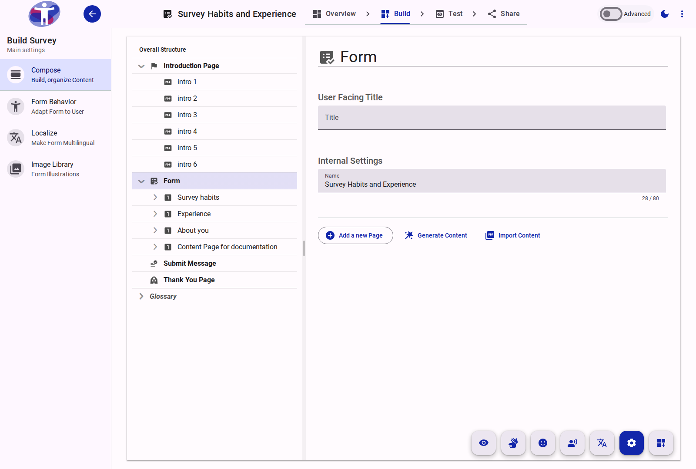

# Form Reference

The Form is the root container element for the entire survey. It encapsulates all Pages, Sections, and Questions, and defines the global identity of the questionnaire.

<figure>
  
  <figcaption>The standard view of the Form element at the top of the Compose tree.</figcaption>
</figure>

## Form Identity

These fields identify the form itself; they are not the survey's name or title:

- **Title** (User Facing Title): The heading of the form, translated for each language.
- **Name** (Internal Settings): The form's internal name used in the editor. It is not visible to respondents.
- **Form Description** (Internal Settings, Advanced): Internal documentation for the form.

::: info
To rename the survey, use its **Introduction Page** — see [Rename a survey](../../../how-to/editing-a-survey.md#rename-a-survey).
:::
