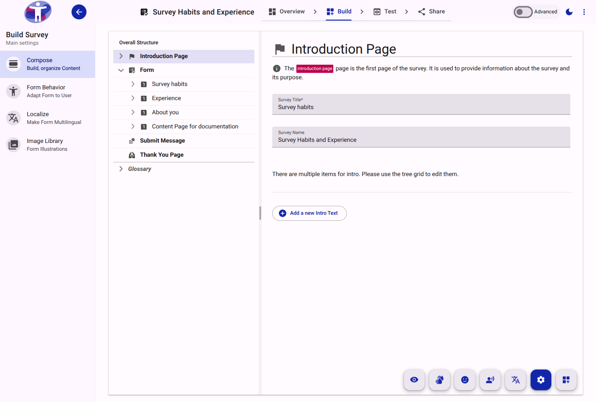
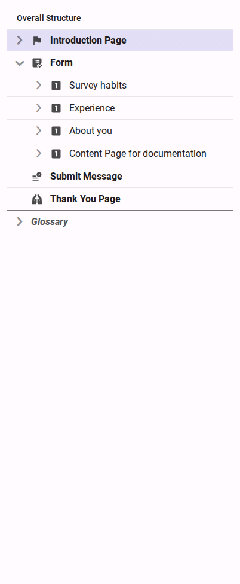
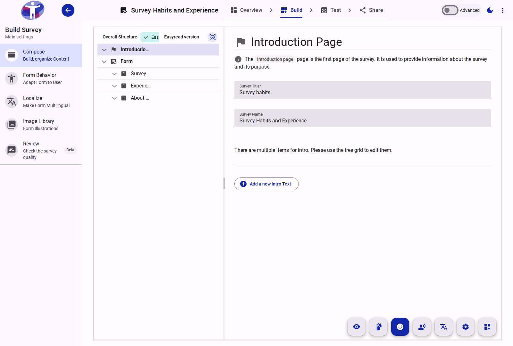

# Compose Reference

The Compose tool is the structural editor for a survey form. It enables the creation and arrangement of hierarchical elements, including pages, sections, and individual questions.

## Interface Elements

The Compose view consists of a navigation tree for structure management and an editing pane for configuring the selected element.

<figure>
  
  <figcaption>The main view of the Compose tool.</figcaption>
</figure>

<figure>
  
  <figcaption>The structural tree grid used to navigate and arrange form elements.</figcaption>
</figure>

<figure>
  
  <figcaption>The toolbar for switching between different editing modes or views, including direct access to the Review workspace when open findings exist.</figcaption>
</figure>

## Tree Grid Filtering

The structural tree grid includes column-header filter controls to help authors inspect, validate, and audit specific subsets of items across large questionnaires.

<figure>
  
  <figcaption>Filtered tree grid in Easy Read mode showing items with Easy Read images and the active filter chip.</figcaption>
</figure>

### Available Filters

Filter controls appear as interactive icon buttons in column headers depending on the active editing mode:

| Filter | Header Icon | Mode Availability | Behavior |
| :--- | :--- | :--- | :--- |
| **Generated content** | `auto_awesome` | Settings (when prompt active) | Shows only items generated by AI that are pending validation. Also accessible via the prompt action FAB. |
| **Needs review** | `rate_review` | Settings | Filters to items with open review findings (structure, logic, translation, accessibility, or content). Disabled when no findings exist. |
| **Visibility settings** | `visibility` | Settings (Advanced) & Visibility | Filters to items with conditional logic (`logic.hidden` or `visibilityModes`). Disabled when no items have visibility rules. |
| **Easy Read images** | `ar_on_you` / `image_not_supported` | Easy Read | Tri-state cycle: **items with images** → **items without images** (candidates missing an illustration) → **filter off**. |
| **Read Aloud voices** | `record_voice_over` / `volume_off` | Read Aloud | Tri-state cycle: **items with recorded/generated voice** → **items without voice** → **filter off**. |
| **Sign Language videos** | `sign_language` / `videocam_off` | Sign Language | Tri-state cycle per language column: **items with validated video** in that language → **items without video** → **filter off**. |

### Filter State & Tree Behavior

* **Filter chip indicator:** When a filter is active, an `<md-filter-chip>` appears in the grid header alongside **Overall Structure** (e.g., `Needs review only (3)` or `Easyread images only (6)`). Clicking the chip's remove icon or clicking the active header button clears the filter.
* **Preserving context:** Matching items keep their ancestor nodes in the hierarchy, and ancestor branches expand automatically so matched questions and options stay visible in their surrounding sections.
* **Drag-and-drop safety:** Drag-and-drop reordering is temporarily disabled while a filter is active to prevent unintended structural shifts.
* **Mutually exclusive:** Activating any column filter replaces the previous filter.

## Quick Review Access from Compose

When open quality findings exist across your survey, a floating **Review** button appears directly in the bottom modes toolbar next to the prompt action FAB. Clicking **Review** navigates straight to the [Review Reference](../review.md) workspace, allowing rapid context switching between composing structure and addressing findings.

## Supported Element Types

The following elements can be added and configured within the Compose tool:

* **[Form](./form.md)**: The root container for the survey.
* **[Text Page](./text-page.md)**: Non-interactive pages for information, such as introductions or thank-you messages.
* **[Page](./page.md)**: A structural container representing a single screen or logical division of the survey.
* **[Section](./section.md)**: A subgrouping element within a page to organize related questions.
* **[Question](./question.md)**: Interactive data collection fields (e.g., text, multiple choice, rating).
