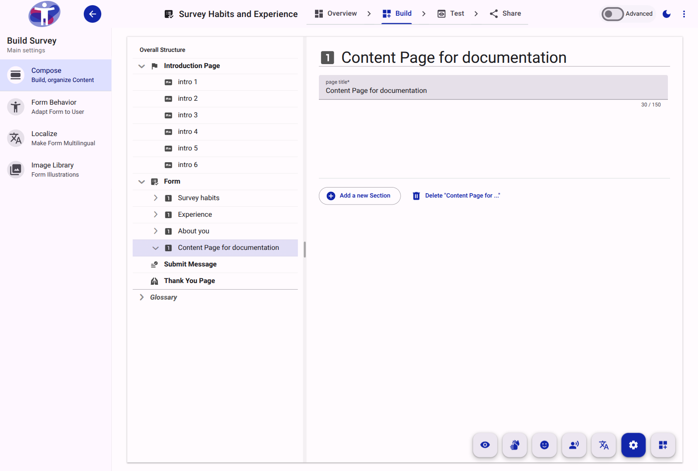

# Page Reference

A **Page** is a primary structural container within the survey Form. In multi-page surveys (`multipleQuestionsPerPage`), each Page represents an individual screen presented to the respondent. Pages group related **Sections**, provide structured screen headings, and support page-level randomization and visibility rules.

<figure>
  
  <figcaption>The Page configuration drawer in Build → Compose showing title, subtitle, and layout options.</figcaption>
</figure>

## Structural Hierarchy

Pages sit directly inside the Form container:

$$\text{Form} \longrightarrow \mathbf{Page} \longrightarrow \text{Section} \longrightarrow \text{Question / Text}$$

A Page cannot be nested inside another Page or Section. All data collection fields (Questions) belong to Sections inside a Page.

## Page Properties

Selecting a Page in the structure tree displays its configuration options:

### Administrative Settings

- **Name (`name`):** Internal identifier used in the editor tree and builder navigation. Not shown to respondents.

### Localized Page Headings

Page headings are translated per language in **Localize Mode**:

| Field | Requirement | Character Limit | Role in Respondent UI |
| :--- | :--- | :--- | :--- |
| **Page Title (`heading`)** | Required | 150 characters | The primary heading rendered at the top of the screen when the page loads. |
| **Page Subtitle (`subHeading`)** | Optional | 300 characters | Explanatory context or instructions displayed immediately below the page title. |
| **Short Title (`shortHeading`)** | Required | 30 characters | Compact label used in tab bars, breadcrumbs, and pagination indicators where space is restricted. |

## Randomization and Fixed Positioning

Pages support bi-directional randomization controls:

- **Randomize Sections (`props.randomize`):** When toggled on, shuffles all sections and questions contained within this page for each respondent session.
- **Fixed Position (`props.fixed`):** If the parent Form has page randomization enabled (`props.randomize`), enabling **Fixed Position** ensures this specific page remains in its original sequence (for example, keeping demographic questions strictly on the first or last page).

## Visibility Logic and Conditional Branching

Form logic can be attached directly to a Page via the context action **Add Visibility Logic**:

- **Cascading Skipping:** When a Page's visibility expression evaluates to false, the entire page and all its nested sections and questions are skipped completely.
- **Validation Exemption:** Skipped pages do not enforce `required` field validation, allowing respondents to proceed seamlessly through subsequent pages.
- **Data Cleanup:** Answers submitted on a page that is subsequently hidden by branching logic are handled according to the survey's [Logic and Branching](../../../how-to/logic-expression.md) rules.

## Available Actions

From the Page context menu (right-click in tree) or bottom drawer actions:

- **Add a new Section:** Inserts a new Section container into this Page.
- **Move Up / Move Down:** Reorders the page within the Form.
- **Add Visibility Logic:** Attaches a conditional rule controlling whether this page appears.
- **Expand all / Collapse all:** Recursively toggles all sections and questions in this page.
- **Translate:** Edits the page's `heading`, `subHeading`, and `shortHeading` across all target survey languages.
- **Delete Page:** Soft-deletes the page and all child sections. Deleted pages can be recovered from the [Restore Tool](../restore.md).
