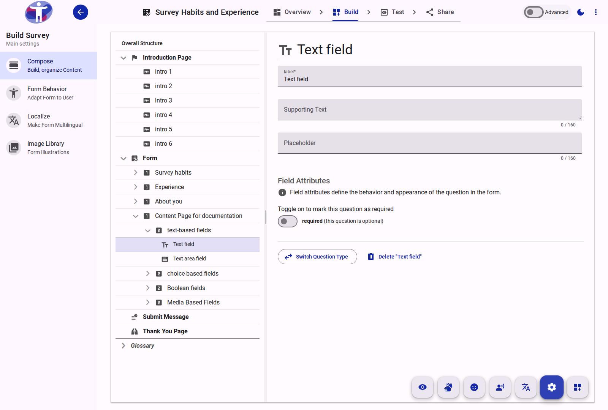
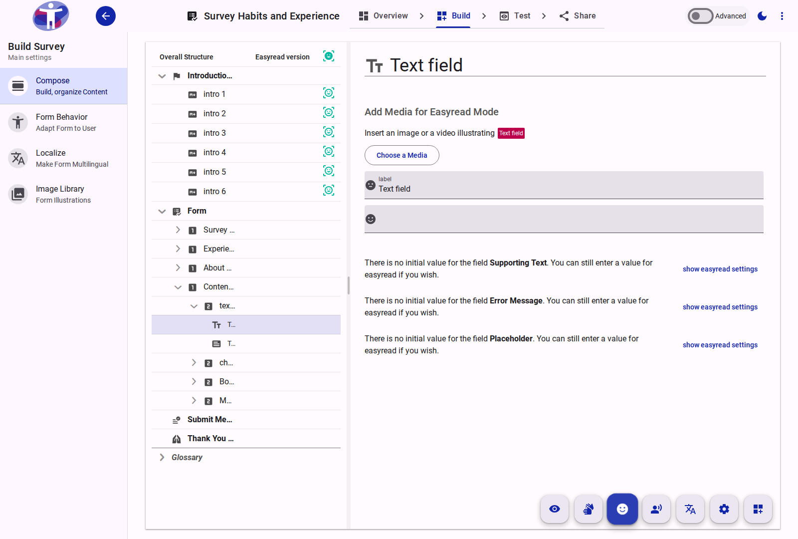
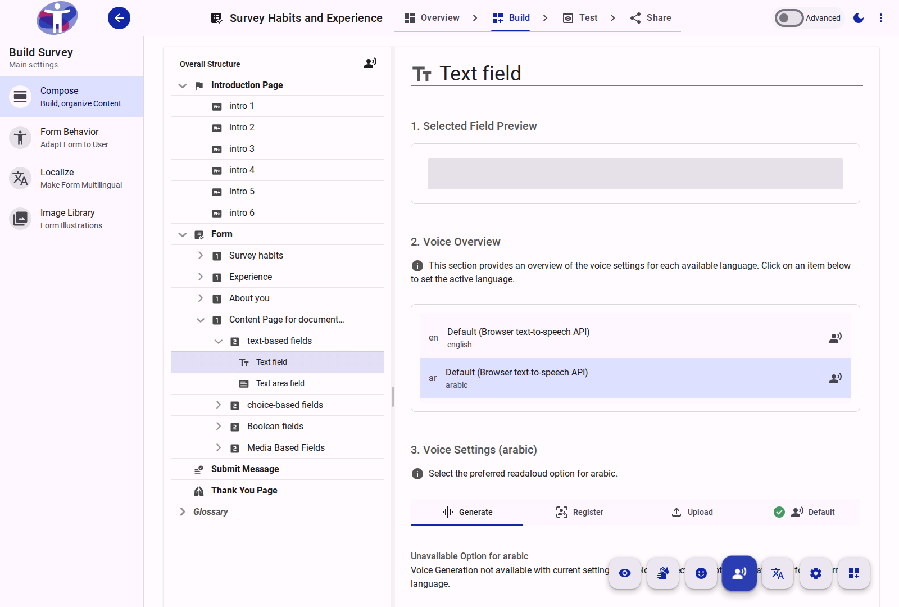
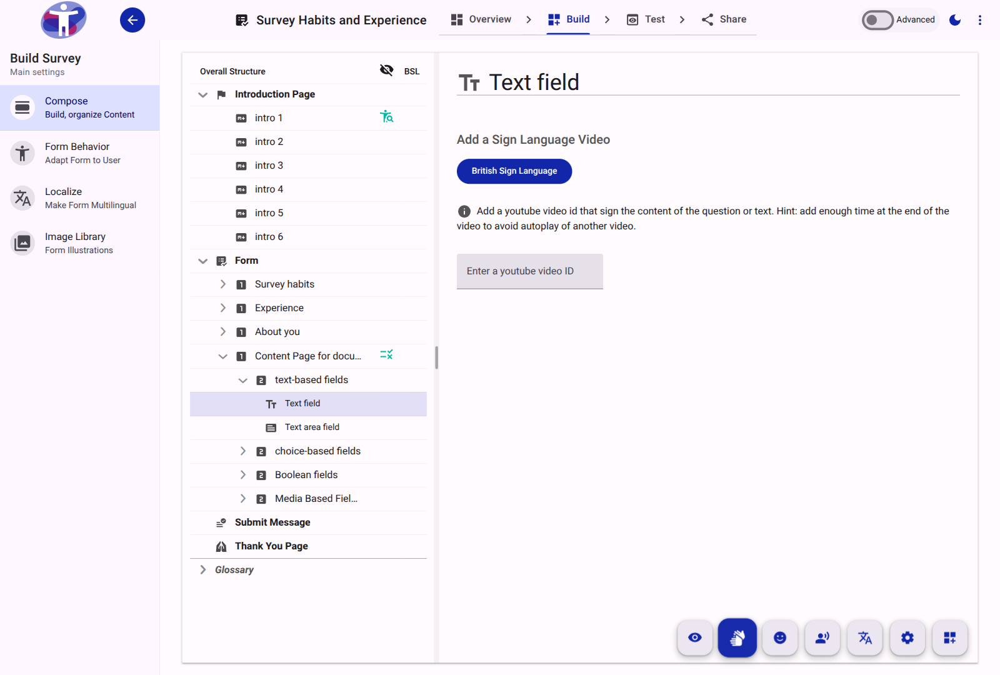
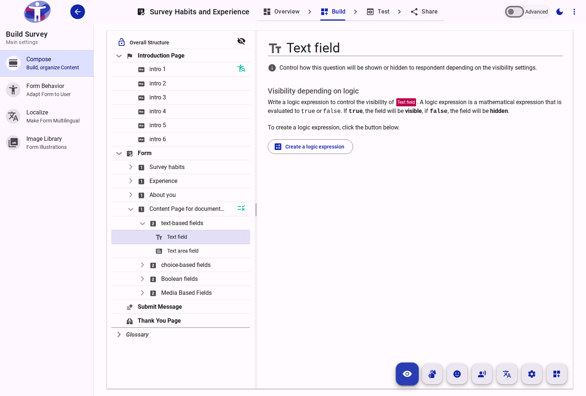

# Question Reference

Questions are the interactive data collection components of a survey. The builder provides **19 question types** organized into four functional data families, supporting comprehensive validation rules, option customization, glossary tooltips, and specialized accessibility modes.

<figure>
  
  <figcaption>The primary interface for configuring a survey question in Build → Compose.</figcaption>
</figure>

## The 19 Question Types

The survey engine supports 19 specialized question types aligned with the question-type chooser in the builder:

| Data Family | Type Code (`subType`) | Label in Chooser | HTML Element | Data Group | Description |
| :--- | :--- | :--- | :--- | :--- | :--- |
| **Text Based** | `textfield` | Text Field | `a11y-text-field` | `open` | Single-line free text input. |
| **Text Based** | `textarea` | Text Area | `a11y-text-field` (`type="textarea"`) | `open` | Multi-line text area with automatic vertical height expansion. |
| **Text Based** | `number` | Number | `a11y-text-field` (`type="number"`) | `open` | Validated numeric input with optional range and step limits. |
| **Text Based** | `tel` | Telephone | `a11y-text-field-tel` | `open` | Telephone input triggering numeric keypad on mobile devices. |
| **Text Based** | `date` | Date | `a11y-text-field-date` | `open` | Standardized ISO calendar date selector. |
| **Text Based** | `email` | Email | `a11y-text-field` (`type="email"`) | `open` | Format-validated email input for standard form answers. |
| **Text Based** | `url` | URL | `a11y-text-field` (`type="url"`) | `open` | Validated HTTP or HTTPS web address input. |
| **Text Based** | `accountEmail` | Account Email | `a11y-account-email` | `open` | Specialized respondent account email with verification and opt-in consent checkboxes. |
| **Choice Based** | `radio` | Radio Group | `a11y-radio-group` | `choice` | Mutually exclusive single-choice selection with `specify` support. |
| **Choice Based** | `checkbox` | Checkbox Group | `a11y-checkbox-group` | `multi` | Multi-select choice group allowing multiple answers with `specify` support. |
| **Choice Based** | `dropdown` | Dropdown | `a11y-select` | `choice` | Compact dropdown menu for single-choice selection from long lists. |
| **Choice Based** | `rating` | Rating | `a11y-rating` | `rating` | Ordinal rating scale (stars or numbered points) for satisfaction or agreement. |
| **Choice Based** | `ranking` | Ranking | `a11y-ranking` | `choice` | Reorderable list allowing respondents to prioritize items by preference. |
| **Boolean** | `check` | Checkbox | `a11y-checkbox` | `boolean` | Single standalone binary checkbox (true/false) for explicit declarations. |
| **Boolean** | `switch` | Switch | `a11y-switch` | `boolean` | Binary toggle switch for binary preferences. |
| **Media Based** | `file` | File Upload | `a11y-upload` | `media` | Generic file upload field with size and count controls. |
| **Media Based** | `image` | Image Upload | `a11y-upload` (`accept="image/*"`) | `media` | Image file attachment with camera integration on mobile devices. |
| **Media Based** | `video` | Video Upload | `a11y-upload` (`accept="video/*"`) | `media` | Video recording and file attachment. |
| **Media Based** | `audio` | Audio Upload | `a11y-upload` (`accept="audio/*"`) | `media` | Audio sound recording and audio file attachment. |

*(Note: Informational rich text without data collection is provided by the standalone `text` element; see [Text Page Reference](./text-page.md).)*

## Option Fields (Choice Based Questions)

Choice-based questions (`radio`, `checkbox`, `dropdown`, and `ranking`) manage an ordered list of **Options**:

### Option Properties

- **Option Label (`label`):** The visible text presented to the respondent. Translated per survey language in **Localize Mode**.
- **Option Code (`build.code`):** Unique identifier used to key answers in database records, logic expressions, and CSV/JSON exports. Restricted to alphanumeric characters, hyphens, and underscores (`^[a-zA-Z0-9_\-]+$`).

### Option Customization

- **Specify Field (`props.specify`):** Checking **Specify** on a choice option adds an inline free-text input when that option is selected. This allows capturing qualitative elaborations (e.g. "Other: please specify"). The specify input carries its own translated label (`specifyLabel`).
- **Fixed Position (`props.fixed`):** When option randomization is enabled on the question, toggling **Fixed Position** ensures this specific option remains anchored at its original index. This is essential for terminal options such as *"None of the above"*, *"All of the above"*, or *"Prefer not to answer"*.

## Glossary Items and Tooltips

Glossary terms provide on-demand definitions for technical, legal, or domain-specific terminology without cluttering question text:

- **Defining Terms:** Add terms under the survey's **Glossary** container in Build → Compose. Each glossary item has a unique term identifier (`name`) and a translated definition (`definition`).
- **Referencing Terms in Content:** To embed a glossary definition in any question label, helper text, or markdown block, use the `<lapp-tooltip>` custom element:

  ```html
  Please state your <lapp-tooltip term="grossIncome">gross annual income</lapp-tooltip>.
  ```

- **Respondent Interaction:** The text renders with an accessible dashed underline. Hovering, tapping, or focusing the element opens an accessible popover containing the translated definition.

## Validation Rules and Constraints

Validation is configured under the **Settings** tab in the question drawer:

### General Settings

- **Required:** When enabled, respondents cannot navigate past the question or submit the survey without providing a valid answer.
- **Label:** The primary prompt asking for information.
  - **Standard Mode:** When form-level **Accessible Label** is off, labels are silently constrained to **80 characters** to ensure layout stability.
  - **Accessible Label Mode:** Enabling [Accessible Label](./form.md#global-question-settings) removes the 80-character limit entirely and increases font readability.
- **Question Code (`build.code`):** Unique camelCase key representing this question in database records and exported datasets. Derived automatically from the label, but can be manually overridden in Advanced Mode.

### Numeric & Character Constraints

- **Min Length / Max Length:** Applies to text inputs (`textfield`, `textarea`). Constrains minimum and maximum character counts.
- **Min / Max:** Sets acceptable numeric bounds for `number` fields.
- **Step:** Controls numeric granularity (e.g. `1` for whole numbers, `0.1` for single-digit decimals).

### Pattern Validation (Strict Unicode Regex)

The **Pattern** field applies an HTML5 regular expression pattern to short text, textarea, and telephone inputs:

- **Implicit Anchoring:** The browser automatically anchors patterns with `^(?:` and `)$`, requiring the entire input string to match.
- **ES2024 Unicode Sets (`v` Flag):** Pattern validation compiles regex using the strict browser `v` flag. In `v` mode, unescaped parentheses inside character classes trigger syntax errors. To match literal parentheses inside brackets, they must be escaped: `[0-9\-\(\)]`.

## Email Purposes

For email inputs — **Email** (`textfield` with `type="email"`) and [Account Email](./account-email.md) (`a11y-account-email`):

- Use **Email** for a plain questionnaire answer with format validation.
- Use **Account Email** when managing respondent identity verification or offering consent opt-ins for reminders, survey reports, or follow-up studies.
- Collected addresses are kept out of data exports unless the survey selects the **Dataset** email purpose.

See [Account Email Reference](./account-email.md#email-purposes-and-export-behavior) and the authoritative [Email Purposes Table](../../share/email/index.md#email-purposes) on the Share Email page.

## Specialized Accessibility Configurations

Questions can be enhanced with rich multimodal accessibility features:

<figure>
  
  <figcaption>Settings for adding Easy Read imagery and simplified text to a question.</figcaption>
</figure>

<figure>
  
  <figcaption>Settings for configuring the Read Aloud behavior for a question.</figcaption>
</figure>

<figure>
  
  <figcaption>Settings for linking Sign Language videos to a question.</figcaption>
</figure>

<figure>
  
  <figcaption>Settings for defining logical expressions that control when the question is visible to the respondent.</figcaption>
</figure>

- **Easy Read:** Provide simplified question phrasing and visual illustrations (see [Using Easy Read](../../../how-to/use-easy-read.md)).
- **Read Aloud:** Configure text-to-speech audio pronunciation and voice overrides.
- **Sign Language:** Attach YouTube video IDs translating the question into sign languages (see [Use Sign Language](../../../how-to/use-sign-language.md)).
- **Visibility Logic:** Define conditional display rules showing or hiding this question dynamically (see [Controlling Visibility](../../../how-to/controlling-visibility.md)).
