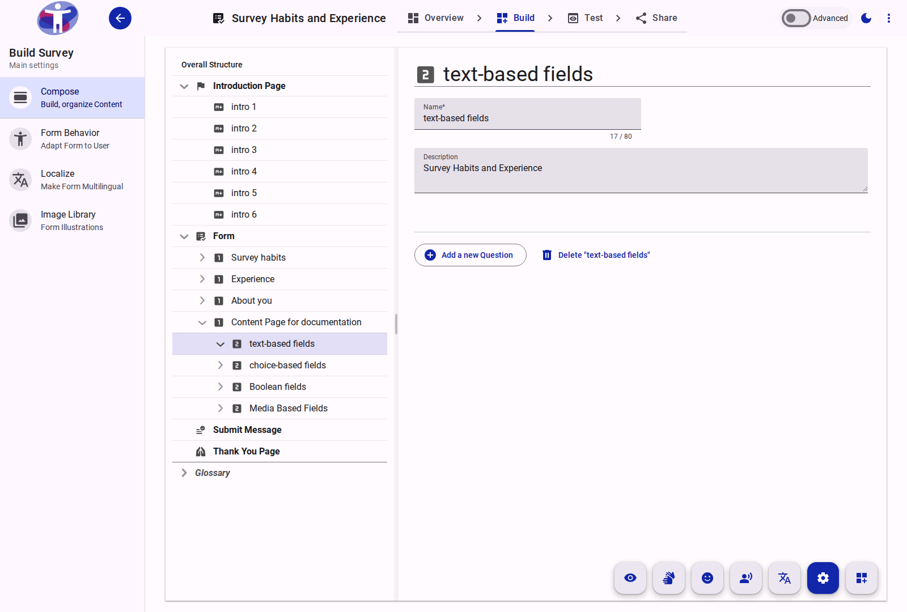

# Section Reference

A **Section** is an essential structural container inside a Page. Sections group thematically related questions and text blocks, define visual subheadings, apply cascading visibility logic, and enable reusable **Section Sharing** across surveys and teams.

<figure>
  
  <figcaption>The Section configuration drawer in Build → Compose showing identity, sharing, and layout controls.</figcaption>
</figure>

## Hierarchy and Containment

Sections reside inside Pages and contain questions or standalone text blocks:

$$\text{Page} \longrightarrow \mathbf{Section} \longrightarrow \text{Question / Text} \longrightarrow \text{Option}$$

Grouping questions into sections allows managing complex forms in modular chunks rather than sprawling flat question lists.

## Identity Properties

- **Name (`name`):** Internal administrative title used in the tree view and library searches.
- **Section Description (`shortDesc`):** Internal notes or subtitle context explaining the section's purpose.
- **Visible Title & Context:** Displayed to respondents as a section header above the contained questions.

## Section Sharing Properties

Sections can be published to the Section Library and embedded across multiple surveys. In **Advanced Mode**, the **Sharing** section configures how a shared section behaves:

### Scope (`scope`)

The sharing scope controls who can discover and embed the section from the Section Library:

| Scope | Visibility | Usage |
| :--- | :--- | :--- |
| **Team (`team`)** | Current team members only | Reusing common question blocks within your own workspace. |
| **Customer (`customer`)** | All teams in your organization | Standardizing corporate demographic profiles, customer feedback modules, or company-wide consent forms. |
| **Global (`global`)** | All platform users | Curated, validated question standards published by system administrators. |

### Live Reference vs. Embedded Copy

When embedding a shared section from the Section Library, editors choose between two linking models:

- **Live Reference (`liveRef: true`):** The section remains dynamically linked to the source definition. It is read-only in the consuming survey: any updates, improvements, or translations made by the authoring team flow automatically into all surveys referencing it.
- **Copy (`copySection`):** Creates an independent, disconnected copy of the section in your survey. Your team owns and edits the questions without altering the library source or receiving upstream updates.

### Response Keying (`props.storeType`)

Response keying determines where and how respondent answers to this section are stored:

| Keying Option | Value | Behavior |
| :--- | :--- | :--- |
| **Per survey attempt (default)** | `survey` | Answers are stored per survey attempt. Standard isolated survey data. Choose this to opt a shared section out of cross-survey prefilling (e.g. consent agreements). |
| **Per respondent** | `user` | Answers are stored once against the respondent's identity. Any other survey in the customer organization embedding this section automatically pre-fills with their previous answers. |
| **Per organization** | `organization` | Answers are keyed to the respondent's organization or business unit. |

### Prefill Modes (`props.prefill`)

When a respondent encounters a shared section that already holds their stored answers from a previous survey, the prefill mode dictates their user experience:

| Prefill Mode | UI Presentation | Respondent Interaction |
| :--- | :--- | :--- |
| **Quiet (default)** | Inline pre-filled | The section renders pre-filled with a slim informative banner. The respondent can review or edit their answers directly. |
| **Review** | Collapsed summary card | The section appears collapsed as an overview card. The respondent expands the card only if they wish to verify or update answers. |
| **Interstitial** | Keep-or-Update prompt | A dedicated transitional step asks whether to keep previous answers or modify them. "Keep" shows a summary; "Update" expands the fields. |

### Frozen Sections (`frozen`)

The **Frozen** switch protects stable or validated sections from inadvertent modification:

- **Frozen (On):** Locks the section completely. Nobody can edit properties, modify questions, or change translations — including the originating source team.
- **Frozen (Off):** Normal editing allowed by authorized team members.

## Randomization and Fixed Positioning

In **Advanced Mode**, sections support fine-grained randomization controls:

- **Randomize Items (`props.randomize`):** Shuffles the order of child questions and text items within this section for each respondent session.
- **Fixed Position (`props.fixed`):** If the parent Page has randomization turned on, toggling **Fixed Position** on the section guarantees it stays anchored in its authored position (for example, keeping introductory demographic sections first).

## Cascading Visibility Logic

Applying a logical condition to a Section applies to all child items:

- If the condition is false, the entire section and all contained questions are hidden simultaneously.
- Hidden child questions are automatically exempt from mandatory (`required`) answer validation.

## Section Actions

From the Section row context menu or footer:

- **Add a new Question:** Opens the question-type chooser to add a field.
- **Add a new Text:** Inserts an informational markdown block into the section.
- **Copy Section:** Duplicates the section and all contained questions into the active page.
- **Delete Section:** Soft-deletes the section (recoverable via the [Restore Tool](../restore.md)).
- **Translate:** Translates section headers and child questions in Localize Mode.
